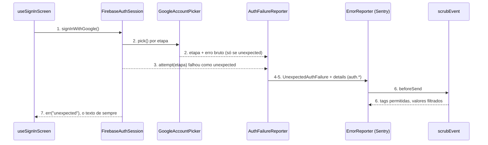

# E5.2b · Falhas inesperadas de login no Sentry

**Approved**: 2026-11-27 - user: "aprovo" (perguntas 255 a 257 com as recomendações apresentadas: incluir `auth.detail`, reportar `provider-unavailable` do SDK, entrega por EAS Update no canal `production` publicado pelo Gabriel)
**Settled mid-build:** none
**Review:** <escrito quando a revisão for enviada - sent at <hash>>
**Fix pass:** <escrito quando a correção for feita>

> **Depende do Gabriel (perguntas 255 a 257, abaixo em `Assumptions` e `Open questions`):** 255, se o detalhe entre colchetes da mensagem do Firebase (`[ CONFIGURATION_NOT_FOUND ]`, `[ 10: ]`) entra por uma lista fechada de caracteres; 256, se `provider-unavailable` vindo do SDK também é reportado; 257, a publicação no celular (EAS Update no canal `production`, só ele publica). Sem resposta, vale a recomendação de cada uma (autonomia do `CLAUDE.md`), menos a publicação da 257, que é dele.

## Problem

O app do teste interno da Play não entra com Google: a tela mostra "Não deu para entrar agora. Tente de novo." (`apps/mobile/src/strings/auth.pt-BR.ts:35`, a falha `unexpected`). Nenhum sinal desse erro chega a lugar algum: `auth-failure-codes.ts` reduz todo código desconhecido a `"unexpected"`, o adaptador descarta o erro original, e o `ErrorReporter` (E5.2, ADR 0080) só é chamado pelo botão de teste da tela de dev (`ErrorTestSection.tsx`). Quem paga é o Gabriel, único testador da lista interna (pergunta 247): sem o código, a etapa e a pilha, o diagnóstico vira tentativa e erro com builds novos, e o teste fechado (12 pessoas por 14 dias) não pode começar com o login quebrado. Evidência: o relato do Gabriel em 27/11/2026; nenhum log ou evento.

O login no app não passa pela API: `signInWithGoogle` vai do seletor do Google (`google-sign-in.ts`) ao `signInWithCredential` do Firebase (`firebase-auth-session.ts`) e devolve um `AuthResult`; a tela só sai do login quando o `onAuthStateChanged` muda o snapshot (`_layout.tsx`, `SessionStack`). Uma falha da API depois do login (403 de `GuardedRoutes.cs`, rede) aparece com o texto de `api-error-text.ts`, nunca com "Não deu para entrar agora", e é um `ApiError` esperado que o ADR 0080 deixa fora do Sentry (o 5xx já chega pelo projeto `sacou-api`). Por isso a etapa "chamada à API" do pedido não tem onde acontecer neste fluxo (ver `Out of scope`).

Quando isto sair, cada falha `unexpected` de login gera um evento no projeto `sacou-mobile` com a etapa, o código, o tipo do erro e a pilha, sem a mensagem do SDK, e o Gabriel descobre a causa olhando o Sentry em vez de gerar builds às cegas.

## Shape

Reusa a porta `ErrorReporter` já injetada (`services/error-reporting/error-reporter.ts`), o filtro `scrub-event.ts` do `beforeSend` e a leitura de código de `auth-failure-codes.ts`; não cria SDK novo nem tela. As regras (qual falha é reportada, o que entra e o que é descartado do erro) ficam em funções puras em `src/adapters/`, que o Vitest do app já cobre (`firebase-auth-session.test.ts`, `auth-failure-codes` e `scrub-event.test.ts`).

1. toque em "Entrar com Google" -> `useSignInScreen` (exists) chama `authSession.signInWithGoogle()`, sem mudança
2. `createFirebaseAuthSession` (exists) -> `GoogleAccountPicker.pick()` (exists): cada chamada do SDK do Google numa etapa própria (`google-play-services`, `google-picker`, `google-response`); um erro que vira `unexpected` (ou `provider-unavailable`, pergunta 256) é passado ao `AuthFailureReporter` com a etapa e o erro bruto
3. `createFirebaseAuthSession` (exists) - `attempt(stage, action)`: o mesmo para `firebase-google-credential`, `firebase-email-sign-in`, `firebase-email-sign-up`, `firebase-password-reset`, `firebase-reauth-google`, `firebase-reauth-password`
4. `AuthFailureReporter` (new, `src/adapters/auth-failure-report.ts`) - decide se reporta (só `unexpected`, e `provider-unavailable` vindo do SDK) e monta o relatório: etapa, código validado, tipo validado, pilha só com as linhas de quadro, sinais do Google; cria um `Error` novo (`UnexpectedAuthFailure`) com `name` = tipo, `message` = `"<etapa>: <código>"` e `stack` = quadros; nada do erro original é copiado além disso
5. `ErrorReporter.captureError(error, { area: "auth", details })` (exists, contexto ampliado, door 1) -> `startErrorReporter` (exists) põe `details` nas tags do evento
6. `sentryOptions.beforeSend` -> `scrubEvent` (exists): passam só as tags da lista permitida, que ganha as `auth.*` (door 1), com o valor filtrado por `redactText`
7. out: evento no projeto `sacou-mobile`; a tela segue mostrando o mesmo texto de hoje (`AuthFailure` e `AuthResult` sem mudança)

**Changes underneath**

| Front | What changes |
| --- | --- |
| domain | nada: `AuthFailure` continua a união fechada de 8 valores; a etapa não entra na porta `AuthSession` (só os adaptadores a conhecem) |
| port `ErrorContext` | ganha `details` opcional (chaves fechadas, valores texto); o único consumidor hoje é `ErrorTestSection.tsx` (só `area`) e o `fake-error-reporter.ts`, que guarda o contexto inteiro |
| `scrubEvent` | a lista de tags permitidas ganha as `auth.*`; o valor de toda tag permitida passa por `redactText` (hoje passa cru; `area`, `event.origin` e `event.environment` são fixos e não mudam) |
| `createFirebaseAuthSession` / `createGoogleAccountPicker` | recebem o `AuthFailureReporter` por dependência (`_layout.tsx`, onde o `errorReporter` já nasce antes do `authSession`); os testes que montam a sessão passam um falso |
| stored data | nada |
| readers | o painel do Sentry (`sacou-mobile`): busca por `auth.stage`, `auth.code` |

Data: none - nada é gravado no aparelho nem na API.

## Surface

None - nada consumido fora do app além do evento do Sentry, cujas tags estão no door 1.

## Landing

| One-way door | Literal shape | Alternative rejected |
| --- | --- | --- |
| 1. Nomes e valores das tags do login no Sentry (buscas e alertas do painel dependem deles) | `area=auth`; `auth.stage` ∈ {`google-play-services`, `google-picker`, `google-response`, `firebase-google-credential`, `firebase-email-sign-in`, `firebase-email-sign-up`, `firebase-password-reset`, `firebase-reauth-google`, `firebase-reauth-password`}; `auth.failure` ∈ {`unexpected`, `provider-unavailable`}; `auth.code` (código validado, `none` ou `unrecognized`); `auth.error_type` (nome validado, `none`, `non-error` ou `unrecognized`); só em `google-response`: `auth.google.response_type` ∈ {`success`, `cancelled`, `other`} e `auth.google.has_id_token` ∈ {`true`, `false`}; com a pergunta 255: `auth.detail` | contexto próprio (`contexts.auth`): o `scrubEvent` derruba todo contexto fora da lista e teria de ganhar um ramo novo; `extra`: é apagado inteiro pelo filtro (D10) e é texto livre por natureza |
| 2. Padrão "erro reportado sem a mensagem": um `Error` novo, nunca o original, com `name` = tipo validado, `message` montada só de valores validados e `stack` = só as linhas `at ...` do original, cada uma por `redactText` | `new UnexpectedAuthFailure(report)`, sem `cause` e sem outra propriedade própria | (a) mandar o original e limpar `exception.values[].value` no `beforeSend`: o SDK ainda copia `cause` (LinkedErrors) e o primeiro trecho da `stack` do Hermes repete a mensagem; e o `beforeSend` não sabe quais eventos são de login; (b) mandar só a mensagem filtrada por `redactText`: o Gabriel deixou para depois ("fica de fora por enquanto") e o filtro por padrões não pega um apelido solto |

- Nada mais nesta mudança é difícil de reverter.

## Criteria

### S1: falha inesperada de login vira evento sem dado pessoal (P1)

Uma fatia só, de ponta a ponta: as etapas nos dois adaptadores, o relatório puro, o contexto da porta, o filtro e a documentação. Estimativa: cerca de 300 linhas com os testes, 9 arquivos de código e 2 de documentação.

**Acceptance Criteria**

Quando reporta

1. WHEN uma etapa de login termina em `unexpected` THEN o sistema SHALL chamar `errorReporter.captureError` uma vez, com `area` = `auth` e `auth.failure` = `unexpected`
   - `GoogleSignin.signIn` rejeita com `code: "10"` → 1 evento, `auth.stage=google-picker`, `auth.code=10`; Firebase rejeita `signInWithGoogleIdToken` com `auth/internal-error` → 1 evento, `auth.stage=firebase-google-credential`, `auth.code=auth/internal-error`
2. IF a falha mapeada é `cancelled`, `offline`, `invalid-credentials`, `email-unavailable`, `weak-password` ou `too-many-requests` THEN o sistema SHALL NOT chamar `captureError`
   - `SIGN_IN_CANCELLED` e `IN_PROGRESS` → 0 eventos; `response.type === "cancelled"` → 0; `auth/wrong-password` → 0; `auth/network-request-failed` → 0
3. WHEN o SDK rejeita com um código que vira `provider-unavailable` (`PLAY_SERVICES_NOT_AVAILABLE`, `auth/operation-not-allowed`) THEN o sistema SHALL reportar com `auth.failure=provider-unavailable` (pergunta 256)
   - `auth/operation-not-allowed` no e-mail → 1 evento; o `provider-unavailable` sem erro do SDK (build sem client ID do Google, `signInWithApple`) → 0 eventos
4. WHEN `GoogleSignin.hasPlayServices` rejeita com um código desconhecido THEN o sistema SHALL reportar com `auth.stage=google-play-services`
5. WHEN `signIn` devolve `type: "success"` com `idToken === null` THEN o sistema SHALL reportar com `auth.stage=google-response`, `auth.code=none`, `auth.error_type=none`, `auth.google.response_type=success`, `auth.google.has_id_token=false`, e a tela SHALL mostrar o texto de `unexpected` como hoje
6. IF a leitura da resposta do Google lança (sem `data`, `type` desconhecido) THEN o sistema SHALL reportar com `auth.stage=google-response`, `auth.google.response_type=other` e o tipo do erro lançado
7. WHEN `signInWithEmail`, `createAccountWithEmail`, `sendPasswordReset` ou `reauthenticate` termina em `unexpected` THEN o sistema SHALL reportar com a etapa `firebase-email-sign-in`, `firebase-email-sign-up`, `firebase-password-reset`, `firebase-reauth-password` ou `firebase-reauth-google`, nessa ordem
8. The sistema SHALL devolver à tela o mesmo `AuthResult` de hoje em todos os casos acima: reportar nunca muda o resultado, e um `captureError` que lança não derruba o login (o erro do relatório é engolido)

O que vai

9. The relatório SHALL levar o código só quando ele casa com `^(auth/[a-z0-9-]{1,60}|-?[0-9]{1,6}|[A-Z][A-Z0-9_]{0,39})$`, depois de `String(code)`; sem código, `none`; fora do padrão, `unrecognized`
   - `10` (número) → `10`; `"12500"` → `12500`; `"DEVELOPER_ERROR"` → `DEVELOPER_ERROR`; `"auth/internal-error"` → `auth/internal-error`; `"ana@x.com"` → `unrecognized`; `"auth/"` + 61 letras → `unrecognized`; sem `code` → `none`
10. The relatório SHALL levar como tipo o `name` do erro quando ele casa com `^[A-Za-z][A-Za-z0-9_]{0,59}$`; objeto sem `name` texto → `Error`; valor que não é objeto (texto, número, `undefined` lançado) → `non-error`; fora do padrão → `unrecognized`
    - `TypeError` → `TypeError`; `name: "ana@x.com"` → `unrecognized`; `throw "ana@x.com"` → `non-error`
11. The relatório SHALL levar da `stack` original só as linhas que casam com `^\s*at\s`, cada uma passada por `redactText`, e nenhuma outra linha; sem `stack` texto ou sem linha de quadro, o `Error` novo fica com a pilha do ponto de captura (o SDK a põe com `attachStacktrace`)
    - `"Error: falhou ana@x.com\nsegunda ana@x.com\n    at f (index.bundle:1:2)"` → só `"    at f (index.bundle:1:2)"`; o caso forte: `"x\n    at ana@x.com"` → `"    at [filtrado]"`
12. The evento SHALL ter como exceção o `UnexpectedAuthFailure`: `type` = tipo do critério 10, `value` = `"<etapa>: <código>"` (ex.: `google-picker: 10`), e o objeto não SHALL ter `cause` nem outra propriedade própria além de `name`, `message` e `stack`
13. WHERE a pergunta 255 é aprovada the relatório SHALL levar `auth.detail` com o primeiro trecho entre colchetes da mensagem do Firebase que casa com `\[\s*([A-Z][A-Z0-9_]{1,59}|[0-9]{1,6}):?\s*\]`, e nada além dele
    - `"[auth/unknown] An internal error has occurred. [ CONFIGURATION_NOT_FOUND ]"` → `CONFIGURATION_NOT_FOUND`; `"[ 10: ]"` → `10`; `"[ ana@x.com ]"` → sem `auth.detail`; mensagem sem colchetes → sem `auth.detail`; o `[auth/unknown]` não casa (minúsculas e `/`)

O que nunca vai

14. The evento SHALL NOT conter a mensagem do SDK, o e-mail, a senha, o `idToken`, o nome (`displayName`), o UID nem qualquer propriedade do erro original além de `code`, `name` e as linhas de quadro da `stack` (`userInfo`, `nativeStackAndroid`, `cause` e a resposta do Google ficam de fora)
    - teste: um erro com `message`, `stack`, `userInfo`, `cause` e `code` contendo `ana@x.com` e um JWT (`eyJ...`), passado pelo relatório e depois por `scrubEvent` no formato do evento do Sentry: `JSON.stringify` do resultado não contém `ana@x.com`, `eyJ` nem `@`
15. IF uma tag `auth.*` chega ao `scrubEvent` com e-mail, token ou GUID no valor THEN o filtro SHALL trocar o trecho por `[filtrado]` ou `[id]`; uma tag fora da lista (`auth.email`, `auth.uid`) SHALL ser descartada
16. The evento SHALL levar o mesmo usuário anônimo de todo evento (`ANONYMOUS_USER`, ADR 0080, D14), sem `user.id` real

Arquitetura e documentação

17. The sistema SHALL manter `AuthFailure`, `AuthResult` e a porta `AuthSession` sem mudança; a etapa e o relatório SHALL existir só em `src/adapters/`, e só `src/adapters/` SHALL importar `@sentry/*` (lint de hoje)
18. The `AuthFailureReporter` SHALL entrar por dependência nos dois adaptadores (`frontend.md`, regra 3), com o falso de teste montado sobre `createFakeErrorReporter`
19. The ADR 0080 SHALL ganhar o D16 (o que o evento de login leva, os doors 1 e 2, as perguntas 255 e 256) e `docs/seguranca/dados-pessoais.md` (linha "Erros e travamentos do app") SHALL listar o evento de login: etapa, código, tipo, pilha sem mensagem e sinais do Google; nunca mensagem, e-mail, token, nome ou UID

## Out of scope

| Excluded | Why |
| --- | --- |
| Etapa "chamada à API" | O login no app não chama a API: a falha da API depois do login (403, rede) não vira `unexpected` de login, aparece com o texto de `api-error-text.ts` e é `ApiError` esperado, fora do Sentry pelo ADR 0080 (o 5xx chega pelo `sacou-api`) |
| A mensagem do SDK filtrada por `redactText` | O Gabriel deixou de fora "por enquanto"; o filtro por padrões não pega um apelido solto. A pergunta 255 cobre só um trecho de lista fechada |
| `getIdToken`, `signOut`, `forgetProviderAccount`, `deleteAccount` | Não são login nem mostram "Não deu para entrar agora"; os erros são engolidos de propósito hoje |
| Contagem por pessoa, `user.id`, correlação com a conta | ADR 0057 D2 (o UID não sai do adaptador) e ADR 0080 D14 (usuário anônimo fixo) |
| Página web (`apps/web`) | O login da web usa o SDK JS do Firebase, outro adaptador; entra se o problema aparecer lá |
| Corrigir a causa do login no teste interno | Esta tarefa só a torna visível. Pista para o orquestrador: com a Play App Signing (pergunta 246), o APK da Play é assinado pela chave do Google, cuja SHA-1 precisa estar no app Android do Firebase; sem ela, o seletor devolve `DEVELOPER_ERROR` (código 10), que este evento mostra |

## Assumptions

| Assumption | Chosen default | Rationale | Confirmed? |
| --- | --- | --- | --- |
| Detalhe entre colchetes da mensagem do Firebase (pergunta 255) | Incluir `auth.detail` só com o padrão fechado do critério 13 | `auth/unknown` e `auth/internal-error` escondem a causa no trecho `[ ... ]`, e o padrão (maiúsculas, dígitos e `_`) não comporta e-mail, nome nem token. Não é a "mensagem filtrada" que ficou de fora | n |
| `provider-unavailable` vindo do SDK (pergunta 256) | Reportar | `auth/operation-not-allowed` é provedor desligado no console do Firebase, erro de configuração nosso; `PLAY_SERVICES_NOT_AVAILABLE` é raro e diz qual aparelho falha. O estático (sem client ID, Apple) não é reportado | n |
| UID no evento | Nunca | ADR 0057 D2 e ADR 0080 D14; o diagnóstico não precisa saber quem | n |
| Uma tentativa, um evento | Sem deduplicação no app | O limite de 300 eventos por hora da chave (D13) já segura o abuso; tentativas repetidas mostram a frequência | n |
| Valor da exceção | `"<etapa>: <código>"` | Título legível no painel e agrupamento por causa, só com valores validados | n |

**Open questions:**

- 255 (`open`, padrão: incluir): ver `Assumptions`.
- 256 (`open`, padrão: reportar): ver `Assumptions`.
- 257 (`blocks go-live`): a mudança é só de JS e chega ao celular por EAS Update no canal `production` (E5.4), que só o Gabriel publica; o mapa de fontes do update precisa ser enviado ao Sentry no mesmo passo (`SENTRY_AUTH_TOKEN` local), senão a pilha chega sem simbolizar. **Recomendação:** EAS Update depois do merge, com o roteiro do orquestrador; build novo só se o `runtimeVersion` do AAB instalado não casar.

## Differences from the source

None - a tarefa não tem tela; o texto de "Não deu para entrar agora. Tente de novo." não muda.

## Sources

- Pedido do Gabriel e brief do orquestrador, 27/11/2026 - binding - `request.md`
- ADR 0080 (D9, D10, D13, D14) - binding - porta, filtro por lista permitida, usuário anônimo
- ADR 0057 (D2, D7) - binding - a mensagem do SDK e o UID não saem do adaptador; sem oráculo de conta
- `docs/padroes/frontend.md`, regra 3 - binding - o relatório entra por interface injetada
