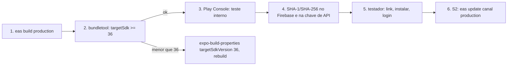

# E5.4 · Builds EAS e envio para o teste interno da Play

> **Depende do Gabriel antes do código:** perguntas 245 (para qual API aponta o primeiro AAB, já que a produção não foi publicada), 246 (quem guarda as chaves de assinatura, decisão de mão única) e 247 (lista de testadores do interno). O primeiro deploy de produção da API **não** faz parte desta tarefa: é decisão irreversível dele (`CLAUDE.md`, "Pare e pergunte", item 3).

**Approved**: 2026-11-26 - user: "Aprovo as duas fatias" (respostas 245: "Esperar a produção"; 246: "Google + EAS"; 247: "Só você")
**Settled mid-build:** (1) resposta 245 = esperar a produção: o ambiente `production` do EAS tem `EXPO_PUBLIC_API_URL` da API de **produção** (`https://sacou-api-804880427435.us-east4.run.app`, a confirmar no primeiro deploy), e o primeiro AAB só é gerado depois do primeiro deploy de produção (resposta 248); nada aponta para o teste. (2) O perfil `production` declara `environment: "production"` e `distribution: "store"`, também conferidos pelo teste de configuração. (3) O teste de configuração é `scripts/lib/eas-config.test.mjs`. (4) Lista do interno: só o Gabriel (247). (5) S2: `expo-updates` fixo em 58.0.22, porque a 58.0.23 saiu no dia e a idade mínima de versão do pnpm a recusa (sem exceção no `pnpm-workspace.yaml`); o `expo-doctor` passa a listar 16 pacotes fora da versão do SDK (eram 15). O canal `development` não existe: o perfil usa o cliente de desenvolvimento.
**Review:** <a escrever quando a revisão for enviada>
**Fix pass:** <a escrever depois da correção>

Tarefa **sensível** (chaves de assinatura, impressões digitais no Firebase, canal de atualização pelo ar que entrega código a todos os aparelhos): `revisor-seguranca` obrigatório. Desenvolvedor Opus.

## Problem

Hoje o Sacou só chega a um celular por APK solto (`preview` ou `development`, `apps/mobile/eas.json`), instalado à mão com "fontes desconhecidas". Não existe perfil que gere AAB, o app `com.sacou.app` não existe na Play Console (resposta 243), ninguém conferiu o `targetSdkVersion` que o Expo SDK 58 gera (lacuna G8, `docs/operacao/google-play.md`, "Nível de API alvo"), e o `versionCode` sobe à mão (ADR 0084, D9), o que a Play recusa se repetir. Quem paga: o piloto, que não pode começar no teste fechado (resposta 227) sem antes existir o app na Play, e cada testador, que teria de confiar num APK mandado por mensagem. O endereço da API está embutido no JS do build (`EXPO_PUBLIC_API_URL`), e a resposta 89 pediu que ele possa mudar sem build novo; hoje não há `expo-updates` no app.

Evidência: `eas.json` só tem `development` e `preview`, ambos `apk`; `app.json` tem `versionCode: 1` e nenhum `runtimeVersion` nem `updates`; `pendencias.md` (25/11, E5.2 P2) pede o perfil `production` com `EXPO_PUBLIC_SENTRY_ENVIRONMENT=production` e sem `EXPO_PUBLIC_DEV_TOOLS`.

**Quando isto sair:** o Gabriel e os testadores da lista do interno abrem um link, aceitam o convite e instalam o Sacou pela Play Store, entram com o Google e usam o app; o AAB enviado tem `targetSdkVersion` 36 ou mais, conferido; e um JS novo (por exemplo, com o endereço da API de produção) chega aos aparelhos instalados sem AAB novo.

## Shape

Reusa o projeto EAS existente (`projectId` em `app.json`), o mesmo `google-services.json` da pasta principal (fora do Git, como no `preview`), as variáveis do EAS já criadas para o `preview` e o plugin do Sentry; o envio é à mão pelo Console (resposta 244), sem EAS Submit. As regras que mudam o resultado (o que cada perfil liga e desliga) ficam em `eas.json` e `app.json`, conferidas por um teste de configuração rodado pelo `pnpm test:tooling`; o que só o build real mostra (alvo do SDK, assinatura, instalação pelo link) é conferido por roteiro, com o resultado registrado no doc.

1. `eas build -p android --profile production` na pasta principal -> `EAS Build` (exists) - lê o perfil `production` (new, em `apps/mobile/eas.json`), pega o `versionCode` do contador remoto do EAS e soma 1 (door 2), assina com a chave de upload guardada no EAS (door 1) e entrega um `.aab`.
2. `.aab` -> conferência do alvo (new: passo documentado com `bundletool dump manifest`, pelo Java do Android Studio) - lê `targetSdkVersion`; menor que 36 trava o envio.
3. `.aab` -> `Play Console` (exists, conta do Gabriel) - o Gabriel cria o app, aceita a chave de assinatura gerada pelo Google (door 1) e publica no **teste interno** para a lista de e-mails (pergunta 247).
4. `Play Console` -> impressões SHA-1 e SHA-256 da chave de assinatura do app -> `Firebase` (exists) e a restrição da chave de API do Android no Google Cloud (exists, `segredos.md` linha 11) - sem isso, o login com o Google falha no app instalado pela Play.
5. testador -> link de inscrição -> Play Store -> app instalado, login com o Google, lista de grupos carregada da API de produção (resposta 245).
6. (S2) `eas update --channel production` -> `EAS Update` (door 3) - o app instalado no canal `production`, com o mesmo `runtimeVersion`, baixa o JS novo na abertura e aplica na abertura seguinte.

**Changes underneath**

| Front | What changes |
|---|---|
| domain | nada |
| configuração de versão | `versionCode` deixa de ser lido do `app.json` e passa ao contador remoto do EAS (`appVersionSource: remote`); o `app.json` fica com o valor antigo, ignorado. ADR 0084 D9 ("sobe à mão") é emendado. Quem lê: o `expo-application` (`nativeBuildVersion`) da versão mínima, que continua recebendo o inteiro real do binário |
| assinatura | os APKs `preview` e `development` já assinados pela chave do EAS e o app da Play (assinado pela chave do Google) **não se atualizam um sobre o outro**: quem tem o APK solto desinstala antes de instalar pela Play |
| readers | Sentry `sacou-mobile` ganha o ambiente `production`; Firebase Auth passa a aceitar a nova impressão |

Data: none - nenhuma tabela nem arquivo persistido do app muda; o estado novo vive no EAS (contador de versão, chave) e na Play.

## Surface

None - nothing consumed outside. Nenhuma rota da API muda.

## Landing

| One-way door | Literal shape | Alternative rejected |
|---|---|---|
| 1. Assinatura (pergunta 246) | Play App Signing com a **chave de assinatura do app gerada e guardada pelo Google**; **chave de upload** gerada e guardada pelo EAS (credencial remota, a mesma que já assina o `preview`), com cópia baixada pelo Gabriel (`eas credentials` -> Android -> production -> Download keystore) para o gerenciador de senhas dele | Subir uma chave de assinatura própria (exportada com `pepk`): se ela vazar ou sumir, não há volta, e o Google não deixa trocar a do app depois do primeiro envio (só um "upgrade" que vale para instalações novas). Chave de upload só no disco local: depende do computador do Gabriel e do `credentials.json` fora do Git, e nenhum agente consegue gerar build |
| 2. Contador de `versionCode` | `eas.json`: `"cli": { "appVersionSource": "remote" }`, `"production": { "autoIncrement": true }` e `"preview": { "autoIncrement": true }`; antes do primeiro build, `eas build:version:set` com o maior `versionCode` já usado (1). A Play recusa para sempre um código igual ou menor que um já enviado | `local` à mão (ADR 0084 D9): um agente que esquece de subir gera AAB recusado; e o `preview` com o mesmo número de um AAB da Play confunde a versão mínima |
| 3. Política de `runtimeVersion` e canais (S2) | `app.json`: `"runtimeVersion": { "policy": "fingerprint" }`, `"updates": { "url": "https://u.expo.dev/6ebec243-d104-4750-a5a2-8f0ab0e548db" }`; `eas.json`: `"channel": "production"` no `production` e `"channel": "preview"` no `preview`. Um binário só aceita JS do mesmo `runtimeVersion`; trocar a política depois deixa os binários instalados sem atualização até o próximo AAB | `appVersion`: exige subir `version` a cada dependência nativa nova, regra que os agentes esquecem e que, esquecida, manda JS para um binário sem o módulo nativo e trava o app (risco R10 da E5.3). Se o fingerprint calculado no Windows não bater com o do build (critério 13), cai para `appVersion` com essa regra no `docs/padroes/` |
| 4. App gratuito na Play | No "Criar app": **Gratuito**. A Play não deixa um app gratuito virar pago | Pago: o Sacou não cobra a instalação; a assinatura futura (ADR 0046) é compra dentro do app, que funciona num app gratuito |
| 5. Pacote `com.sacou.app` | fixado pelo primeiro AAB enviado | nenhuma: já decidido em `app.json` |

- Nothing else in this change is hard to reverse

## Criteria

### S1: o Gabriel instala o Sacou pelo link do teste interno (P1)

O primeiro AAB sai do perfil `production`, passa na conferência do alvo, é publicado à mão no interno e instala pelo link, com login funcionando.

**Acceptance Criteria**

1. The `eas.json` SHALL ter o perfil `production` com `android.buildType` `app-bundle`, `autoIncrement` `true`, `env.EXPO_PUBLIC_SENTRY_ENVIRONMENT` `production` e **sem** `EXPO_PUBLIC_DEV_TOOLS`, `SENTRY_DISABLE_AUTO_UPLOAD` nem `SENTRY_ALLOW_FAILURE`, conferido por um teste de configuração no `pnpm test:tooling`
   - perfil sem `production` -> teste falha; `production` com `EXPO_PUBLIC_DEV_TOOLS: "0"` -> falha (a chave não pode existir); `production` com `buildType: apk` -> falha
2. The `eas.json` SHALL ter `cli.appVersionSource` `remote`, e o `preview` SHALL ter `autoIncrement` `true`, conferidos pelo mesmo teste
3. WHEN o Gabriel roda `eas build -p android --profile production` THEN o EAS SHALL entregar um `.aab` com `versionCode` maior que o de qualquer build anterior (o primeiro é 2, depois de `eas build:version:set` com 1) e `versionName` `0.1.0`
4. WHEN a conferência roda `bundletool dump manifest --bundle=<arquivo>.aab --xpath=/manifest/uses-sdk/@android:targetSdkVersion` THEN o resultado SHALL ser 36 ou mais, e o número SHALL ficar registrado em `google-play.md`, "Nível de API alvo", com a data e o `versionCode` conferido
   - 36 -> segue; 35 -> o desenvolvedor fixa `targetSdkVersion: 36` e `compileSdkVersion: 36` no `expo-build-properties` e gera outro AAB antes de qualquer envio
5. IF o ambiente `production` do EAS não tem `EXPO_PUBLIC_API_URL`, `EXPO_PUBLIC_INVITE_BASE_URL`, `EXPO_PUBLIC_GOOGLE_WEB_CLIENT_ID` e `EXPO_PUBLIC_SENTRY_DSN` THEN o build SHALL ser refeito antes do envio (conferência pelo `eas env:list --environment production`, só os nomes no relatório; nenhum valor no repositório)
6. WHEN o Gabriel segue o roteiro (seção "Roteiro do Gabriel") THEN o app `com.sacou.app` SHALL existir na Play Console, gratuito, com uma versão publicada no **teste interno** e a chave de assinatura do app gerada pelo Google
7. WHEN um testador da lista abre o link de inscrição com a conta Google da lista, aceita e toca em "Fazer o download no Google Play" THEN a Play Store SHALL instalar o Sacou com o `versionCode` enviado
8. WHEN esse testador entra com o Google no app instalado pela Play THEN o app SHALL abrir a aba de grupos carregando da API de produção (resposta 245), sem "Não deu para carregar seus grupos"
   - IF o login devolve `DEVELOPER_ERROR` ou a Firebase recusa a chave THEN falta a impressão SHA-1 da chave do Google no Firebase ou na restrição da chave de API (passo 4 do roteiro)
9. WHEN o Gabriel tenta abrir a tela de desenvolvimento no app instalado pela Play THEN o app SHALL mandá-lo para o início, sem os botões de erro (`config/dev-tools.ts` lê a chave ausente como desligada; teste existente em `error-test-section.test.tsx`)
10. WHEN o primeiro erro real do app instalado pela Play chega ao Sentry THEN ele SHALL aparecer em `sacou-mobile` com ambiente `production` e release `0.1.0 (<versionCode>)`, com pilha simbolizada (sem evento até o fim da S1, fica registrado como pendente em `pendencias.md`)
11. The `google-play.md` SHALL ganhar as seções "Builds e envio" (comando, conferência do alvo, onde baixar o AAB, como subir o `versionCode`) e "Roteiro do Gabriel", e o ADR 0088 SHALL registrar os doors 1, 2 e 4, emendando o ADR 0084 D9

### S2: um JS novo chega ao app instalado sem AAB novo (P2)

Liga o EAS Update (resposta 89) e prova o caminho num aparelho instalado pela Play.

**Acceptance Criteria**

12. The `app.json` SHALL ter `runtimeVersion.policy` `fingerprint` e `updates.url` do projeto EAS, e o `eas.json` SHALL dar `channel` `production` ao perfil `production` e `preview` ao `preview`, conferidos pelo teste de configuração
13. WHEN o desenvolvedor gera o fingerprint no Windows (`npx expo-updates fingerprint:generate --platform android`) THEN o hash SHALL ser igual ao `runtimeVersion` mostrado na página do build do EAS
   - igual -> segue; diferente -> trocar para `"policy": "appVersion"` (door 3, alternativa) antes de enviar o AAB da S2, e registrar no ADR 0088
14. WHEN o AAB da S2 (com `expo-updates`, `versionCode` seguinte) está instalado pela Play e o Gabriel publica `eas update --channel production --environment production` com uma mudança visível só de JS THEN o app SHALL mostrar a mudança depois de fechar e abrir duas vezes (padrão `checkAutomatically: ON_LOAD`, aplica na abertura seguinte)
15. IF o update publicado tem outro `runtimeVersion` THEN o app instalado SHALL ignorá-lo e continuar com o JS embutido
16. WHEN um update sai THEN os mapas de código SHALL ser enviados ao Sentry (`npx sentry-expo-upload-sourcemaps dist`), e o comando SHALL estar na seção "Builds e envio"
17. The `modelo-de-ameacas.md` SHALL ganhar a linha do canal de atualização (quem tem a conta do Expo publica JS em todos os aparelhos; mitigação: 2FA na conta do Expo, canal `production` só pela pasta principal) e a da chave de upload; `segredos.md` SHALL dizer onde ficam a chave de upload e a cópia dela (só o lugar, nunca o conteúdo)

## Roteiro do Gabriel (10 minutos, depois do primeiro AAB)

1. **Criar o app** (2 min). Play Console -> Todos os apps -> Criar app: nome `Sacou`, idioma padrão Português (Brasil), **App**, **Gratuito** (não volta, door 4), marcar as duas declarações -> Criar app.
2. **Lista de testadores** (2 min). Testar e lançar -> Teste -> Teste interno -> aba Testadores -> Criar lista de e-mails `Sacou interno` com os e-mails da pergunta 247 -> Salvar. Copiar o **link de inscrição** ("Participar na Web").
3. **Primeira versão** (3 min). Aba Versões -> Criar nova versão. Em "Assinatura de apps do Google Play", deixar a opção padrão (o Google gera e guarda a chave do app; door 1) -> Continuar. Arrastar o `.aab` baixado da página do build no expo.dev. Nome da versão: o que a Play sugerir (`2 (0.1.0)`). Notas: "Primeira versão de teste." -> Próxima -> Salvar e publicar.
4. **Impressões da chave** (2 min). Testar e lançar -> Configuração -> Integridade do app -> Assinatura de apps: copiar SHA-1 e SHA-256 da **chave de assinatura do app**. Firebase -> Configurações do projeto -> app Android `com.sacou.app` -> Adicionar impressão digital (as duas). Google Cloud -> APIs e serviços -> Credenciais -> chave de API do Android -> restrição de apps Android -> Adicionar `com.sacou.app` com o SHA-1 novo -> Salvar. Baixar de novo o `google-services.json` para a pasta principal (`apps/mobile/`), fora do Git.
5. **Instalar** (1 min). No celular: desinstalar o APK `preview` ou `development` (assinatura diferente). Abrir o link do passo 2 com a conta Google da lista -> Aceitar -> Fazer o download no Google Play -> Instalar. Entrar com o Google e abrir um grupo. A publicação no interno costuma levar alguns minutos; se a Store disser que o app não existe, esperar e tentar de novo.

## Do interno ao fechado (fora desta tarefa)

Para o teste fechado (resposta 227, 12 testadores por 14 dias, resposta 242) a Play pede, além do AAB: Data safety (respostas prontas em `google-play.md`), URL da política de privacidade em `https://<API de produção>/privacidade` (E6.1, exige o deploy de produção e a revisão jurídica), URL da exclusão de conta (E6.4), ficha da loja (descrição curta e completa, ícone 512 x 512, gráfico de recursos 1024 x 500, capturas de tela), classificação IARC, público-alvo, anúncios, acesso ao app para o revisor (conta de teste e grupo Demonstração na produção, pergunta 226), países, e a revisão do Google na primeira versão fechada. Na prática, o fechado vem depois do primeiro deploy de produção da API, de M6-B5 (`pendencias.md`, 25/11) e da E6.4.

## Out of scope

| Excluded | Why |
|---|---|
| TestFlight, App Store, perfil iOS | App Store só depois do piloto (resposta 58) |
| EAS Submit e conta de serviço da Play | Resposta 244: envio sempre à mão |
| Primeiro deploy de produção da API | Irreversível, decisão do Gabriel (`CLAUDE.md`, item 3); a pergunta 245 trata do que o AAB usa enquanto isso |
| Teste fechado, ficha da loja, Data safety, E6.4 | Tarefas próprias (seção acima) |
| Domínio próprio | Resposta 89: quando a E3.12 for aos jogadores |
| Assinatura de código do EAS Update (code signing) | Pede chave própria e rotina de rotação; depois do piloto, registrado no modelo de ameaças como risco aceito |
| Versionar o `google-services.json` | Decisão de 15/11 (`segredos.md`), depende da restrição da chave, que o passo 4 só amplia |

## Assumptions

| Assumption | Chosen default | Rationale | Confirmed? |
|---|---|---|---|
| Contador do `versionCode` | remoto no EAS, `autoIncrement` no `production` e no `preview` (door 2) | Agentes geram builds; um contador só evita AAB recusado e número repetido entre APK solto e Play | n |
| Política do `runtimeVersion` | `fingerprint`, com volta para `appVersion` se o critério 13 falhar | Muda sozinha quando a parte nativa muda; o repositório já força LF (`pnpm check:eol`), que é a causa comum de fingerprint diferente entre Windows e Linux | n |
| Conferência do alvo sem Python | `bundletool` (jar do GitHub, fora do repositório) rodado com o Java do Android Studio (`jbr/bin/java`); confirmação extra no "Explorador de pacotes de apps" do Console | `aapt2` não lê AAB; o Console só mostra depois do envio | n |
| Variáveis do `production` | ambiente `production` do EAS, criado pelo orquestrador copiando os nomes do `preview` (autorizado como no `preview`, diário de 25/11); o DSN é o mesmo projeto `sacou-mobile`, separado pelo ambiente do Sentry | `EXPO_PUBLIC_*` não são segredos (`segredos.md`); `SENTRY_AUTH_TOKEN` já existe no EAS | n |
| Atualização automática | `checkAutomatically: ON_LOAD`, sem tela de "nova versão" | Padrão do `expo-updates`; não muda o que o usuário vê | n |

**Open questions:**

- **245 (blocks S1).** O AAB do teste interno aponta para: (1) a API de **teste** (`sacou-api-test`), com Sentry `production`, e troca para a produção por EAS Update (S2) depois que o Gabriel publicar a API de produção; (2) espera o primeiro deploy de produção para gerar o AAB; (3) o Gabriel faz agora o primeiro deploy de produção. **Recomendação: 1.** Destrava o Console, a assinatura, o alvo do SDK e a instalação pelo link sem passo irreversível; os dados do interno ficam no banco de teste (avisar os testadores) e os limites ×10 do Staging (M6-M1) valem ali. A URL de produção, quando existir, deve ser `https://sacou-api-804880427435.us-east4.run.app` (formato determinístico do Cloud Run, a confirmar no primeiro deploy).
- **246 (blocks S1, door 1).** Assinatura: (1) chave do app gerada pelo Google (Play App Signing) e chave de upload gerada pelo EAS, com cópia baixada por você; (2) chave do app própria, exportada para o Google; (3) chave de upload só no seu computador. **Recomendação: 1.**
- **247 (blocks o passo 2 do roteiro).** Quem entra na lista do teste interno (até 100 e-mails de contas Google): (1) só você, para conferir, e o resto entra no fechado; (2) você e quem já testou com APK; (3) já as 12 ou mais pessoas do fechado. **Recomendação: 2**, para tirar os APKs soltos de circulação; o interno não conta para os 14 dias.

## Differences from the source

None - a tarefa não tem tela.

## Sources

- `docs/plano-mvp.md`, linha da E5.4 - binding - critério de aceite
- `docs/estado/perguntas.md` 89, 227, 242 a 244 - binding - EAS Update, teste fechado, conta pessoal, envio à mão
- `docs/operacao/google-play.md` - binding - API 36, Data safety só fora do interno, conferência com `bundletool`
- `docs/arquitetura/adr/0084-feature-flags-e-versao-minima.md` D9 - emendado pelo door 2
- `docs/seguranca/segredos.md` linhas 11 e 13 - restrição da chave de API ao SHA-1; variáveis do Sentry por perfil
- `docs/estado/pendencias.md` 25/11 (E5.2 P2) - perfil `production` com Sentry `production`, sem `EXPO_PUBLIC_DEV_TOOLS`
