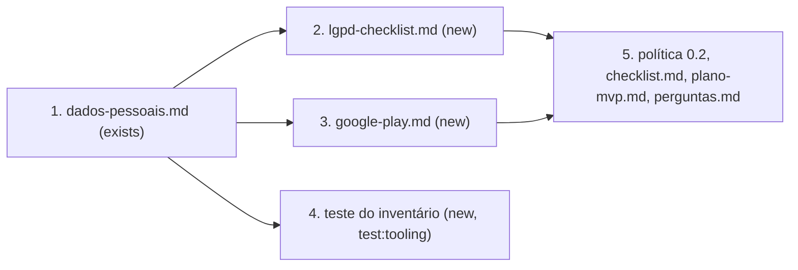

# E6.2 · Revisão de LGPD e das exigências das lojas

**Approved**: 2026-11-25 - user: "Aprovo com as recomendações" (perguntas 219 a 227 com a recomendação)
**Settled mid-build:** (1) G5 não virou tarefa: a resposta 219 (opção 1) manteve a nota do admin e o rating fora do app, sem código. (2) G8 entrou como aceite da E5.4, não como tarefa nova: é conferência, sem código. (3) G1 a G4, G6 e G7 viraram E6.3 a E6.8, na ordem G1, G2, G3, G4, G6, G7. (4) O teste do inventário roda no `node --test` do `test:tooling` (`scripts/lib/privacy-inventory.test.mjs`), não no Vitest: é o executor que o `test:tooling` usa.
**Review:** <escrito quando a revisão for enviada - sent at <hash>>
**Fix pass:** <escrito quando a correção for feita>

> **Depende de decisões do Gabriel que os docs não cobrem** (seção "Open questions", 219 a 227; renumerar se chocar com outro plano do M6). Sem ele presente, o desenvolvedor segue com as recomendações (CLAUDE.md, Autonomia) e registra em `perguntas.md`. Três itens são **ação dele**, não decisão técnica: o e-mail do encarregado (pergunta 199, já aberta), a revisão jurídica da política e dos termos (pergunta 2 e 203) e a conta da Play Console verificada (US$ 25, `plano-mvp.md:60`). **Loja da Apple fora:** piloto só no Android (resposta 58, `perguntas.md:151` e `:157`); o checklist da App Store fica como seção "depois do piloto", sem pesquisa nesta tarefa.

## Problem

Hoje o inventário `docs/seguranca/dados-pessoais.md` descreve 60 e poucas linhas de dados, mas **nenhuma tem base legal nem prazo de retenção** ("Retenção e base legal: a definir", linha 9), e onze pontos dizem literalmente "a definir na E6.2" ou "conferir na E6.2" (`deleted_accounts`, `deviceId`, nota do admin fora da exportação, rating sem direito de acesso, Resend, PostHog, IP e logs, ex-jogador, backups, região do Firebase Auth e do Expo, apagar o grupo). A política de privacidade (E6.1, rascunho 0.1) contradiz o código em pelo menos dois pontos: diz que a cópia diária do banco vai para o **Cloudflare R2** (`politica-de-privacidade.md:105`), mas o ADR 0082 a pôs no **Google Cloud Storage** `us-east1`; e trata o **Sentry** como "CONFERIR se estiver ativo" (`:80`), mas o `Sentry.AspNetCore` já está no `Sacou.Api.csproj` (ADR 0080). Ela também cita o canal "da seção 12" quando o contato é a 13 (`:148`).

Do lado da loja, nada no repositório responde o que a Google Play pede antes de o app sair do teste interno: o formulário Data safety, o **link web de exclusão de conta** (não existe página web de exclusão: só `/termos`, `/privacidade`, `/r/{code}` e `/c` em `Sacou.Api/Web/Pages`), o público-alvo e a classificação, o conteúdo gerado por usuário (apelido, nome do grupo, local e nome de convidado são texto livre visto por outros, e não há "denunciar"), o nível de API alvo e as instruções de acesso para o revisor. O backup também tem uma lacuna que trava o piloto com jogadores reais: não há comando de reexclusão a partir de `identity.deleted_accounts` depois de uma restauração (ADR 0082, D10).

Quem paga: o Gabriel, que responde como controlador (pergunta 198) e não tem como responder a um pedido de titular nem a um revisor da Play com o que está escrito; e o jogador do piloto, cuja conta apagada volta numa restauração. Evidência: as linhas citadas acima; nenhum incidente.

Quando isto sair, o Gabriel tem num lugar só: o checklist LGPD com base legal, retenção e operador de cada dado, os direitos do titular conferidos contra o código, as respostas prontas para colar no Data safety e nas outras declarações da Play Console, e uma lista curta de correções com tamanho, separando o que ele precisa decidir ou fazer.

## Shape

Reaproveita o inventário `dados-pessoais.md` como fonte única (o checklist aponta para as linhas dele, não copia) e a tabela de rastreio da política (E6.1); nenhum serviço novo. A única regra que muda resultado é "toda linha do inventário tem base legal e retenção, e nenhuma diz 'a definir na E6.2'", e ela roda num teste do `pnpm test:tooling` (Vitest dos scripts), que a CI já executa.

1. Entra o inventário `docs/seguranca/dados-pessoais.md` (exists) -> o analista/desenvolvedor confere cada linha contra o código (greps da S1) e acrescenta as colunas **Base legal** e **Retenção** (door 1).
2. `docs/seguranca/lgpd-checklist.md` (new) - checklist por tema (bases, direitos, retenção, operadores, transferência, encarregado, incidente, crianças), cada item com estado `ok`, `lacuna Gn` ou `decisão do Gabriel`, e o link para a linha do inventário.
3. `docs/operacao/google-play.md` (new) - exigências atuais da Play (pesquisadas em 25/11/2026, com fonte e data) e as respostas prontas do Data safety, do público-alvo, da classificação, do UGC, das permissões e do acesso do revisor.
4. `scripts/` teste de inventário (new, no `test:tooling`) - lê as tabelas de `dados-pessoais.md` e reprova linha sem base legal, sem retenção ou com "a definir na E6.2".
5. out: `docs/legal/politica-de-privacidade.md` (exists) corrigida e com versão 0.2; `docs/seguranca/checklist.md` (exists) com o nível do ASVS, V17 e MASVS-PRIVACY revistos; `docs/plano-mvp.md` e `docs/backlog.md` (exist) com as correções G1..Gn como tarefas novas; `perguntas.md` com 219 a 227.

**Changes underneath**

| Front | What changes |
| --- | --- |
| domain | nenhum termo muda. "Ex-jogador" ganha uma retenção escrita (pergunta 223) |
| stored data | nada nesta tarefa. A retenção de `identity.deleted_accounts` (pergunta 222) e a da página pública `/r` (pergunta 224) viram correções G3 e G6, fora do diff |
| readers | quem muda o inventário passa a preencher as duas colunas (o teste reprova); a política de privacidade (rastreio no fim dela) e o revisor de segurança, que lê o checklist |

Data: none - a tarefa muda só documentos e um teste de documento; nenhuma tabela, rota ou chave de cache.

## Surface

None - nothing consumed outside. A página web de exclusão (G2) é uma tarefa nova, com plano próprio.

## Landing

| One-way door | Literal shape | Alternative rejected |
| --- | --- | --- |
| 1. Colunas novas no inventário, travadas por teste | Cada tabela de `dados-pessoais.md` passa a `\| Dado \| Onde fica \| Por quê \| Base legal \| Retenção \| Fonte \| Na exclusão \|`. Base legal só de uma lista fechada: `execução de contrato (art. 7, V)`, `legítimo interesse (art. 7, IX)`, `obrigação legal (art. 7, II)`, `consentimento (art. 7, I)`, `exercício de direitos (art. 7, VI)`, `não é dado pessoal`, `fora do piloto` | Um arquivo separado com base e retenção por dado: duplica o inventário e deixa de bater na primeira mudança, que é o defeito que a tabela de rastreio da política já tenta evitar |

- Nothing else in this change is hard to reverse

## Criteria

### S1: Checklist LGPD completo e inventário sem "a definir" (P1)

O Gabriel abre `docs/seguranca/lgpd-checklist.md` e vê, para cada dado do piloto, a base legal, o prazo, o operador e a região, e cada direito do titular com o caminho que o atende no app ou a lacuna.

**Acceptance Criteria**

1. The inventário SHALL ter, em toda linha das tabelas "Conta e perfil", "Grupo e rodada", "Pagamentos" e "Serviços externos", as colunas `Base legal` e `Retenção` preenchidas, e o teste do `pnpm test:tooling` SHALL falhar quando uma delas estiver vazia
   - linha com `Base legal` vazia → falha citando o `Dado`; linha com `Retenção` "a definir na E6.2" → falha; linha de "Foto da cartinha" com `fora do piloto` nas duas → passa; base legal fora da lista fechada (door 1), por exemplo "contrato" → falha
2. IF o texto "a definir na E6.2" ou "conferir na E6.2" aparecer em `dados-pessoais.md`, `checklist.md` ou `politica-de-privacidade.md` THEN o teste SHALL falhar com o arquivo e a linha (hoje há pelo menos 11 ocorrências no inventário)
3. The checklist SHALL ter as seções, nesta ordem: 1 Bases legais, 2 Direitos do titular (art. 18, os 9 incisos), 3 Retenção e descarte, 4 Operadores e suboperadores, 5 Transferência internacional (art. 33), 6 Encarregado e canal, 7 Segurança e incidente (art. 46 e 48), 8 Crianças e adolescentes (art. 14), 9 Decisões automatizadas (art. 20), 10 Lacunas G1..Gn; cada item com o estado `ok`, `lacuna Gn` ou `decisão do Gabriel (pergunta N)`
4. The seção 4 SHALL listar cada operador do piloto com o dado que recebe, a região e a fonte da região: Google Firebase Authentication, Google Cloud Run e Cloud Logging (`us-east4`), Google Cloud Storage (backup, `us-east1`), Neon sobre AWS (`us-east-1`), Sentry (EUA, 90 dias), Expo Push, Google FCM; e SHALL marcar como "não usado no piloto" Resend, PostHog, RevenueCat, Cloudflare R2 e o provedor de IA
   - Resend: nenhum pacote no `apps/` (grep de 25/11/2026) → "não usado no piloto"; Sentry: `Sentry.AspNetCore` no `Sacou.Api.csproj` → operador ativo
5. The seção 2 SHALL conferir cada direito contra o código e citar o arquivo: acesso e portabilidade (`GET /v1/me/export`, folha 30a), eliminação (`DELETE /v1/me`, tela 30b, `DeleteMyAccountHandler`), correção (tela 27, `PUT` do perfil), informação sobre compartilhamento (política, seção 5), revogação do consentimento (não se aplica: nenhuma base é consentimento, pergunta 201) e revisão de decisão automatizada (não se aplica no piloto: o rating não decide nada, ADR 0047)
6. WHEN o checklist tratar da nota do admin e do rating THEN ele SHALL registrar a resposta da pergunta 219 (acesso a dado inferido) e, se for "incluir", abrir a correção G5 com o tamanho
7. The seção 3 SHALL dar um prazo concreto (em dias, ou "enquanto a conta existir", ou "enquanto o grupo existir") para cada linha, e para o backup SHALL dizer "30 dias; conta apagada depois do dump volta numa restauração até a G1 existir"
8. The seção 6 SHALL dizer que o canal do encarregado não existe até a pergunta 199 ser resolvida e SHALL marcar a E7 (piloto com jogadores reais) como bloqueada por ela
9. The seção 8 SHALL registrar a idade mínima de 18 anos (pergunta 202), declarada nos termos (`termos-de-uso.md:28`) e no público-alvo da Play (S2), sem coleta de idade no app

### S2: Respostas prontas da Google Play (P1)

O Gabriel abre `docs/operacao/google-play.md` e copia as respostas para a Play Console sem precisar reler o código.

**Acceptance Criteria**

10. The documento SHALL abrir com as exigências atuais e a data da pesquisa (25/11/2026), cada uma com o link oficial:
    - nível de API alvo: Android 16 (API 36) para app novo e atualização desde 31/08/2026
    - Data safety: obrigatório em teste fechado, aberto e produção; dispensado **só** no teste interno
    - exclusão de conta: caminho no app **e** link web que deixe pedir a exclusão sem reinstalar o app; informar o link no Data safety
    - conta pessoal criada depois de 13/11/2023: teste fechado com 12 testadores por 14 dias seguidos antes do acesso à produção
    - verificação de desenvolvedor: vale no Brasil desde 30/09/2026; app da Play precisa estar registrado no Console
    - conteúdo gerado por usuário: aceitar os termos antes de criar conteúdo, denunciar conteúdo e usuário dentro do app, bloquear quando houver interação 1:1
11. The documento SHALL ter a tabela do Data safety com, por tipo de dado da Play, `Coletado`, `Compartilhado`, `Efêmero`, `Obrigatório ou opcional`, `Finalidade` e a linha do inventário de onde vem, para no mínimo: Informações pessoais > E-mail (coletado pelo Firebase Auth, obrigatório, gerenciamento da conta); Nome (apelido, obrigatório; o nome do Google só no aparelho → não coletado); IDs do usuário (UID do Firebase, `MemberId`); Atividade no app > Outro conteúdo gerado pelo usuário (nome do grupo, local, nome do convidado); Atividade no app > Interações no app (presença, pontos, votos); Informações e desempenho do app > Registros de falhas e Diagnóstico (Sentry, só a API); IDs do dispositivo ou outros (token de push, `installation_id`, `deviceId`); Fotos (imagem da cartinha: só no aparelho e na folha de compartilhar → não coletado)
    - "Compartilhado": `não` para operadores que tratam em nome do Sacou (regra da Play sobre prestadores); "Criptografado em trânsito": `sim` (TLS do Cloud Run, `VerifyFull` no banco); "Pode pedir exclusão": `sim`, com o link da G2
12. The documento SHALL ter as respostas de: público-alvo (18 anos ou mais; não é para crianças, então fora do programa Families), anúncios (não tem), questionário de classificação (IARC: sem violência, sexo, apostas nem compras; interação entre usuários `sim`, compartilha localização `não`), acesso ao app para o revisor (conta de teste a criar pelo Gabriel, só no ambiente de teste ou com um grupo de demonstração na produção, pergunta 226), permissões declaradas (`VIBRATE`, `POST_NOTIFICATIONS` do `expo-notifications`; as de leitura de mídia bloqueadas em `app.json:42-50`) e app de finanças, saúde ou governo (`não`)
13. WHEN o documento falar do nível de API THEN ele SHALL dizer como conferir no AAB gerado pelo EAS (`targetSdkVersion` 36 ou mais no manifesto) e marcar como `a conferir na E5.4` se o build ainda não existir; Expo SDK 58 (`apps/mobile/package.json:24`)
14. The documento SHALL separar, numa seção "O que o Gabriel faz", as ações de conta e de dinheiro: criar e verificar a conta da Play Console (US$ 25), registrar o pacote `com.sacou.app`, cadastrar os testadores, colar as respostas, publicar a política final e informar a URL pública da política e da exclusão
15. The documento SHALL ter a seção "App Store (depois do piloto)" só com os itens que já se sabe que mudam (Sign in with Apple, exclusão de conta no app, rótulo de privacidade), marcada como fora do piloto pela resposta 58

### S3: Política e checklist de segurança coerentes com o código (P1)

16. The política SHALL subir para a versão 0.2 com a data, e SHALL trocar "Cloudflare R2 (cópia diária do banco)" por Google Cloud Storage nos EUA com 30 dias, incluir o Sentry como operador ativo (erros da API, EUA, 90 dias, sem IP) e corrigir "seção 12" para "seção 13" em "Respondemos aos pedidos"
    - a tabela de rastreio no fim da política ganha as linhas do Sentry e do backup apontando para `dados-pessoais.md`
17. The política SHALL dizer, na seção 7, o prazo de cada item que hoje está "sem prazo definido" (marca de exclusão, página da rodada, ex-jogador), conforme as perguntas 222 a 224
18. The `checklist.md` SHALL registrar o nível do ASVS escolhido (recomendação: nível 1, com os controles de nível 2 já feitos em V8 e V14 citados), V17 WebRTC como "não se aplica" (nenhum documento prevê) e MASVS-PRIVACY e MASVS-RESILIENCE com o estado depois desta revisão
19. IF uma afirmação do inventário não bater com o código no grep da revisão THEN a linha SHALL ser corrigida e citada no relatório como achado, com o arquivo conferido

### S4: Lacunas viram tarefas com tamanho (P2)

20. The `plano-mvp.md` SHALL ganhar uma linha por lacuna que muda código, com ID novo, aceite e dependência, e o `backlog.md` SHALL pôr no M6 as que bloqueiam o piloto com jogadores reais; cada uma com o tamanho estimado em linhas e se é sensível:

    | Lacuna | O que falta | Tamanho | Bloqueia | Sensível |
    | --- | --- | --- | --- | --- |
    | G1 | Comando de reexclusão depois de restaurar o backup, a partir de `identity.deleted_accounts` (ADR 0082, D10) | ~400 linhas (Cloud Run Job ou modo do executável, testes de integração) | piloto com jogadores reais | sim |
    | G2 | Página web de exclusão de conta (link do Data safety), conforme a pergunta 220 | ~150 linhas (opção 1) ou ~700 (opção 2) | teste fechado e produção da Play; não o teste interno | sim |
    | G3 | Prazo da marca de exclusão e limpeza periódica (pergunta 222) | ~150 linhas (varredura diária já existe, ADR 0069) | não | não |
    | G4 | Denunciar conteúdo no app (pergunta 221) | ~300 a 600 linhas, conforme a opção | teste fechado e produção da Play, se a resposta for 2 | não |
    | G5 | Nota do admin e rating no acesso do titular (pergunta 219) | ~200 linhas | não | sim |
    | G6 | Apelidos da página `/r` escondidos depois da rodada (pergunta 224) | ~100 linhas | não | não |
    | G7 | Pontos pendentes no `sacou.db` de uma conta apagada (M4-B7, pergunta 225) | ~150 linhas | não | não |
    | G8 | Conferir `targetSdkVersion` 36 no AAB | conferência, 0 linhas se já vier do Expo 58 | envio à Play | não |

21. IF uma lacuna couber em menos de 20 linhas de documento THEN ela SHALL ser resolvida no próprio diff desta tarefa, sem tarefa nova

## Out of scope

| Excluded | Why |
| --- | --- |
| Implementar G1 a G7 | Cada uma é sensível ou muda tela e merece plano, revisão e teste próprios; o aceite da E6.2 é o checklist |
| Revisão jurídica | É do advogado (perguntas 2 e 203); esta tarefa entrega a proposta para ele |
| App Store e TestFlight | Piloto só no Android (resposta 58); a pesquisa da Apple fica para depois do piloto |
| Foto, denúncia de foto, Pix, assinatura, PostHog, resumo com IA | Fora do piloto (ADR 0046); as linhas ficam no inventário com `fora do piloto` |
| Sentry no app (E5.2 Parte 2) | Ainda não existe; quando entrar, a linha do inventário e a resposta "Registros de falhas" do Data safety mudam (o checklist diz isso) |
| Relatório de impacto (RIPD) | A ANPD pode pedir, mas o porte do piloto e o tipo de dado não o exigem por padrão; o checklist registra como item para o advogado |

## Assumptions

| Assumption | Chosen default | Rationale | Confirmed? |
| --- | --- | --- | --- |
| Bases legais | Execução de contrato para conta, perfil, grupos, rodadas, partidas e push; legítimo interesse para logs, Sentry, limite de requisições, marca de exclusão, rating e nota do admin; nenhuma por consentimento | Pergunta 201, padrão adotado na E6.1 | n |
| Prazos | Os da E6.1 (pergunta 200), mais: marca de exclusão 60 dias (pergunta 222), página `/r` só até 7 dias depois da rodada (224) | 60 dias cobre os 30 do backup com folga | n |
| Faixa do piloto na Play | Só teste interno (até 100 testadores, sem Data safety obrigatório); teste fechado e produção depois | `plano-mvp.md:60` e `:185` falam em teste interno; a pergunta 227 confirma | n |
| `deviceId` | Identificador pseudônimo de instalação, dado pessoal; já exportado em `courtWrites`; fica com o histórico como o `MemberId` | Linha do inventário pede decisão; tratar como pessoal é o lado seguro | n |
| Região do Firebase Auth e do Expo | Registrar como "EUA, definida pelo provedor", com o link da documentação de cada um, conferido no S1 | O inventário pede o registro, não uma escolha | n |

**Open questions** (para `perguntas.md`; recomendação em negrito):

- **219** (`open`) Nota do admin e rating no direito de acesso (art. 18, II): hoje fora da exportação (pergunta 42). (1) manter fora e responder pelo canal do encarregado se alguém pedir; (2) incluir na exportação; (3) incluir só a existência ("o admin deu uma nota", sem o valor). **Recomendação: 1 no piloto, levando ao advogado**, porque mostrar a nota contraria o ADR 0047 e o pedido pelo canal ainda atende ao direito.
- **220** (`blocks go-live` do teste fechado) Página web de exclusão: (1) página estática `/excluir-conta` com o passo a passo do app e o e-mail do encarregado para pedir sem o app (~150 linhas, depende da 199); (2) página com login Firebase Web, como a `/c`, que chama `DELETE /v1/me` e mostra os bloqueios (~700 linhas, sensível). **Recomendação: 1**, porque a Play aceita "pedir" a exclusão e a 2 cria uma superfície de ataque nova para o piloto; a 2 fica para quando houver volume.
- **221** (`blocks go-live` do teste fechado) Conteúdo gerado por usuário (apelido, nome do grupo, local, nome de convidado, visto pelos membros e, o apelido, pela página `/r`): (1) "Denunciar" na tela do membro e do grupo que manda só IDs a um e-mail ou tabela, mais "Remover membro" do admin como ação; (2) só o canal do encarregado citado nos termos; (3) declarar que não há UGC público. **Recomendação: 1 antes do teste fechado, 2 no teste interno**, porque a página `/r` torna o apelido público e a política da Play pede denúncia dentro do app.
- **222** (`open`) Prazo da marca de exclusão (`subject_hash`, hoje sem prazo): (1) 60 dias; (2) para sempre. **Recomendação: 1**: cobre o backup de 30 dias e o token de 1 h; depois disso a pessoa pode criar conta nova com o mesmo Google.
- **223** (`open`) Ex-jogador: o `MemberId` nos eventos, presenças e estatísticas fica enquanto o grupo existir. (1) assim, tratado como dado pseudonimizado do grupo; (2) apagar o histórico da pessoa depois de N meses. **Recomendação: 1**, que é o que a política já diz e o `decisoes.md:35` decidiu.
- **224** (`open`) Apelidos na página pública `/r/{código}` depois da rodada (hoje para sempre, `politica-de-privacidade.md:120`): (1) esconder a lista 7 dias depois da rodada; (2) manter. **Recomendação: 1**.
- **225** (`open`) Pontos não enviados no `sacou.db` de uma conta apagada (M4-B7): (1) apagar as sessões da conta dona na exclusão feita no aparelho; (2) deixar até desinstalar. **Recomendação: 1**.
- **226** (`blocks go-live` do teste fechado) Conta para o revisor da Play: (1) uma conta de e-mail de teste com um grupo de demonstração na produção; (2) nenhuma, pedindo isenção. **Recomendação: 1**; a conta é criada pelo Gabriel (conta nova).
- **227** (`open`) Faixa da Play no piloto: (1) só teste interno; (2) teste fechado desde o início, para já contar os 14 dias dos 12 testadores. **Recomendação: 2 se o piloto tiver 12 pessoas ou mais com Android**, porque o relógio dos 14 dias só corre no teste fechado e o Data safety fica pronto nesta tarefa; senão 1.

## Differences from the source

None - a tarefa não tem tela; a fonte é o backlog.

## Sources

- `docs/plano-mvp.md:192` - binding - tarefa e aceite
- `docs/seguranca/dados-pessoais.md` - binding - inventário a completar
- `docs/legal/politica-de-privacidade.md`, `docs/legal/termos-de-uso.md` (E6.1, rascunho 0.1) - binding - textos a corrigir
- `docs/estado/perguntas.md` 2, 3, 42, 58, 91, 198 a 203, 208 - binding - decisões já tomadas e abertas
- Google Play, nível de API alvo, consultado em 25/11/2026: https://developer.android.com/google/play/requirements/target-sdk e https://support.google.com/googleplay/android-developer/answer/11926878
- Google Play, exclusão de conta: https://support.google.com/googleplay/android-developer/answer/13327111
- Google Play, Data safety: https://support.google.com/googleplay/android-developer/answer/10787469
- Google Play, teste fechado para conta pessoal: https://support.google.com/googleplay/android-developer/answer/14151465
- Google Play, conteúdo gerado por usuário: https://support.google.com/googleplay/android-developer/answer/9876937 e https://support.google.com/googleplay/android-developer/answer/12923286
- Verificação de desenvolvedor Android: https://android-developers.googleblog.com/2026/06/android-developer-verification.html e https://developer.android.com/developer-verification/guides
