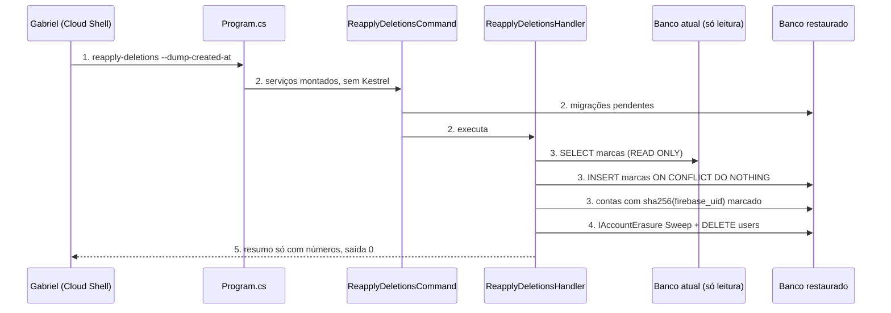
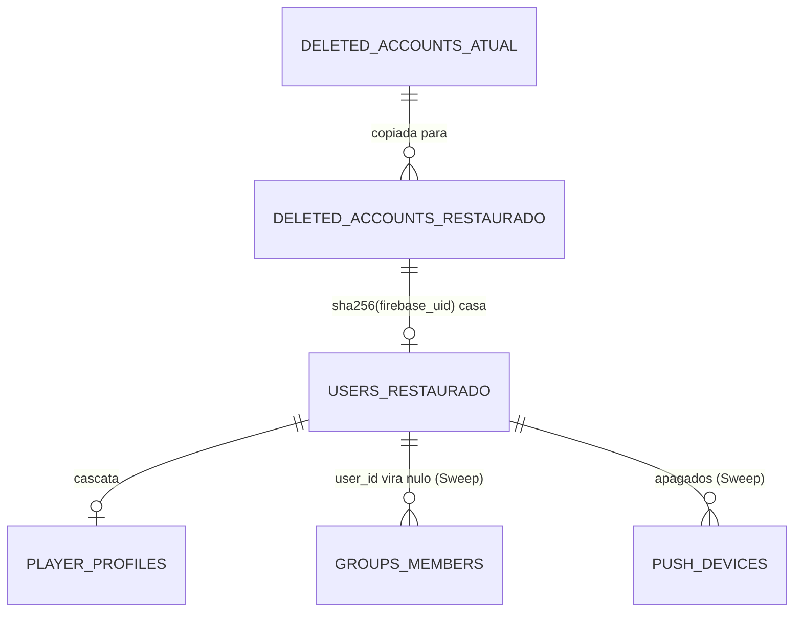

# E6.3 · Reaplicar as exclusões de conta depois de restaurar um backup

**Approved**: <a escrever quando o Gabriel aprovar - AAAA-MM-DD - user: "palavras dele">
**Settled mid-build:** none
**Review:** <a escrever quando a revisão for enviada>
**Fix pass:** <a escrever quando a correção for feita>

> **Depende do Gabriel:** perguntas 228 a 231 (fim do arquivo), com recomendação; nenhuma trava a S1. A linha literal da E6.3 no `plano-mvp.md` (branch da E6.2) precisa ser colada em `request.md` pelo orquestrador; este plano segue o brief e o ADR 0082, D10. **Sensível: sim** (dados pessoais, direito de exclusão da LGPD, credencial do banco de produção): `revisor-seguranca` na S1; desenvolvedor **Opus**.

## Problem

Restaurar um dump (até 30 dias) ou um ponto do Neon (até 6 h) traz de volta, completas, as contas de quem pediu a exclusão depois daquele instante: apelido, posições, vínculo com grupos, aparelhos de notificação. A marca `identity.deleted_accounts` do banco restaurado também volta ao passado, então nem o 410 da recriação vale para essas pessoas. Hoje a única forma de excluir é o `DELETE /v1/me` da própria pessoa, que já não tem conta no Firebase para chamá-lo. Quem paga é o jogador que exerceu o direito de exclusão (LGPD, art. 18, VI) e o Gabriel, controlador. Evidência: ADR 0082, D10, e `docs/operacao/backup.md`, "Restaurar de verdade", passo 3, que mandam parar; por isso nenhuma restauração da produção nem piloto com jogadores reais é permitido.

Quando isto chegar: o Gabriel restaura um backup seguindo o roteiro, roda um comando, e toda pessoa que se excluiu antes do momento da restauração volta a estar excluída no banco restaurado, antes de a API voltar a servir; o bloqueio do piloto (D10) cai.

## Shape

Reusa a exclusão que já existe (as `IAccountErasure` do Notifications e do Groups, em modo `Sweep`, e o `IDeletedAccountStore` do Identity, com `SubjectHash`), chamada por um modo de comando do próprio binário da API, em vez de reescrever a exclusão em SQL no `backup.sh`. As regras que mudam o resultado (quais contas casam com quais marcas, a guarda de idade do dump, a contagem do resumo) ficam num handler do Identity coberto por teste de unidade, e a ida e volta inteira num teste de integração com Postgres real (`Sacou.Integration.Tests`).

1. Gabriel, no Cloud Shell, roda a imagem da API (`sacou-api:restore`, já construída no passo 4 do ensaio) com o argumento `reapply-deletions --dump-created-at <createdAt do manifesto>`, a URL do banco restaurado em `SACOU_DATABASE_URL` e a URL **só leitura** do banco atual (papel `sacou_backup`) em `SACOU_DELETIONS_SOURCE_DATABASE_URL` -> `Program.cs` (exists) desvia para o comando depois de montar os serviços, sem subir o Kestrel (door 1)
2. `Sacou.Api/Operations/ReapplyDeletionsCommand` (new) - valida argumentos e variáveis (TLS forçado pela mesma regra de `DatabaseConnectionSetup` (exists)), aplica as migrações pendentes do destino (as mesmas `*Module.MigrateAsync` (exists)) e chama o handler
3. `Identity/ReapplyDeletions/ReapplyDeletionsHandler` (new) - lê todas as marcas da origem numa transação `READ ONLY` (`DeletedAccountSource`, new); recusa se o dump é mais velho que a retenção da marca; grava cada marca no destino (`INSERT ... ON CONFLICT DO NOTHING`, door 2); acha no destino as contas cujo `sha256(firebase_uid)` está nas marcas
4. para cada conta achada, em ordem de `id`: as `IAccountErasure` (exists) em `ErasureMode.Sweep` e depois `DELETE FROM identity.users` (o perfil cai em cascata), o mesmo passo 3 do ADR 0056, D7
5. out: uma linha na saída padrão e uma no log, só com números (`reapply-deletions: ok, <marcas> marks, <novas> new marks, <contas> accounts erased, <grupos> groups left without admin, <s> s`), código de saída 0; a API depois lê o banco restaurado e responde 410 a quem se excluiu (D5 do ADR 0056, sem mudança)

**Changes underneath**

| Front | What changes |
|---|---|
| domain | Nenhum termo muda. `ErasureMode.Sweep` passa a ter um segundo chamador (o comando); hoje só o `DeleteMyAccountHandler` |
| stored data | Nada a migrar: nenhuma tabela nova nem coluna. O destino ganha as marcas que faltam |
| readers | `POST /v1/me` (410 para quem foi reexcluído) e toda rota (403 `user-not-registered`): sem mudança de código; o teste de integração confere |
| operação | `docs/operacao/backup.md`: o passo 3 de "Restaurar de verdade" vira o comando; o passo 1 (Restore do Neon) ganha o mesmo comando (pergunta 230); o ensaio mensal ganha o comando contra o `sacou_restore`; o aviso de bloqueio do topo sai |

New: nothing - o comando escreve só em tabelas que já existem. One-way constraints: nenhuma.

## Surface

Comando, não rota HTTP (pergunta 228). Imagem da API, `docker run ... sacou-api:restore reapply-deletions --dump-created-at <ISO 8601 UTC>`.

| Entrada | Obrigatória | Padrão |
|---|---|---|
| `--dump-created-at <ISO 8601>` | sim (o `createdAt` do manifesto; no Restore do Neon, o instante escolhido) | - |
| `SACOU_DATABASE_URL` | sim (banco restaurado, papel da API) | - |
| `SACOU_DELETIONS_SOURCE_DATABASE_URL` | sim (banco atual, papel `sacou_backup`, só leitura) | - |

| Saída | Código |
|---|---|
| `reapply-deletions: ok, ...` (resumo só com números) | 0 |
| `reapply-deletions: usage: ...` (argumento ausente ou inválido, variável ausente, origem igual ao destino) | 2 |
| `reapply-deletions: source unreadable` (conexão, permissão ou tabela de marcas ausente na origem) | 3 |
| `reapply-deletions: dump older than the mark retention (<dias> days)` | 4 |
| `reapply-deletions: failed after <n> of <total> accounts; run again` (falha no meio) | 5 |

Quem: só quem tem as duas URLs (Gabriel, no Cloud Shell, com o Secret Manager). Nada exposto na API publicada: o modo de comando só existe com o argumento na linha de comando do contêiner; o serviço do Cloud Run não passa argumentos.

## Landing

| One-way door | Literal shape | Alternative rejected |
|---|---|---|
| 1. Modo de comando no binário da API (padrão novo no código) | `Program.cs`: depois de `builder.Build()`, `if (OperationCommands.TryMatch(args) is { } command) { return await command.RunAsync(app.Services, ct); }`, antes de `UseSacou*`, `MapHealthChecks` e `RunAsync`. Próximos comandos de operação seguem o mesmo `OperationCommands` | Rota `POST /ops/...` no painel do operador (E7.2): o banco restaurado ainda não está atrás da API quando o comando precisa rodar (ligá-la antes serve as contas ressuscitadas), e a rota exporia uma escrita em massa na internet. Script SQL no `backup.sh`: duplica a exclusão de dois módulos (membros, convites, níveis, aparelhos) fora dos testes, e diverge na primeira mudança. Projeto de console novo (`Sacou.Ops`): mais um projeto, imagem e registro dos módulos para o mesmo resultado |
| 2. A lista de exclusões que vale é a do **banco atual** (fora do backup restaurado), copiada inteira para o destino | Origem = `identity.deleted_accounts` do banco atual pelo papel `sacou_backup` (só leitura, `pg_read_all_data`, já existe); se o banco atual se perdeu, a origem é o dump **mais novo** restaurado num banco descartável (pergunta 229). Todas as marcas, não só as mais novas que o dump | Cópia própria das marcas fora do Neon (arquivo no bucket ou outro banco): infraestrutura e credencial novas, e o bucket apaga em 31 dias, menos que os 60 da marca. Copiar só `deleted_at > createdAt`: depende do relógio e do manifesto certos; copiar todas é idempotente e cobre um manifesto errado |
| 3. Busca da conta pelo hash no banco | `WHERE sha256(convert_to(firebase_uid, 'UTF8')) = ANY(@hashes)` (função nativa do Postgres 11+, sem `pgcrypto`), com teste golden de que o resultado é igual a `SubjectHash.Of` | Ler todos os `firebase_uid` para a memória e fazer o hash em C#: põe os UIDs de todos os jogadores no processo sem necessidade |

- Nothing else in this change is hard to reverse.

## Criteria

### S1: o comando reexclui no banco restaurado quem se excluiu depois do dump (P1) · ~350 linhas

Ponta a ponta: argumento, host, handler, as duas exclusões existentes, resumo e o teste de integração com dois bancos reais.

**Acceptance Criteria**

1. WHEN o comando roda com uma origem que tem a marca de A e um destino onde A ainda tem conta THEN o sistema SHALL, no destino, apagar a linha de A em `identity.users` e o perfil, deixar os membros de A com `user_id` nulo e `left` (os ativos, com `left_at` = agora), apagar as `member_levels` sobre A, revogar os convites de A, apagar os aparelhos de A, gravar a marca de A com o `deleted_at` da origem, e sair com 0
   - A excluída depois do dump → `1 accounts erased`; B, sem marca → intacta (conta, perfil, membros e aparelhos iguais)
2. WHEN o comando roda de novo sobre o mesmo destino THEN o sistema SHALL sair com 0 e `0 new marks, 0 accounts erased`, sem mudar nenhuma linha
3. WHEN A pede `POST /v1/me` à API ligada no destino depois do comando THEN o sistema SHALL responder 410 `identity.account-deleted` sem criar linha (ADR 0056, D5); outra rota com o token de A → 403 `identity.user-not-registered`
4. WHEN o destino já não tem A (A se excluiu antes do dump) THEN o sistema SHALL apenas garantir a marca e contar `0 accounts erased`
5. IF A era o único Admin ativo de um grupo com outro membro ativo com conta (o bloqueio do ADR 0056, D3, que no banco atual já foi resolvido e no restaurado voltou) THEN o sistema SHALL reexcluir A mesmo assim (modo `Sweep`, sem conferir bloqueio) e contar o grupo em `groups left without admin` (pergunta 231)
   - 1 grupo assim → `1 groups left without admin`; Co-admin restante não conta como admin
6. The system SHALL escrever no log e na saída só números e códigos: nenhum UID, hash (nem em hexadecimal), `UserId`, `MemberId`, `groupId`, apelido, nome de grupo nem URL de banco ou senha
   - teste L1: a saída e o log capturados de toda a bateria da S1 não contêm o UID de A, o hex do hash de A, o apelido de A, o nome do grupo, o id de A nem a senha das URLs
7. The system SHALL achar a conta pelo `sha256(convert_to(firebase_uid, 'UTF8'))` do banco igual a `SubjectHash.Of(AuthSubject)`
   - golden: UID ASCII de 28 caracteres e um UID com caractere fora do ASCII → mesmos 32 bytes nos dois lados
8. The system SHALL abrir a origem numa transação `READ ONLY` e nunca escrever nela
   - teste: depois do comando, contagens de todas as tabelas da origem iguais às de antes; com o papel só leitura (`pg_read_all_data`) no teste, o comando funciona
9. The system SHALL rodar o modo de comando sem abrir porta HTTP nem mapear rotas, e o serviço sem argumento SHALL subir como hoje (`/health` 200)

### S2: as recusas e a falha no meio (P1) · ~150 linhas

O comando nunca deixa o operador achar que deu certo quando não deu.

**Acceptance Criteria**

10. IF falta `--dump-created-at`, ele não é ISO 8601 com fuso, ou falta uma das duas variáveis THEN o sistema SHALL sair com 2 e `reapply-deletions: usage: ...`, sem abrir conexão
11. IF a origem e o destino apontam para o mesmo host, banco e porta THEN o sistema SHALL sair com 2 (operador trocou as variáveis)
12. IF a origem não conecta, recusa a leitura ou não tem `identity.deleted_accounts` THEN o sistema SHALL sair com 3 e `source unreadable`, sem gravar nada no destino
13. IF `--dump-created-at` é mais antigo que agora menos a retenção da marca (60 dias, resposta 222; constante única com a E6.5) THEN o sistema SHALL sair com 4, sem gravar nada
    - 59 dias e 23 h → roda; 60 dias e 1 min → 4
14. IF o comando cai depois de reexcluir parte das contas THEN o sistema SHALL sair com 5 e `failed after <n> of <total> accounts; run again`, e a nova execução SHALL terminar o resto (cada passo idempotente, ADR 0056, D7)
    - teste: uma `IAccountErasure` de teste que falha na 2ª conta de 3 → 5, `1 of 3`; segunda execução sem a falha → 0, `2 accounts erased`
15. WHEN o destino tem migrações pendentes do código atual THEN o sistema SHALL aplicá-las antes de ler as contas (as mesmas de `MigrateOnStartup`)
16. IF o destino não tem o esquema `identity` (banco vazio ou errado) THEN o sistema SHALL sair com 2, sem criar o esquema (o comando nunca cria um banco do zero)

### S3: o roteiro passa a chamar o comando e o bloqueio cai (P1) · ~100 linhas de docs

**Acceptance Criteria**

17. WHEN o Gabriel segue "Restaurar de verdade" em `docs/operacao/backup.md` THEN o passo 3 SHALL ter o comando literal (`docker run` com `read -rs` das duas URLs, a de origem lida do segredo `sacou-backup-database-url-<env>`, nunca impressa) e o resultado esperado, antes da troca do banco do serviço (passo 4)
18. WHEN o Gabriel usa o Restore do Neon (passo 1) THEN o roteiro SHALL mandar rodar o mesmo comando com a origem no ramo de antes da restauração que o Neon guarda, e `--dump-created-at` no instante escolhido (pergunta 230)
19. WHEN o Gabriel faz o ensaio mensal THEN o roteiro SHALL incluir o comando contra o `sacou_restore` com a origem no banco atual, com o resultado anotado no diário
20. The system SHALL ter o aviso "Bloqueado na produção" de `backup.md` e o "Pendente" do ADR 0082, D10, trocados pela referência ao comando, e a linha do piloto com jogadores reais liberada só depois do primeiro ensaio com o comando (anotado no diário)
21. The system SHALL ter um ADR novo (próximo número livre; 0086 se a E6.2 não o usar) com as portas 1 a 3, a nota no ADR 0056 (segundo chamador do `Sweep`), a linha nova em `docs/seguranca/modelo-de-ameacas.md` (credencial de origem no Cloud Shell; risco residual da pergunta 229) e a nota em `docs/seguranca/dados-pessoais.md` (a marca agora também serve à restauração)

## Out of scope

| Excluded | Why |
|---|---|
| Apagar o resto da marca depois de 60 dias | E6.5 (resposta 222); aqui só a constante compartilhada |
| Cópia das marcas fora do Neon | Pergunta 229: infraestrutura nova para um risco residual pequeno |
| Promover um admin automaticamente no grupo que ficou sem | `grupos.md:23` proíbe promoção automática; pergunta 231 |
| Conta no Firebase | Já apagada pelo app na exclusão original (pergunta 57); o restore não a traz de volta |
| Avisar os grupos do que se perdeu | Passo 6 do roteiro, manual, sem mudança |
| Rota no painel do operador | Pergunta 228 |

## Assumptions

| Assumption | Chosen default | Rationale | Confirmed? |
|---|---|---|---|
| `left_at` dos membros reexcluídos | Agora (o `TimeProvider` do `Sweep`), não o `deleted_at` da marca | Reusa o `Sweep` sem mudar a assinatura; a diferença é de horas a dias e não identifica ninguém | n |
| Marcas copiadas | Todas da origem, não só as mais novas que o dump | Idempotente e independe do relógio do manifesto | n |
| Neon Restore guarda o estado anterior num ramo | O Restore do Neon cria um ramo de backup com o estado de antes; o roteiro aponta a origem para ele | A conferir no console do Neon no primeiro uso; se não houver, a origem é o dump mais novo (pergunta 229) | n |
| Ordem das exclusões | A da injeção (Notifications antes do Groups, ADR 0069, D9), como no `DELETE /v1/me` | Mesmo contrato; teste de ordem já existe | n |
| Retenção da marca | 60 dias (resposta 222, segundo o brief) | Precisa ser maior que os 30 dias do bucket; o texto da resposta está na branch da E6.2 | n |

**Open questions:**

- **228 (open).** Forma do comando: (1) modo de comando no binário da API, rodado no Cloud Shell pela imagem do ensaio; (2) rota no painel do operador (E7.2); (3) script SQL no `backup.sh`. **Recomendação: 1** (porta 1: reusa a exclusão testada, sem superfície na internet, roda antes de a API ver o banco).
- **229 (open).** Origem das marcas se o banco atual se perder de vez (projeto do Neon apagado): (1) o dump mais novo, restaurado num banco descartável; perde-se só quem se excluiu entre as 04:00 e a perda, risco residual registrado; (2) cópia diária só das marcas noutro lugar (custo e credencial novos). **Recomendação: 1.**
- **230 (open).** Rodar o comando também no Restore do Neon (até 6 h): (1) sim, com a origem no ramo de antes da restauração; (2) não, aceitar o risco das últimas horas. **Recomendação: 1** (o D10 já diz que o Restore também ressuscita).
- **231 (open).** Grupo que fica sem Admin porque o restaurado desfez a passagem de admin: (1) reexcluir mesmo assim e só contar no resumo; o Gabriel promove à mão (SQL do roteiro) se o grupo pedir; (2) promover automaticamente o membro mais antigo com conta; (3) não reexcluir essa conta. **Recomendação: 1** (o direito de exclusão prevalece; a 3 viola a LGPD e a 2 contraria `grupos.md:23`).

## Differences from the source

None - não há tela; o comando segue o ADR 0082, D10, e o roteiro de `backup.md`.

## Sources

- ADR 0082, D10, e `docs/operacao/backup.md` ("Restaurar de verdade", passo 3) - binding - a condição LGPD e o ponto do roteiro
- ADR 0056 (E3.16, `docs/estado/tarefas/E3.16.md`, D2, D3, D5, D7, D11) - binding - o que a exclusão apaga, a marca, a idempotência e os logs
- `DeleteMyAccountHandler`, `GroupsAccountErasure`, `NotificationsAccountErasure`, `PostgresDeletedAccountStore`, `SubjectHash` - o que se reusa
- Resposta 222 (E6.2, branch `task/E6.2-lgpd-play`) - binding - retenção da marca, 60 dias, citada pelo brief
- G1 de `.specs/features/E6.2/plan.md` (branch da E6.2) - não lida por este analista; conferir que nada além do D10 foi pedido

## Test notes (para o desenvolvedor e o testador)

- Integração (`Sacou.Integration.Tests/Backup/ReapplyDeletionsTests.cs`, ao lado de `BackupRoundTripTests`): dois bancos do mesmo Postgres 18 descartável, migrados; semear A e B (perfil, grupo com A Admin e B membro, convite de A, nível sobre A, aparelho de A), copiar para o "restaurado" pelo `backup.sh dump`/`restore-check` já existente ou por `CREATE DATABASE ... TEMPLATE`; excluir A no "atual" pelo `DELETE /v1/me`; rodar o comando como processo (código de saída e saída padrão reais). Casos 1 a 9 e 10 a 16.
- Unidade (`Sacou.Modules.Identity.Tests/ReapplyDeletions/`): guarda de idade (13, bordas), análise de argumentos (10), resumo (5, 14).
- Sabotagens sugeridas: usar `ErasureMode.Checked` (5 deve falhar); tirar o `ON CONFLICT` (2); hash sem `convert_to` UTF-8 (7, caso fora do ASCII); origem sem `READ ONLY` com escrita de teste (8); imprimir o hex do hash (6); `>=` por `>` na guarda (13).
