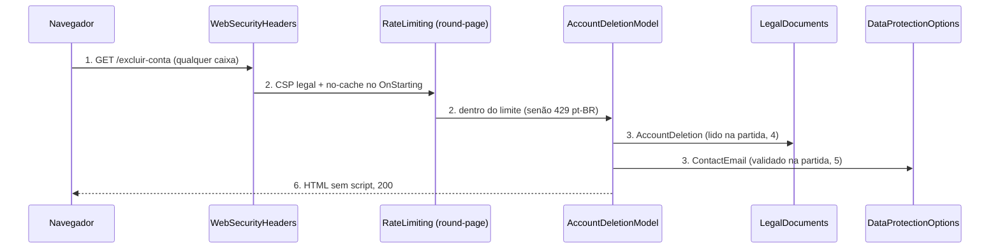

# E6.4 · Página web de exclusão de conta

> **Depende do Gabriel (topo, pedido do brief):** o e-mail do encarregado (pergunta **199**) não existe. Este plano **não** escreve endereço nenhum: o e-mail entra só por configuração (`DataProtection__ContactEmail`), e a API de **produção não sobe** sem ele (pergunta 250). A S1 e a S2 podem ser feitas e ir ao ambiente de teste já; o link no Data safety e o teste fechado da Play esperam a 199 **e** a pergunta 253 (como o operador apaga a conta pedida por e-mail, que hoje não tem mecanismo).

**Approved**: 2026-11-26 - user: "Aprovo com as recomendações" (250, 251, 252 e 254; 253: "Tarefa nova E6.9")
**Settled mid-build:** none
**Review:** <written when the review is sent - sent at <HEAD short hash>>
**Fix pass:** <written when the fix pass is made>

## Problem

Hoje a única forma de excluir a conta do Sacou é pelo próprio app (tela 30b, `DELETE /v1/me`). Quem desinstalou o app, perdeu o celular ou não consegue entrar não tem como pedir a exclusão, e a Play exige um link web que deixe pedir "sem reinstalar o app", informado no Data safety (`docs/operacao/google-play.md`, "Exigências atuais"; lacuna G2 de `docs/seguranca/lgpd-checklist.md:117`). Sem esse link, o Data safety não fecha e o app não entra no teste fechado nem na produção da Play (resposta 227: o piloto quer começar pelo teste fechado). O canal para pedir sem o app também não existe (`lgpd-checklist.md:81`, pergunta 199).

Quando sair: qualquer pessoa abre `https://<origem da API>/excluir-conta` sem login, lê o passo a passo do app, o que é apagado, o que fica e por quanto tempo, e encontra no alto da página o e-mail do encarregado para pedir sem o app; a Play Console recebe essa URL.

## Shape

Reusa a moldura das páginas legais da E6.1 (ADR 0083): texto em `docs/legal/` embutido no build, `LegalDocumentParser` sem mudança, `LegalDocuments` lido na partida, partial `_LegalDocument`, CSS `legal`, cabeçalhos de `WebSecurityHeaders` e o limitador `round-page`. As regras que mudam o resultado (validação do e-mail, recusa da partida em Produção sem ele, prefixo dos cabeçalhos sem diferença de maiúsculas, o texto sem notas de revisão) rodam no `Sacou.Api` e são cobertas pelo xUnit de `Sacou.Api.Tests` (`Web/`), sem domínio novo.

1. `GET|HEAD /excluir-conta` entra -> `WebSecurityHeaders` (exists) - prefixo `/excluir-conta` comparado com `OrdinalIgnoreCase`, escreve a CSP legal fechada e `no-cache`
2. `RateLimiting` (exists) - política `round-page` (60 / 60 s por endereço) pela `MapSacouWeb().RequireRateLimiting(RoundPage)` (exists)
3. `AccountDeletionModel` (new, Razor Page `Web/Pages/AccountDeletion.cshtml[.cs]`) - lê `ILegalDocuments.AccountDeletion` (exists, ganha a 3ª propriedade) e `DataProtectionOptions.ContactEmail` (door 1); não lê nada do pedido
4. `LegalDocuments` (exists) - na partida, lê também `docs/legal/exclusao-de-conta.md` (door 2) pelo mesmo leitor; texto recusado derruba a partida (ADR 0083, D4)
5. `DataProtectionOptionsValidator` (new) - na partida: e-mail fora do formato derruba em qualquer ambiente; vazio derruba **só** em `Production` (door 1)
6. out: HTML pt-BR sem script: cabeçalho, bloco "Pedir sem o app" com o `mailto:` (ou o aviso de canal indisponível), o texto do documento, rodapé com a Política de Privacidade

**Changes underneath**

| Front | What changes |
| --- | --- |
| domain | nada: só texto público e configuração |
| stored data | nada a migrar; nenhuma tabela lida ou escrita |
| readers | `ILegalDocuments` ganha `AccountDeletion`: os falsos de `LegalPageTests` (`FakeDocuments`) mudam junto; `GroupRouteGuard` e `RateLimitedRoutesTests` listam a rota nova |
| configuração | `DataProtection__ContactEmail` em `deploy/cloud-run/service.yaml` (`${DATA_PROTECTION_EMAIL}`, de uma variável de environment do GitHub `vars.SACOU_DATA_PROTECTION_EMAIL`, como `ROUND_PAGE_BASE_URL`); não é segredo, mas o nome vai para `docs/operacao/deploy.md` |

Data: none - página anônima sem leitura de banco. O pedido que chega ao e-mail do encarregado é dado pessoal novo **fora do sistema** (caixa de entrada): linha nova em `docs/seguranca/dados-pessoais.md` (S2, pergunta 252).

## Surface

| Route | In | Out | Status | Who |
| --- | --- | --- | --- | --- |
| `GET /excluir-conta`, `HEAD /excluir-conta` | nada (query ignorada, nunca refletida) | `text/html; charset=utf-8`, sem script | `200`; `429` no 61º pedido em 60 s do mesmo endereço; outro método `401` (fallback seguro, ADR 0036 D7); `/excluir-conta/x` e `/AccountDeletion` `401` | anyone |

## Landing

| One-way door | Literal shape | Alternative rejected |
| --- | --- | --- |
| 1. Nome da configuração do canal do encarregado (o Gabriel cadastra; a política usará o mesmo valor) | seção `DataProtection`, chave `ContactEmail`; env `DataProtection__ContactEmail`; variável de environment `SACOU_DATA_PROTECTION_EMAIL`; vazio = canal indisponível; obrigatório em `Production` | e-mail fixo no `.md` ou em `WebTexts`: inventaria um endereço que não existe (199) e obriga PR para trocar de caixa; segredo no Secret Manager: o valor é público e iria para a página de qualquer jeito |
| 2. Terceiro documento legal | `docs/legal/exclusao-de-conta.md`, recurso `Sacou.Api.Legal.exclusao-de-conta.md` (o glob do `.csproj` e o `.dockerignore` já cobrem `docs/legal/*.md`), mesmos marcadores `publicar:inicio`/`fim`, `Versão:` e `Atualizada em:` | texto em `WebTexts`: fugiria da regra "textos centralizados como os de `/termos`", sem versão nem data visíveis, e o jurídico não revisaria no mesmo lugar |
| 3. URL pública consumida pela Play Console | caminho `/excluir-conta` (minúsculas, hífen) | `/exclusao` ou `/conta/excluir`: o backlog e o `google-play.md` já citam `/excluir-conta`; mudar depois exige atualizar o Data safety |

- Nothing else in this change is hard to reverse (o parser, o CSS e os cabeçalhos não mudam de forma).

## Criteria

### S1: a página abre com o passo a passo e os prazos, sem e-mail ainda (P1)

Qualquer pessoa abre `/excluir-conta` no navegador e lê como excluir pelo app, o que é apagado e o que fica; o bloco do e-mail mostra que o canal ainda não está disponível.

Arquivos: `docs/legal/exclusao-de-conta.md` (novo); `Web/Legal/LegalDocuments.cs` (3º arquivo, `AccountDeletionFile`); `Web/Pages/AccountDeletion.cshtml` e `.cshtml.cs` (novos); `Web/Pages/Shared/_LegalDocument.cshtml` (espaço opcional para o bloco do canal, antes do `article`; `LegalPageView` ganha o bloco como valor opcional, sem prop de modo); `Web/WebSecurityHeaders.cs` (`AccountDeletionPrefix`); `Web/WebTexts.cs` (moldura: títulos do bloco, aviso de indisponível); testes em `tests/Sacou.Api.Tests/Web/` (`LegalPageTests`, `LegalPageRefusalTests`, `Legal/LegalDocumentParserTests` se o teste do recurso embutido listar arquivos), `RateLimitedRoutesTests.cs`, `Sacou.Modules.Groups.Tests/Access/GroupRouteGuard.cs`.

**Acceptance Criteria**

1. WHEN alguém sem login faz `GET /excluir-conta` THEN a API SHALL responder `200`, `text/html; charset=utf-8`, `<html lang="pt-BR">`, `<h1>Excluir sua conta do Sacou</h1>`, a linha "Versão 0.1 (rascunho) · atualizada em DD/MM/AAAA" do topo do arquivo, e nenhum `<script`
   - `HEAD /excluir-conta` → `200` sem corpo
2. The página SHALL nomear o app como aparece na Play ("Sacou") no título e no cabeçalho (`WebTexts.Brand`)
3. The texto SHALL trazer, nesta ordem, as seções `##` "Pelo app", "Sem o app", "O que é apagado", "O que fica e por quanto tempo", "Antes de excluir" (passos extras exigidos pela Play)
4. The seção "Pelo app" SHALL listar os passos com os rótulos do app copiados de `apps/mobile/src/strings/` caractere por caractere: aba "Eu" → "Configurações" → em "Excluir conta", tocar "Excluir" → "Para confirmar, digite EXCLUIR" → "Excluir minha conta"; e, para login por e-mail, "Sua senha" (o desenvolvedor confere no emulador que o caminho é esse)
5. The seção "Antes de excluir" SHALL dizer que quem é o único admin de um grupo passa o papel antes ("Escolher outro admin") e que a exclusão não dá para desfazer
6. The seção "O que é apagado" SHALL listar, com os prazos do inventário (`dados-pessoais.md`, colunas Retenção e Na exclusão): login e e-mail no Firebase; conta na API; perfil (apelido, posições, nível); notas que admins deram sobre você; aparelhos do push e notificações; denúncias feitas por você ou sobre você; convites criados por você (revogados)
7. The seção "O que fica e por quanto tempo" SHALL listar: o histórico das partidas, presenças, votos do MVP e estatísticas, que ficam com o grupo como "Ex-jogador", sem levar a você, enquanto o grupo existir; a cópia de segurança do banco, até 30 dias; o histórico de restauração do banco, 6 horas; a marca de exclusão (só identificador), 60 dias, para refazer a exclusão se um backup for restaurado; os registros de acesso (IP e navegador) no Google Cloud, 30 dias; os registros de falhas, 90 dias, sem identificar você
8. IF o texto publicado tiver `LACUNA`, `CONFERIR`, `RASCUNHO PARA REVISÃO`, `NOTA`, `pergunta 19` ou `publicar:` THEN o teste SHALL falhar (mesma trava da ADR 0083, D8, estendida ao 3º arquivo)
9. WHEN a resposta sai THEN os cabeçalhos SHALL ser os da `/termos`: `Content-Security-Policy` igual a `WebSecurityHeaders.LegalContentSecurityPolicy` (com `default-src 'none'`, `script-src 'none'`, `form-action 'none'`, `frame-ancestors 'none'`, sem `https://`), `X-Content-Type-Options: nosniff`, `X-Frame-Options: DENY`, `Referrer-Policy: strict-origin`, `X-Robots-Tag: noindex, nofollow`, `Cache-Control: no-cache`, sem `Set-Cookie`
10. IF o caminho vier em outra caixa THEN os cabeçalhos do critério 9 SHALL estar presentes (o furo M6-B1 não se repete)
    - `/EXCLUIR-CONTA` → CSP legal e `no-cache`; `/Excluir-Conta` → idem; `/excluir-contas` → `401` sem CSP de página (outro segmento, sem endpoint)
11. IF o pedido for `POST /excluir-conta`, `GET /excluir-conta/x` ou `GET /AccountDeletion` THEN a API SHALL responder exatamente `401`, sem "Sacou" no corpo
12. WHEN o pedido trouxer `?x=<script>ZZQUERY` THEN o HTML SHALL não conter `ZZQUERY`
13. WHEN um mesmo endereço fizer o 61º pedido em 60 s (somando `/termos`, `/privacidade`, `/excluir-conta`) THEN a API SHALL responder `429` com "Muitas tentativas" e `Retry-After`; outro endereço SHALL receber `200`
14. WHEN um `ILegalDocuments` falso devolve `` no `AccountDeletion` THEN o HTML SHALL conter `&lt;img src=x onerror=alert(1)&gt;` e não `Política de Privacidade</a>` (como o "Veja também" da `/termos`)
18. The recurso embutido `Sacou.Api.Legal.exclusao-de-conta.md` SHALL ser igual ao arquivo do repositório (teste já existente estendido) e o `GroupRouteGuard` SHALL listar `"GET,HEAD excluir-conta"`; `RateLimitedRoutesTests` SHALL listar GET e HEAD em `round-page`

### S2: o canal do encarregado por configuração, e a produção só sobe com ele (P1)

Com o e-mail cadastrado no ambiente, a página mostra no alto como pedir sem o app; em Produção, sem ele, a API não sobe. Os documentos de operação e segurança passam a citar a página.

Arquivos: `Web/DataProtectionOptions.cs` e o validador (novos, registrados em `WebSetup.AddSacouWeb` com `ValidateOnStart`); `AccountDeletion.cshtml[.cs]`; `WebTexts.cs`; `deploy/cloud-run/service.yaml`; testes em `tests/Sacou.Api.Tests/Web/`; docs listados nos critérios 25 a 29.

**Acceptance Criteria**

19. WHERE `DataProtection:ContactEmail` tem um e-mail válido the página SHALL mostrar, antes do texto do documento, o bloco "Sem o app" com o endereço visível e `<a href="mailto:<e-mail>?subject=Excluir%20minha%20conta%20do%20Sacou">`, com alvo de toque de 2,75 rem (CSS `legal` existente)
20. The bloco SHALL dizer, de `WebTexts`: envie do e-mail usado para entrar no Sacou; diga o apelido; o prazo de resposta (pergunta 252); e que um pedido de outro endereço recebe uma resposta pedindo a confirmação pelo e-mail da conta (pergunta 251)
21. IF o valor não for um e-mail simples THEN a partida SHALL falhar em qualquer ambiente com `DataProtection:ContactEmail must be an e-mail address.`, sem ecoar o valor
    - `encarregado@exemplo.org` → aceito; `Encarregado@Exemplo.org` → aceito, mostrado em minúsculas; `a@b` → recusado (sem ponto no domínio); `a@b.c"><script>` → recusado; `a@b.c?cc=x@y.z` → recusado (`?` quebraria o `mailto:`); `a b@c.d` → recusado; 255 caracteres → recusado (máximo 254)
22. IF o ambiente for `Production` e o valor estiver vazio ou ausente THEN a partida SHALL falhar com `DataProtection:ContactEmail is required in Production.`
    - `Staging` vazio → sobe, critério 16; `Development` vazio → sobe; `Production` com valor válido → sobe
23. The e-mail SHALL nunca aparecer em log, no Sentry nem em mensagem de erro (só o nome da chave)
24. The e-mail SHALL entrar no HTML só pelo Razor (sem `Html.Raw`, teste de arquitetura existente), e nenhum valor da requisição SHALL entrar no `mailto:`
25. `deploy/cloud-run/service.yaml` SHALL ter `DataProtection__ContactEmail: ${DATA_PROTECTION_EMAIL}` e o passo de deploy SHALL ler `vars.SACOU_DATA_PROTECTION_EMAIL` do environment; `docs/operacao/deploy.md` SHALL listar o nome (não é segredo; `segredos.md` não muda)
26. `docs/operacao/google-play.md` SHALL trocar "A página da E6.4" por `https://<domínio da API de produção>/excluir-conta`, com a nota "só depois da pergunta 199 e da 253", e a regra "Pode pedir exclusão" SHALL citar a mesma URL
27. `docs/seguranca/modelo-de-ameacas.md`, seção 8a, SHALL virar "Termos, política e exclusão de conta" e ganhar as linhas: **S/T** pedido de exclusão forjado por e-mail (alguém pede a exclusão da conta de outro) → só do e-mail da conta, confirmação pelo encarregado (251); **T** e-mail da configuração injetando HTML ou outro destinatário no `mailto:` → validação estrita na partida (21), Razor codifica; **I** página sem cabeçalhos por caixa diferente (M6-B1) → `OrdinalIgnoreCase` e teste (10); **R** pedido atendido sem registro → resposta guardada na caixa pelo prazo da 252
28. `docs/seguranca/dados-pessoais.md` SHALL ganhar a linha "Pedido de exclusão ou de direitos por e-mail" (onde: caixa do encarregado; base: obrigação legal, LGPD art. 18; retenção: a da 252; na exclusão: não se aplica) e a política ganha a referência na tabela de rastreio, sem subir de versão o texto se não mudar
29. `docs/seguranca/lgpd-checklist.md` SHALL marcar G2 como feita no código, "aguardando 199 e 253 para o link na Play"

## Out of scope

| Excluded | Why |
| --- | --- |
| Excluir pela web com login (pergunta 220, opção 2) | Resposta 220: opção 1; superfície nova de ataque |
| Comando do operador para apagar a conta pedida por e-mail | Tarefa própria (pergunta 253), sensível, com o padrão AD-004/AD-005 |
| Formulário na página | `form-action 'none'`; um formulário anônimo pede captcha e guarda dado pessoal |
| Corrigir o M6-B1 nas rotas `/r` e `/c` | Pergunta 254 (recomendação: incluir na S1, 2 linhas e 2 testes no mesmo arquivo) |
| Link para a `/excluir-conta` dentro da `/privacidade` ou do app | O leitor recusa links no texto; a política cita o caminho em texto quando o advogado revisar |
| Domínio próprio | Resposta 125; a rota muda junto com `/termos` (ADR 0083, D1) |

## Assumptions

| Assumption | Chosen default | Rationale | Confirmed? |
| --- | --- | --- | --- |
| Nome visível exigido pela Play | "Sacou", o nome do app na ficha; o controlador fica na política ("Gabriel, pessoa física", pergunta 198), sem nome completo nesta página | A Play pede "o nome do app **ou** do desenvolvedor" | n |
| Comportamento sem o e-mail | Página no ar fora de Produção com o aviso do critério 16; Produção não sobe sem ele | Pergunta 250 | n |
| Ambiente do teste | O `sacou-api-test` roda como `Staging` e a produção como `Production` (o desenvolvedor confere em `deploy/cloud-run/`) | Critério 22 depende disso | n |
| Versão do texto | 0.1 (rascunho), como os outros, até a revisão jurídica | ADR 0083, D8 | n |

**Open questions:** (registrar em `docs/estado/perguntas.md`)

- **250** (`open`) Sem o e-mail da 199: (1) página no ar no teste com o aviso "ainda não disponível" e Produção recusando subir sem o valor; (2) página `404` até haver e-mail; (3) Produção sobe e mostra o aviso. **Recomendação: 1**: dá para conferir a página já, e a Produção (que ainda não teve deploy) não sai sem o canal que a política e a Play exigem.
- **251** (`blocks go-live`) Como confirmar quem pede por e-mail: (1) só vale pedido enviado do e-mail da conta; de outro endereço, o encarregado responde pedindo que escreva do e-mail da conta; (2) aceitar de qualquer endereço com o apelido e o grupo. **Recomendação: 1**: a 2 deixa qualquer um apagar a conta de outro.
- **252** (`blocks go-live`) Prazo prometido e guarda dos pedidos: atender em até 15 dias (alinhado ao art. 19, II, da LGPD) e guardar o e-mail do pedido e a resposta por 5 anos como prova do atendimento, ou outro prazo do advogado. **Recomendação: 15 dias e 5 anos, a conferir com o advogado** (pergunta 203).
- **253** (`blocks go-live` do teste fechado) O operador não tem como apagar uma conta sem o token da própria pessoa (`DELETE /v1/me` é a única via; `OperationCommands` só tem o `reapply-deletions`). Opções: (1) tarefa nova **E6.9**, comando `delete-account --uid <UID do Firebase>` no executável da API (AD-004), com `ErasureMode.AfterRestore` (AD-005: promove o membro ativo mais antigo quando a pessoa é o último Admin) e o usuário apagado no console do Firebase, com roteiro em `docs/operacao/`; (2) responder pedindo que a pessoa reinstale e exclua pelo app. **Recomendação: 1**: a 2 viola a regra da Play ("sem reinstalar o app").
- **254** (`open`) Corrigir o M6-B1 (`/r` e `/c` com `Ordinal`) no mesmo PR da S1? **Recomendação: sim**: mesmo arquivo, 2 linhas e 2 testes, e a pendência está sem dono.

## Differences from the source

None - a página não tem tela em `design/mvp/`; segue o visual da `/termos` (ADR 0083, D6) e copia os rótulos das telas 14, 30 e 30b.

## Sources

- `docs/plano-mvp.md:194` (E6.4) - binding - escopo e critério do backlog
- Resposta 220 (`docs/estado/perguntas.md:277`) - binding - opção 1, página estática
- ADR 0083 e `apps/api/src/Sacou.Api/Web/` (`WebSecurityHeaders`, `WebSetup`, `Pages/Terms*`, `Pages/Privacy*`, `Legal/`) - binding - moldura, cabeçalhos, limitador
- `docs/seguranca/revisoes/M6-2026-11-26.md`, M6-B1 - binding - prefixo sem diferença de maiúsculas
- `design/mvp/Perfil.dc.html`, `Conta.dc.html`, `ExcluirConta.dc.html` e `apps/mobile/src/strings/account.pt-BR.ts`, `profile.pt-BR.ts` - binding - rótulos do passo a passo
- `docs/seguranca/dados-pessoais.md` (colunas Retenção e Na exclusão) - binding - prazos
- Ajuda da Play, exclusão de conta (https://support.google.com/googleplay/android-developer/answer/13327111, lida em 26/11/2026) - binding - nome do app ou desenvolvedor, caminho fácil de achar, sem reinstalar, passos extras, o que apaga e o que fica; e-mail de atendimento é forma aceita
