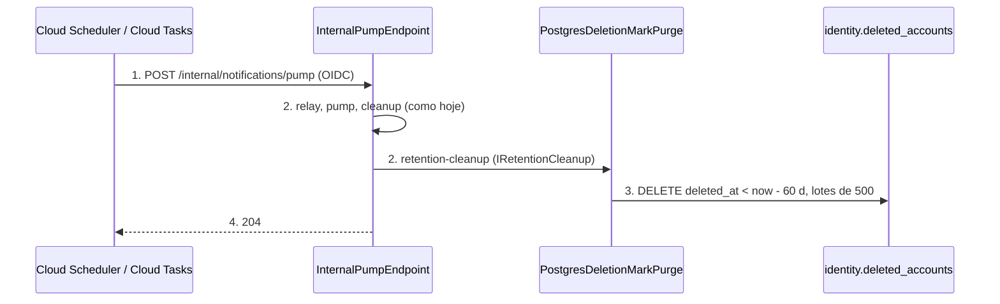
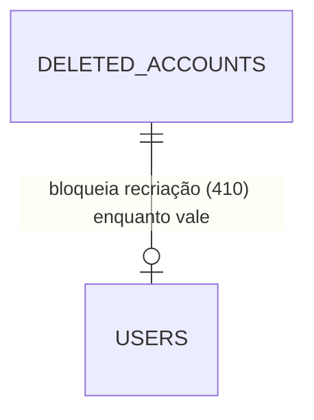

# E6.5 · Prazo de 60 dias da marca de exclusão

**Approved**: <a escrever quando o Gabriel aprovar>
**Settled mid-build:** none
**Review:** <a escrever quando a revisão for enviada>
**Fix pass:** <a escrever quando a correção for feita>

> **Depende do Gabriel:** pergunta 235 (fim do arquivo, com recomendação; não trava a S1). **Depende de:** E6.3 S2 na `main` (condição 5 da segurança no plano da E6.3: as recusas do comando de reexclusão entram antes de as marcas começarem a sumir). **Sensível: sim** (dados pessoais e direito de exclusão da LGPD: apagar cedo demais ressuscita contas num restore; não apagar guarda dado além do prazo). `revisor-seguranca` na S1; desenvolvedor Opus (tarefa sensível).

## Problem

`identity.deleted_accounts` guarda para sempre o SHA-256 do UID e o `deleted_at` de toda pessoa que se excluiu (ADR 0056, D5: "Retenção da marca: até a E6.2 decidir"). A resposta 222 fixou 60 dias e o código já tem a constante (`DeletionMarkRetention.Days = 60`, usada pela guarda do comando da E6.3), mas nada apaga a marca. Quem paga: o jogador que pediu a exclusão, cujo pseudônimo (o hash do UID) fica guardado sem prazo, contra a minimização da LGPD (art. 6º, III, e art. 16); e o Gabriel, controlador, que declarou 60 dias e não cumpre. Evidência: a linha da E6.5 no `plano-mvp.md` e o comentário de `DeletionMarkRetention` ("the purge of E6.5").

Quando isto chegar: toda marca com mais de 60 dias some na próxima varredura, sem ação do Gabriel; a reexclusão depois de um restore (E6.3) continua cobrindo todo dump que ainda pode ser restaurado (30 dias do bucket), e quem volta com o mesmo UID depois do prazo é tratado como pessoa nova.

## Shape

Reusa a rota interna que o Cloud Tasks e o Cloud Scheduler já chamam (`POST /internal/notifications/pump`, ADR 0069, D10 a D13, com a limpeza em lotes no mesmo molde de `PostgresNotificationRetention`) e a constante `DeletionMarkRetention`, em vez de criar rota, job do Scheduler ou conta de serviço novos. A regra que muda o resultado (o corte `deleted_at < now - 60 dias`, estrito) fica num método do Identity coberto por teste de integração com Postgres real, recebendo o `now` por parâmetro.

1. Cloud Scheduler (`sacou-notifications-sweep[-test]`, diário, exists) ou Cloud Tasks (exists) -> `InternalPumpEndpoint` (exists), com OIDC do `ServiceCallers.Policy` (exists)
2. `InternalPumpEndpoint` (exists) - depois dos passos atuais, um passo `retention-cleanup` para cada `IRetentionCleanup` injetada (door 1), com o mesmo `StepAsync` (falha de um passo não para os outros) e o mesmo orçamento de 25 s
3. `Identity/Infrastructure/PostgresDeletionMarkPurge` (new) - `DELETE FROM identity.deleted_accounts WHERE subject_hash IN (SELECT subject_hash ... WHERE deleted_at < {now - DeletionMarkRetention.Period} LIMIT 500)`, lote após lote até vir menos de 500 ou o token disparar
4. out: 204 como hoje; no log, só o número de marcas apagadas quando é maior que zero (nenhum hash, nenhuma data por marca, ADR 0056, D11). No próximo `POST /v1/me` do UID cuja marca sumiu, `PostgresUserStore` (exists) cria a conta como para qualquer pessoa nova

**Changes underneath**

| Front | What changes |
|---|---|
| domain | "Conta excluída" passa a ter prazo: a marca vale 60 dias. Quem se ramifica nela hoje: `PostgresUserStore` (`NOT EXISTS` na marca decide o 410 do `POST /v1/me`) e `ReapplyDeletionsHandler` (copia as marcas da origem) |
| stored data | Nada a migrar; a primeira varredura depois do deploy apaga as marcas já vencidas (no piloto, nenhuma: a mais velha é de 16/11/2026) |
| readers | `POST /v1/me`: depois do expurgo, cria conta nova em vez de 410 (critério 4). Reexclusão da E6.3: a guarda de 60 dias já recusa dump que precisaria de marca apagada (critério 6). Painel do operador (`PostgresIdentityMetrics`): "Contas excluídas" (`OpsUsers.Deleted`, documentado como "ever") passa a contar só os últimos 60 dias; as 8 semanas da tabela (56 dias) ficam inteiras (pergunta 235) |

New: nothing - só apaga linhas de uma tabela que já existe. One-way constraints: nenhuma.

## Surface

None - nothing consumed outside. A rota `POST /internal/notifications/pump` não muda de contrato (mesma entrada, 204, 401 igual para qualquer chamador recusado).

## Landing

| One-way door | Literal shape | Alternative rejected |
|---|---|---|
| 1. Contrato de limpeza por retenção chamado pela rota interna (padrão novo entre módulos) | `Sacou.Shared/Retention/IRetentionCleanup.cs`: `Task CleanUpAsync(DateTimeOffset now, CancellationToken cancellationToken)`; o Identity registra `services.AddScoped<IRetentionCleanup, PostgresDeletionMarkPurge>()`; `InternalPumpEndpoint` recebe `IEnumerable<IRetentionCleanup>` e roda cada uma com `StepAsync("retention-cleanup", ...)`. A próxima retenção de outro módulo implementa o mesmo contrato | Rota `POST /internal/identity/sweep` com job novo do Scheduler: mais um job, mais um binding do invocador e mais um script para o Gabriel rodar no Cloud Shell, para um `DELETE` de uma linha. `BackgroundService` com timer: o Cloud Run escala a zero, então o timer não é confiável. Notifications chamando um contrato do Identity (`IDeletionMarkPurge`): a rota passa a conhecer cada limpeza pelo nome. Identity implementar `INotificationSource`: semântica errada (não tem outbox) |

- Nothing else in this change is hard to reverse (o prazo é a constante que já existe; mudá-la é uma linha).

## Criteria

### S1: as marcas com mais de 60 dias somem na varredura (P1) · ~150 linhas

Ponta a ponta: a rota interna chamada como o Scheduler chama, o passo novo, o `DELETE` no Postgres real e o `POST /v1/me` depois.

**Acceptance Criteria**

1. WHEN a rota interna roda com `now` THEN o sistema SHALL apagar de `identity.deleted_accounts` toda marca com `deleted_at < now - 60 dias` e manter as demais
   - 59 dias → fica; 61 dias → sai; exatamente 60 dias → fica; 60 dias e 1 s → sai (mesma borda de `DeletionMarkRetention.Covers`, que aceita dump com `createdAt >= now - 60 dias`)
2. WHEN a rota roda de novo logo depois THEN o sistema SHALL apagar nada e responder 204 (idempotente: o corte só depende de `now`)
3. IF há mais marcas vencidas que um lote (500) THEN o sistema SHALL apagar todas na mesma chamada, lote após lote, parando só quando o lote vem incompleto ou o orçamento de 25 s dispara; o que sobrar sai na próxima chamada
   - 1.001 marcas vencidas → 0 vencidas depois de uma chamada; as não vencidas intactas
4. WHEN a pessoa cuja marca foi apagada chama `POST /v1/me` com o mesmo UID THEN o sistema SHALL criar uma conta nova (201, perfil vazio, nenhum vínculo antigo) em vez de 410 `identity.account-deleted`; com a marca ainda válida (59 dias) → 410 como hoje
5. IF o passo de expurgo falha (exceção do banco) THEN o sistema SHALL seguir com os outros passos, responder 204 e registrar `retention-cleanup` com o tipo da exceção, como os passos atuais (ADR 0069, D10)
6. The system SHALL usar a mesma constante `DeletionMarkRetention.Period` no expurgo e na guarda da E6.3, para nenhum dump aceito pela guarda precisar de marca já apagada
   - teste: para um `now` fixo, um dump em `now - 60 dias` é aceito por `Covers` e toda marca com `deleted_at > now - 60 dias` sobrevive ao expurgo
7. The system SHALL registrar no log só o número de marcas apagadas (e nada quando é zero): nenhum hash, nem em hexadecimal, nenhuma data por marca
   - teste L1: o log capturado do caso 1 não contém o hex dos hashes semeados
8. The system SHALL rodar o expurgo só pela rota interna autenticada: sem o token OIDC aceito → 401 e nenhuma marca apagada
9. The system SHALL ter a base atualizada: ADR 0056, D5 ("Retenção da marca: 60 dias, apagada pela varredura da E6.5"), ADR 0069, D13 (o passo novo), `docs/seguranca/dados-pessoais.md` (prazo da marca) e `docs/dominio/` ou ADR curto para a porta 1 (próximo número livre)

## Out of scope

| Excluded | Why |
|---|---|
| Índice em `deleted_at` | Tabela pequena no piloto (dezenas de linhas); um índice é migração sem ganho medido. Rever se passar de dezenas de milhares |
| Job novo do Scheduler ou rota nova | Porta 1: a rota interna já é chamada todo dia |
| Contador "excluídas desde sempre" que sobreviva ao expurgo | Pergunta 235 |
| Mudar o prazo de 60 dias | Resposta 222 |

## Assumptions

| Assumption | Chosen default | Rationale | Confirmed? |
|---|---|---|---|
| Frequência | A cada chamada da rota (diária pelo Scheduler e a cada janela do Cloud Tasks) | O `DELETE` vazio é barato; separar "chamada diária" exigiria distinguir os chamadores | n |
| Sign-in depois do expurgo | Conta nova, como pessoa nunca vista (critério 4) | É o efeito do prazo: a marca só existe para o 410 e para a reexclusão; depois de 60 dias nenhum backup restaurável tem a conta. Na prática o UID só volta se o `user.delete()` do Firebase falhou (o login com Google gera UID novo depois da exclusão) | n |
| Borda | Estrita (`<`): exatamente 60 dias fica | Casa com `Covers` (`>=`) e não deixa buraco entre a guarda e o expurgo | n |
| Lote | 500, como `NotificationLimits.CleanUpBatchSize` (constante própria do Identity, sem referenciar o Notifications) | Mesmo molde da limpeza existente | n |

**Open questions:**

- **235 (open).** "Contas excluídas" no painel do operador hoje é "desde sempre" e, com o expurgo, vira "nos últimos 60 dias": (1) trocar o rótulo para "Contas excluídas (60 dias)" em `apps/web/src/strings.pt-BR.ts` e o comentário de `OpsUsers.Deleted`; (2) guardar um contador agregado sem hash que não expira (tabela ou linha nova, migração); (3) deixar como está. **Recomendação: 1** (o número ainda serve ao portão do piloto; um contador sem prazo é dado novo sem uso claro). Não trava a S1; se vier 1, entra na mesma S1 (2 arquivos).

## Differences from the source

None - não há tela.

## Sources

- `docs/plano-mvp.md:195` (linha da E6.5) - binding - o que apaga, o prazo e o teste de 59 e 61 dias
- Resposta 222 (`docs/estado/perguntas.md:279`) - binding - 60 dias
- ADR 0056, D5 e D11 - binding - o que a marca é, o 410 e os logs só com números
- ADR 0069, D10, D11 e D13 - binding - a rota interna, o OIDC e a limpeza em lotes
- `.specs/features/E6.3/plan.md`, AD-004 e condição 5 - binding - a constante compartilhada e a ordem E6.3 S2 antes desta
- `InternalPumpEndpoint`, `PostgresNotificationRetention`, `DeletionMarkRetention`, `PostgresUserStore`, `PostgresIdentityMetrics` - o que se reusa ou é afetado

## Test notes (para o desenvolvedor e o testador)

- Integração (`Sacou.Integration.Tests/Identity/DeletionMarkPurgeTests.cs`): Postgres real; semear marcas com `deleted_at` em `now - 59 d`, `now - 60 d`, `now - 60 d - 1 s`, `now - 61 d`, chamar `CleanUpAsync(now)` com `now` fixo (critérios 1, 2, 6); 1.001 vencidas (3); `POST /v1/me` pela API com o UID depois do expurgo e com marca de 59 dias (4).
- API (`Sacou.Api.Tests/InternalPumpRouteTests.cs`, exists): o passo novo roda com o chamador aceito; uma `IRetentionCleanup` de teste que lança não impede os outros passos e a resposta é 204 (5); sem token → 401 e a cleanup de teste não é chamada (8); log sem hash (7).
- Arquitetura: `ModuleBoundaryViolations` continua verde (o Notifications não referencia o Identity fora de `Contracts`; o contrato está em `Sacou.Shared`).
- Sabotagens sugeridas: `<=` no lugar de `<` (60 dias exatos some, 1); `Period` trocado por 30 dias literal (6); sem o laço de lotes (3); passo fora do `StepAsync` (5); logar o hex do hash (7).
