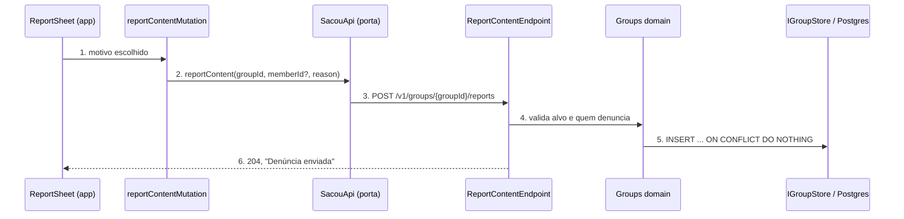
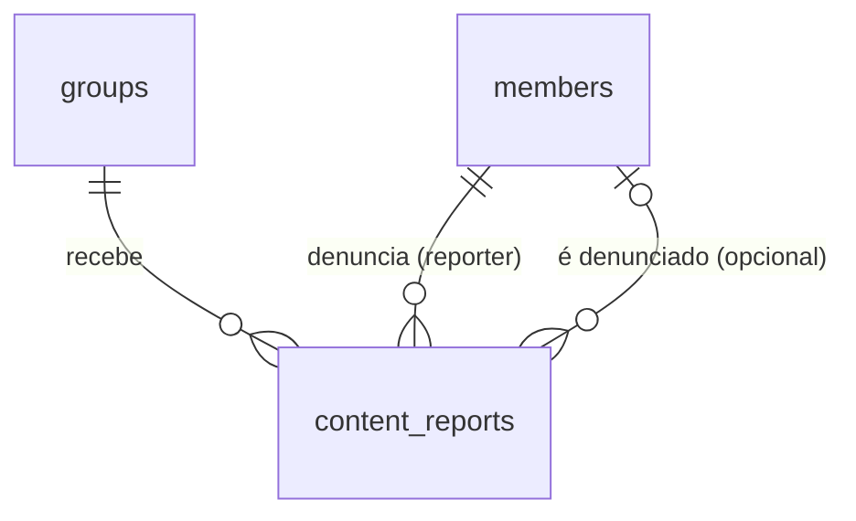

# E6.6 · "Denunciar" no app

**Approved**: <escrito quando o Gabriel aprovar - AAAA-MM-DD - user: "palavras dele">
**Settled mid-build:** none
**Review:** <escrito quando a revisão for enviada - sent at <hash>>
**Fix pass:** <escrito quando a correção for feita>

> **Depende do Gabriel:** perguntas 232 a 234 (fim do arquivo). Sem ele presente, segue com as recomendações (autonomia do `CLAUDE.md`) e registra em `perguntas.md`. Nenhuma depende de conta nova nem de gasto. A política de privacidade continua com a lacuna do canal do encarregado (pergunta 199), que esta tarefa não fecha.

## Problem

Hoje o apelido, o nome do convidado, o nome do grupo e o local são textos livres que outras pessoas do grupo veem (e, no caso do apelido, quem tem o link da página `/r`). Quem vê um apelido ofensivo, um nome de grupo de ódio ou alguém se passando por outra pessoa não tem como avisar o Sacou de dentro do app: a política de conteúdo gerado por usuário da Google Play exige denúncia de conteúdo e de usuário **dentro do app** (`docs/operacao/google-play.md`, linha "Conteúdo gerado por usuário"), e sem ela o app não passa para o teste fechado nem para a produção. A única saída hoje é o canal do encarregado, que ainda não tem endereço (pergunta 199). Evidência: G4 da E6.2 e resposta 221; nenhum dado de uso.

Quando isto for entregue: qualquer membro do grupo toca em "Denunciar" na folha de outro membro ou no grupo, escolhe um motivo de uma lista fechada e envia, sem sair do app; o Gabriel encontra a denúncia (só IDs) numa tabela e age; o admin continua tendo "Remover do grupo" como a ação imediata dentro do grupo.

## Shape

Reusa a fatia vertical do módulo Groups (permissão por grupo `RequireGroupPermission`, `GroupWrite`/`IGroupStore`, a porta `SacouApi` do app e a folha 19c `MemberOptionsSheet`) em vez de criar módulo novo; o motivo é um enum fechado, sem texto livre. As regras que mudam o resultado (quem pode denunciar, quem pode ser denunciado, motivo válido, repetição, quem vê o botão) rodam no domínio do Groups (xUnit) e em `member-actions.ts` / seletores do app (Vitest), onde os testes alcançam.

1. o membro toca em "Denunciar" (folha 19c ou tela 18) -> `ReportSheet` (new) - escolhe um motivo; o estado é a escolha (um campo, `useState`) e o envio é a mutação do TanStack (status dela, sem flag própria)
2. `reportContentMutation` (new, `features/groups/queries`) -> porta `SacouApi.reportContent` (exists a porta; método novo) e `http-sacou-api.ts` / `fake-sacou-api.ts` (exists)
3. `POST /v1/groups/{groupId}/reports` -> `ReportContentEndpoint` (new, `Sacou.Modules/Groups/ReportContent/`) com `RequireGroupPermission(GroupPermission.ReportContent)` (permissão nova, door 3)
4. domínio do Groups (exists) - confere que o alvo é membro do grupo e não é quem denuncia, devolve `Result`
5. `IGroupStore` (exists) grava `groups.content_reports` (door 1) com `ON CONFLICT DO NOTHING` (door 2); escreve um log `LoggerMessage` sem IDs ("content report received") para o alerta (pergunta 234)
6. out: `204`; o app fecha a folha e mostra "Denúncia enviada"; o Gabriel lê a tabela pelo roteiro `docs/operacao/denuncias.md` (new)

**Changes underneath**

| Front | What changes |
| --- | --- |
| domain | `GroupPermission` ganha `ReportContent` (todos os papéis ativos); a matriz de permissões (`docs/dominio/grupos.md`) ganha a linha |
| domain (app) | `memberActions` devolvia `null` para Jogador e Placar na linha de outra pessoa (sem "⋯"); agora devolve uma folha só com "Denunciar" (`MembersScreen` e `MemberRow` decidem o "⋯" por esse retorno) |
| stored data | tabela nova, nada a migrar |
| readers | exclusão de conta (`PostgresGroupStore.Account.cs`, E3.16) e reexclusão depois do backup (E6.3, `ErasureMode.AfterRestore`) apagam as denúncias feitas por e sobre os `MemberId` da pessoa; exportação (`GET /v1/me/export`) não leva denúncias (Out of scope) |

New: `groups.content_reports` com `id` (UUID v7), `group_id`, `reporter_member_id`, `reported_member_id` (nulo = denúncia do grupo), `reason` (texto do enum), `created_at`. **Nada mais** (teste de modelo trava as 6 colunas). One-way constraints: único em (`group_id`, `reporter_member_id`, `reported_member_id` com `NULLS NOT DISTINCT`, `reason`) (door 2).

## Surface

| Route | In | Out | Status | Who |
| --- | --- | --- | --- | --- |
| `POST /v1/groups/{groupId}/reports` | `{ "reportedMemberId": uuid \| null, "reason": "offensiveName" \| "hateOrSexual" \| "impersonation" \| "spam" }` | nada | `204`; `400` `groups.report-self`, `400` validação do `reason`; `404` `groups.member-not-found` (alvo fora do grupo); `401` sem token; o que as outras rotas do grupo dão a quem não é membro ativo (mesmo filtro); `429` do limite por usuário (ADR 0062) | Membro ativo do grupo, qualquer papel. Convidado sem conta não chama (não tem login) |

O contrato entra no OpenAPI e no cliente gerado do app, como as outras rotas do Groups.

## Landing

| One-way door | Literal shape | Alternative rejected |
| --- | --- | --- |
| 1. Tabela da denúncia | `groups.content_reports (id uuid pk, group_id uuid not null, reporter_member_id uuid not null, reported_member_id uuid null, reason text not null, created_at timestamptz not null)`, migração EF do `GroupsDbContext` | Texto livre do motivo ou cópia do apelido/nome denunciado: guarda dado pessoal e conteúdo ofensivo no registro (o backlog proíbe). E-mail pré-preenchido ao encarregado (`mailto:`): tira a pessoa do app, que a Play pede que fique dentro, e o canal ainda não existe (pergunta 199) |
| 2. Repetição idempotente | índice único `ux_content_reports_once` em (`group_id`, `reporter_member_id`, `reported_member_id`, `reason`) `NULLS NOT DISTINCT`; o insert usa `ON CONFLICT DO NOTHING` e responde `204` igual | Aceitar duplicadas: uma pessoa inflaria a contagem tocando de novo; responder `409`: o app teria um estado de erro para algo que deu certo |
| 3. Permissão nova | `GroupPermission.ReportContent`, dada a Admin, Co-admin, Placar e Jogador | Reusar `ViewGroup`: mistura ler com escrever e a matriz deixa de dizer quem grava |

- Nothing else in this change is hard to reverse

## Criteria

### S1: denunciar um membro pela folha 19c (P1)

Um membro escolhe "Denunciar" na linha de outra pessoa, escolhe um motivo e a denúncia (só IDs) fica na tabela.

**Acceptance Criteria**

1. WHEN um membro ativo, de qualquer papel, abre a lista de membros (tela 19) THEN o sistema SHALL mostrar o "⋯" em toda linha que não é a dele
   - Jogador na linha de outro Jogador → "⋯" com só "Denunciar"; Admin na linha de outro → as ações de hoje e "Denunciar" abaixo de "Remover do grupo"; própria linha → sem "Denunciar" (teste de `memberActions`)
2. WHEN o membro toca em "Denunciar" THEN o app SHALL abrir a folha "Denunciar {apelido}" com os 4 motivos (pergunta 233) como opções de escolha única e o botão "Enviar denúncia" desligado até um motivo ser escolhido
3. WHEN o membro escolhe um motivo e toca em "Enviar denúncia" THEN o app SHALL chamar `POST /v1/groups/{groupId}/reports` com `reportedMemberId` e `reason`, e, no `204`, fechar a folha e mostrar "Denúncia enviada. O Sacou vai analisar." 
4. WHILE a mutação está em andamento o app SHALL manter "Enviar denúncia" desligado (status da mutação, sem flag própria)
5. IF a chamada falha (rede, 4xx, 5xx) THEN o app SHALL manter a folha aberta com o motivo escolhido e mostrar o texto de `api-errors.pt-BR.ts` (ou o de sem conexão) numa `ErrorStrip`
6. WHEN a API recebe um pedido válido THEN ela SHALL gravar uma linha em `groups.content_reports` com o `MemberId` de quem denuncia (do contexto do grupo, nunca do corpo) e responder `204`
   - mesmo pedido duas vezes → `204` duas vezes e 1 linha; mesmo alvo com outro motivo → 2 linhas
7. IF `reportedMemberId` é o próprio `MemberId` de quem denuncia THEN a API SHALL responder `400` `groups.report-self` sem gravar
8. IF `reportedMemberId` não é membro do grupo (de outro grupo, inexistente) THEN a API SHALL responder `404` `groups.member-not-found` sem gravar
   - membro que já saiu ou foi removido do grupo → `204` (o apelido ainda aparece no histórico); `MemberId` de outro grupo → `404`
9. IF `reason` está fora da lista ou ausente THEN a API SHALL responder `400` com o erro de validação, sem gravar
10. IF quem chama não é membro ativo do grupo THEN a API SHALL responder como as outras rotas do grupo (mesmo filtro de permissão) e não gravar
11. The sistema SHALL não escrever apelido, nome, e-mail, UID nem `MemberId` no log ao receber uma denúncia; a linha de log da denúncia não tem IDs (teste L1 do padrão dos logs)
12. The folha "Denunciar" SHALL seguir `docs/padroes/frontend.md`: tokens escalados, alvos ≥ 44, textos em `strings/`, `ReportSheet` com props `interface` exportada e sem prop booleana de modo (variantes de alvo por união `{ kind: "member" } | { kind: "group" }`, `react-composition-patterns`)

### S2: denunciar o grupo pela tela 18 (P1)

O nome do grupo e o local também podem ser denunciados, sem escolher membro.

13. WHEN um membro ativo que não é o único Admin abre "Como jogamos" (tela 18) THEN o app SHALL mostrar a linha "Denunciar grupo" no fim da tela (pergunta 232)
14. WHEN ele toca em "Denunciar grupo", escolhe um motivo e envia THEN o app SHALL chamar a mesma rota com `reportedMemberId: null` e mostrar "Denúncia enviada. O Sacou vai analisar."
    - denúncia do grupo repetida com o mesmo motivo → 1 linha (`NULLS NOT DISTINCT`)

### S3: exclusão, operação e documentos (P1)

A denúncia segue a LGPD e o Gabriel sabe como agir.

15. WHEN uma conta é apagada (`DELETE /v1/me`, varredura e `ErasureMode.AfterRestore`) THEN o Groups SHALL apagar as linhas de `content_reports` cujo `reporter_member_id` ou `reported_member_id` é um `MemberId` da pessoa (teste de integração com Postgres real)
16. WHEN um grupo é apagado THEN as denúncias dele SHALL sair junto (FK `group_id` com `ON DELETE CASCADE`, ou o caminho de exclusão que o grupo já usa)
17. The tabela SHALL ter um teste de modelo que trava as 6 colunas (padrão de `member_levels`)
18. The roteiro `docs/operacao/denuncias.md` SHALL dizer: a consulta SQL de leitura no Neon (denúncias dos últimos 7 dias, agrupadas por grupo e alvo, juntando com o apelido só na tela do console), o prazo de resposta (pergunta 234) e as ações (pedir ao Admin que remova; trocar o apelido ou o nome do grupo por SQL com o termo 8 dos Termos; remover a conta)
19. The inventário `docs/seguranca/dados-pessoais.md` SHALL ganhar a linha "Denúncia de conteúdo" com base legal `legítimo interesse (art. 7, IX)` e retenção (pergunta 234), e o teste `privacy-inventory` passa; a política de privacidade ganha a frase sobre a denúncia na tabela de rastreio, com versão e data novas; `google-play.md` marca "Denunciar" como feito; `modelo-de-ameacas.md` ganha a rota nova (abuso: denúncia em massa)

## Out of scope

| Excluded | Why |
| --- | --- |
| Bloquear usuário | A Play só exige bloqueio com interação 1:1 (mensagem, menção); o Sacou não tem (`google-play.md`) |
| Texto livre na denúncia, captura de tela, anexo | O backlog proíbe texto livre e dado pessoal no registro |
| Painel ou rota de operador para ler as denúncias | O backlog pede "uma tabela que o Gabriel lê"; leitura por SQL no Neon (pergunta 234, opção 1). Fica como ideia se o volume crescer |
| Aviso a quem denunciou sobre o resultado; aviso ao denunciado | Piloto pequeno; nada na política exige |
| Denunciar pela página web `/r` (sem login) | Quem não tem conta não é membro; o canal do encarregado cobre. Ideia para depois |
| Denúncia na exportação do titular | O registro é sobre a moderação, só IDs; responde-se pelo canal do encarregado, como a nota do admin (pergunta 219) |
| Denúncia de foto | Foto está fora do piloto (ADR 0046) |

## Assumptions

| Assumption | Chosen default | Rationale | Confirmed? |
| --- | --- | --- | --- |
| Quem denuncia é guardado | `reporter_member_id` na linha, nunca mostrado a ninguém no app | Permite tirar repetição e achar abuso de denúncia; é só ID | n |
| Denunciar membro que já saiu | aceito (`204`) | O apelido segue no histórico da rodada | n |
| Convidado sem conta | denunciado como membro (a linha dele na tela 19 tem "⋯") | Convidado é `Member` sem conta (E3.5); o nome dele é o texto livre | n |
| Reducer | não há reducer: a folha tem um campo (motivo, `useState`) e o envio é o status da mutação | `frontend.md` regra 4 permite `useState` para um campo isolado; o status vem do TanStack (regra 1) | n |
| Limite contra denúncia em massa | só o limite por usuário que já existe (ADR 0062) e o índice único | Piloto pequeno; uma regra própria seria escopo novo | n |
| Tela 18 para quem não administra | Jogador e Placar já abrem "Como jogamos" só para leitura (`editable={canManage}`) | Conferir no emulador; se não abrirem, o "Denunciar grupo" vai para o card do grupo na lista (tela Grupos) | n |

**Open questions:**

- **232 (blocks).** Onde fica o "Denunciar" (nenhuma tela de `design/mvp/` desenha)? (1) Na folha 19c, em toda linha que não é a própria, para todos os papéis, e "Denunciar grupo" no fim da tela 18; (2) só na folha 19c (membro), e o grupo pelo canal do encarregado; (3) num menu "⋯" novo no topo do grupo. **Recomendação: 1** (cobre os quatro textos livres com duas telas que já existem e não muda o desenho delas além de uma linha; a 2 deixa nome do grupo e local sem denúncia no app, que a Play pede).
- **233 (blocks).** Lista fechada de motivos: (1) 4 motivos: "Nome ou apelido ofensivo", "Ódio, assédio ou conteúdo sexual", "Se passando por outra pessoa", "Spam ou propaganda"; (2) os 4 mais "Outro motivo" (sem texto, pouco útil para agir); (3) um botão só, sem motivo. **Recomendação: 1.**
- **234 (blocks go-live).** Como o Gabriel fica sabendo, em quanto tempo responde e quanto tempo a denúncia fica guardada? (1) Lê a tabela pelo SQL do roteiro no Neon, com um alerta por e-mail do Cloud Logging na linha "content report received" (sem custo; o Gabriel configura o alerta no projeto `sacou-api` que já existe), responde em até 7 dias, e a linha fica 180 dias, apagada pela varredura diária (ADR 0069); (2) igual, sem alerta, lendo uma vez por semana; (3) rota de operador no painel da E7.2 (+~150 linhas). **Recomendação: 1** (a Play pede que se aja sobre a denúncia; o alerta evita que ela fique esquecida; 180 dias cobre reincidência no piloto).

## Differences from the source

None - nenhuma captura desenha "Denunciar"; a folha 19c e a tela 18 seguem `MembroOpcoes.dc.html` e `AjustesGrupo.dc.html`, com uma linha a mais cada (pergunta 232)

## Sources

- `docs/plano-mvp.md`, linha da E6.6 - binding - critério de aceite
- `.specs/features/E6.2/plan.md`, G4; `docs/estado/perguntas.md`, resposta 221 - binding - a tarefa existe antes do teste fechado
- `docs/operacao/google-play.md`, "Conteúdo gerado por usuário" - binding - o que a Play exige
- `design/mvp/MembroOpcoes.dc.html`, `design/mvp/AjustesGrupo.dc.html` - binding - as telas onde a linha entra
- [Política de UGC da Google Play](https://support.google.com/googleplay/android-developer/answer/9876937) e [denúncia no app](https://support.google.com/googleplay/android-developer/answer/12923286) - non-binding (referência externa) - denúncia de conteúdo e de usuário dentro do app; bloqueio só com interação 1:1; agir sobre a denúncia; nenhum prazo fixo encontrado

## Test cases (resumo para o desenvolvedor e o testador)

- **Domínio C# (xUnit):** permissão `ReportContent` em cada papel; `report-self`; alvo de outro grupo; alvo que saiu; motivo inválido.
- **Integração (Postgres real):** insert e repetição (1 linha), `NULLS NOT DISTINCT` na denúncia do grupo, exclusão de conta apaga como reporter e como alvo, `AfterRestore` idem, teste de modelo das 6 colunas, varredura de 180 dias (179 dias fica, 181 sai).
- **API (HTTP):** 204, 400, 404, não membro, 401; log sem apelido nem IDs (L1, texto proibido = apelido marcador).
- **App (Vitest):** `memberActions` para os 4 papéis × própria/outra linha; folha com botão desligado sem motivo; sucesso fecha e mostra o aviso; falha mantém o motivo; chamada da porta com `reportedMemberId: null` no grupo; tokens em 3 larguras.
- **Emulador:** folha 19c como Jogador e como Admin; tela 18 com "Denunciar grupo"; envio com e sem rede.
- **Sabotagens sugeridas:** tirar o `ON CONFLICT`; aceitar `MemberId` de quem denuncia vindo do corpo; esquecer as denúncias na exclusão de conta; mostrar "Denunciar" na própria linha; gravar o apelido no log.

## Security

Sensível (dados pessoais e rota de escrita nova): `revisor-seguranca` na primeira parte. Pontos: o reporter vem do contexto autenticado, nunca do corpo; nenhuma resposta conta denúncias ou diz quem denunciou; exclusão de conta cobre a tabela; abuso por denúncia em massa limitado pelo índice único e pelo ADR 0062.

Tamanho: ~450 linhas (API ~200 com migração e testes, app ~200, docs ~50), um PR, três fatias e um commit por fatia.
