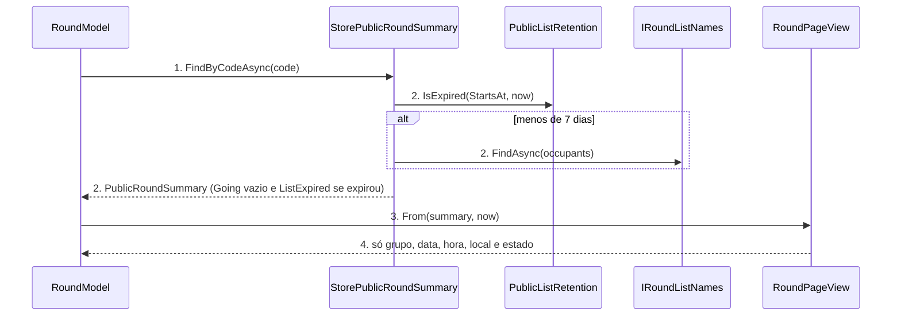

# E6.7 · Apelidos da página `/r` escondidos 7 dias depois do início da rodada

**Approved**: 2026-11-25 - user: "Aprovo os quatro" (respostas 232-235, 238, 240, 241 com a recomendação)
**Settled mid-build:** none
**Review:** <pendente>
**Fix pass:** <pendente>

> **Decisão do Gabriel pendente (não bloqueia):** pergunta 238, a frase que explica a lista ausente. Sem resposta, segue com a recomendação (autonomia do `CLAUDE.md`), registrada em `docs/estado/perguntas.md`.

## Problem

A página `GET /r/{code}` (ADR 0070, D5) mostra a qualquer pessoa com o link, sem login, os primeiros nomes de quem teve vaga, **sem prazo**: o link sobrevive no histórico do WhatsApp e, encaminhado meses depois, ainda mostra quem foi a uma rodada que já acabou. `docs/seguranca/dados-pessoais.md:27` registra a lacuna ("na página `/r`, até 7 dias depois da rodada (pergunta 224; até a E6.7 existir, sem prazo)"). A lacuna G6 da E6.2 é a evidência. Quem paga é o jogador, que tem o apelido exposto sem necessidade depois que a lista perdeu a função.

Quando isto sair, a partir de 7 dias depois do início da rodada a página mostra só o nome do grupo, a data, a hora e o local, e nenhum apelido sai do servidor.

## Shape

Reaproveita o `PublicRoundSummary` e a `RoundPageView` que já existem: sem rota, tabela ou contrato novo. A regra do prazo roda no módulo Sessions (domínio puro, testável com relógio fixo), e o resumo já sai sem nomes; a página só decide o que desenhar pela marca do resumo.

1. `GET /r/{code}` -> `RoundModel` (exists) - chama `IPublicRoundSummary.FindByCodeAsync`.
2. `StorePublicRoundSummary` (exists) - lê a rodada; pergunta à regra `PublicListRetention` (new) se `now >= StartsAt + 7 dias`. Se sim, **não chama** `IRoundListNames.FindAsync` (minimização: os nomes nem são lidos), devolve `Going` vazio e a marca `ListExpired = true`.
3. `RoundPageView.From` (exists) - com `ListExpired`, devolve listas, contagens, quadra, aviso, dica, janela dos avulsos e formato vazios; `When` (dia · hora · local), nome do grupo e a mensagem de estado ficam; mais a frase da pergunta 238. A prévia `og:description` vira `dia · hora · local` (sem a contagem).
4. `Round.cshtml` (exists) - não desenha o bloco das contagens nem o formato quando o modelo diz que a lista expirou; out: HTML com `Cache-Control: no-store` (já é, D7).

**Changes underneath**

| Front | What changes |
| --- | --- |
| domain | `PublicRoundSummary` ganha `ListExpired` (bool); o teste por reflexão da lista fechada de campos (`PublicRoundSummaryTests.cs:194`) muda e cita a E6.7 |
| stored data | nada a migrar - read only |
| readers | a página `/r` e a prévia `og:*`; o script de `apps/web` não lê nomes (a página fechada já sai sem `data-code`, então o script não age); o `resolve` não leva nomes; o app lê nomes por rotas logadas (fora do escopo) |

Data: none - só leitura de `sessions.rounds` e dos nomes, que deixam de ser lidos depois do prazo.

## Surface

None - `GET /r/{code}` mantém rota, status (200 e 404) e quem chama (qualquer pessoa); muda só o conteúdo depois do prazo.

## Landing

None - sem esquema, contrato externo ou dependência; o prazo é uma constante (`TimeSpan.FromDays(7)`) e voltar atrás é um commit.

## Criteria

### S1: página sem apelidos depois de 7 dias (P1)

Quem abre um link velho vê só o grupo, a data e o local.

**Acceptance Criteria**

1. WHILE `now < StartsAt + 7 dias` the system SHALL mostrar na `/r/{code}` as listas com os apelidos, como hoje.
   - início há 6 dias → apelidos na página; início há 7 dias menos 1 segundo → apelidos.
2. WHEN `now >= StartsAt + 7 dias` THEN the system SHALL responder 200 com o nome do grupo, `dia · hora · local` e a mensagem de estado ("Essa rodada já terminou." ou "Rodada cancelada.", a de agora), e nenhum apelido, número de lugar, "Sem apelido", "Vaga", contagem de confirmados, marcas da quadra, espera ou formato.
   - início há exatamente 7 dias → sem apelidos; há 8 dias → sem apelidos; rodada **cancelada** há 8 dias → sem apelidos; rodada que começou e nunca foi encerrada (`Started`), há 8 dias → sem apelidos.
3. WHEN a lista expirou THEN the system SHALL mostrar a frase da pergunta 238, centralizada em `WebTexts` (recomendação: "A lista de quem foi sai da página 7 dias depois da rodada.").
4. WHEN a lista expirou THEN `StorePublicRoundSummary` SHALL não chamar `IRoundListNames.FindAsync` e SHALL devolver `Going` vazio e `ListExpired = true` (teste com o fake contando 0 chamadas).
5. WHEN a lista expirou THEN a prévia `og:description` SHALL ser `dia · hora · local` (cancelada: mais "Rodada cancelada"), sem a contagem.
6. The system SHALL manter `Cache-Control: no-store` na página expirada e na não expirada (D7 do ADR 0070), sem cabeçalho de cache novo.
7. The system SHALL contar o prazo pelo instante `StartsAt` (UTC), não pelo `ClosedAt` nem pelo dia local: o fuso da rodada não muda o corte.
   - rodada às 19h em `America/Sao_Paulo`, relógio em `StartsAt + 7d` em UTC → expirada.

## Out of scope

| Excluded | Why |
| --- | --- |
| Prazo para nomes nas rotas logadas do app | O membro do grupo vê o histórico pelo app (`produto.md:371`); a lacuna G6 é só da página anônima |
| Apagar o `link_code` ou dar 404 depois do prazo | O critério manda mostrar grupo, data e local; o código morto continua sem entrar ninguém (D2) |
| Prazo configurável | Uma constante basta para o piloto; a resposta 224 fixou 7 dias |
| Limpar a prévia já guardada pelo WhatsApp | Ela nunca levou nomes (D5) |

## Assumptions

| Assumption | Chosen default | Rationale | Confirmed? |
| --- | --- | --- | --- |
| Marco do prazo | `StartsAt` (instante), corte em `>=` | O backlog diz "7 dias depois do início da rodada"; `ClosedAt` pode faltar (rodada nunca encerrada) e a cancelada não tem fim | y - backlog, `plano-mvp.md:197` |
| O que some além dos nomes | Contagens, quadra, espera, formato, dica, janela | O critério diz "só grupo, data e local"; a mensagem de estado fica porque explica a página | n |
| No lugar da lista | Nada de "Jogador 1"; só a frase da 238 | "Jogador N" ainda revela quantos foram e não serve a ninguém | n |
| Cache | Nada muda: `no-store` já impede guardar a página com nomes no caminho e no navegador | ADR 0070, D7 | n |

**Open questions:**

- 238 (`open`, não bloqueia). Frase no lugar da lista expirada: (1) "A lista de quem foi sai da página 7 dias depois da rodada."; (2) nenhuma frase, só "Essa rodada já terminou."; (3) outro texto do Gabriel. **Recomendação: 1** (diz que a ausência é de propósito).

## Sub-passos (arquivos)

1. `apps/api/src/Sacou.Modules/Sessions/Domain/Rounds/PublicListRetention.cs` (new): `Period = TimeSpan.FromDays(7)` e `IsExpired(DateTimeOffset startsAt, DateTimeOffset now)`; teste `apps/api/tests/Sacou.Modules.Sessions.Tests/PublicListRetentionTests.cs` (6 d, 7 d − 1 s, 7 d, 8 d).
2. `Sessions/Contracts/IPublicRoundSummary.cs`: campo `ListExpired` e doc; `StorePublicRoundSummary.cs`: pular a leitura dos nomes e montar `Going` vazio. Atualizar `PublicRoundSummaryTests.cs` (lista fechada de campos, fake de nomes sem chamada, cancelada e `Started` com 8 dias).
3. `apps/api/src/Sacou.Api/Web/RoundPageView.cs`, `WebTexts.cs` (frase 238), `Pages/Round.cshtml` (sem contagens e formato quando expirou). Testes de unidade da `RoundPageView` com `now` fixo e um teste HTTP em `Sacou.Api.Tests/Web/` (rodada com `StartsAt` 8 dias atrás: HTML sem apelido semeado, `no-store`, `og:description` sem contagem; e 6 dias: apelido presente).
4. Docs: `docs/seguranca/dados-pessoais.md:27` (tirar "até a E6.7 existir, sem prazo"), nota na D5 do ADR 0070, linha de `modelo-de-ameacas.md` sobre a página `/r` se citar o prazo; `progresso.md`.

## Riscos

- O `RoundPageFixture` não injeta relógio (sem `TimeProvider`): o teste HTTP semeia a rodada com `StartsAt` no passado (se o semeador permitir) ou troca o `TimeProvider` da fábrica por `FixedTimeProvider` (já existe nos testes). Os casos de borda ficam nos testes de unidade.
- Esquecer um caminho de nome: o `HasRegulars` e o `data-has-regulars` saem de `Going` vazio (ficam `false`); conferir que nenhum texto da página sai de `summary.Going` sem passar pela marca.
- **Sensível (dados pessoais, página anônima):** sim. Vai ao `revisor-seguranca`, que confere a minimização na fonte (critério 4) e que nenhum apelido aparece no HTML nem no `og:*` depois do prazo.
- Não é regra do vôlei: sem golden. ~120 linhas com testes.

## Differences from the source

None - a tela 01 não desenha o estado expirado; a página aberta segue igual.

## Sources

- `docs/plano-mvp.md:197` - binding - critério de aceite.
- `docs/estado/perguntas.md:281` (pergunta 224) - binding - 7 dias.
- `docs/arquitetura/adr/0070-pagina-web-da-rodada.md` D5 e D7 - binding - nomes na página e cache `no-store`.
- `docs/seguranca/dados-pessoais.md:27` - binding - prazo registrado.
