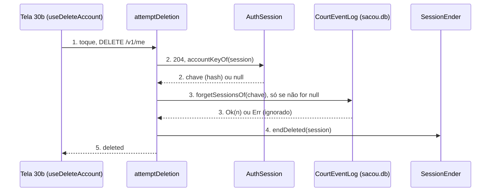
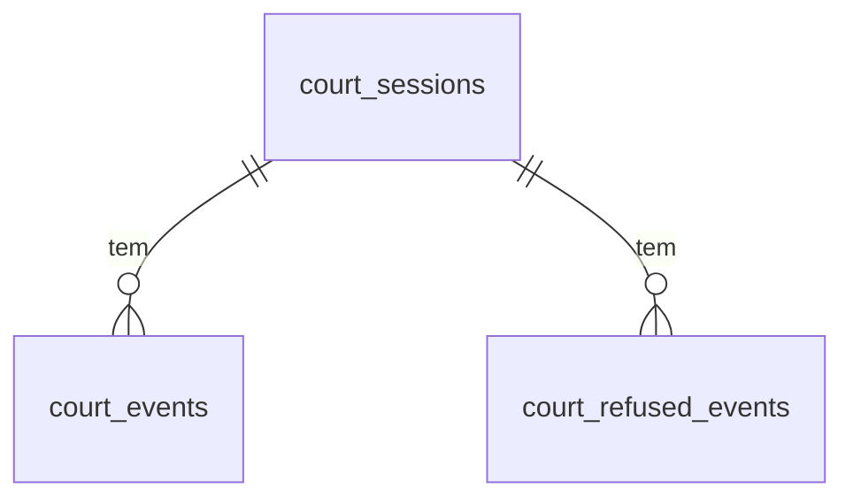

# E6.8 · Quadras de uma conta apagada saem do aparelho

**Approved**:
**Settled mid-build:** none
**Review:**
**Fix pass:**

> **Sensível** (exclusão de conta, dados pessoais, LGPD): `revisor` e `revisor-seguranca` separados. Desenvolvedor **Opus** (tarefa sensível). Nenhuma decisão do Gabriel trava a S1; as perguntas 240 e 241 seguem com a recomendação se ele estiver fora.

## Problem

Quem exclui a conta na tela 30b (`DELETE /v1/me`, 204) sai do app, mas as sessões da quadra que essa conta abriu continuam no `sacou.db` do aparelho: os eventos (inclusive os não enviados), os recusados e o `owner_key` da conta. Ninguém mais os envia: a conta não existe, e o laço só envia as sessões da conta logada (ADR 0067, D8). Ficam no aparelho para sempre, o que o ADR 0067 registrou como risco aceito e a pergunta 225 mandou corrigir. Quem paga: a pessoa que pediu para ser esquecida (os eventos carregam `MemberId` dela e dos outros jogadores) e o próximo dono do aparelho, que vê "Entre com a conta que abriu a quadra" numa quadra que nunca mais vai abrir. Evidência: a linha de risco do ADR 0067; nenhum relato do piloto.

Quando isto sair: depois do 204 da exclusão feita no aparelho, as sessões da quadra cujo `owner_key` é o da conta apagada (abertas ou fechadas, com pendentes ou não) somem do `sacou.db`; as sessões de outras contas e as sem dono ficam como estão.

## Shape

Reusa o `CourtEventLog` (uma operação nova na porta, mesma transação e mesmo par real e falso), o `accountKeyOf` do `AuthSession` (a chave da conta sai do adaptador do Firebase, o UID nunca) e o fluxo da exclusão (`attemptDeletion`). As regras que mudam o resultado (quais sessões saem e em que ordem os passos rodam) ficam em `delete-account-flow.ts` e no repositório SQLite, testados pelo Vitest com o banco falso e com o `node:sqlite` (`node-sqlite-database.test.fixture`), como os outros testes de contrato do log.

1. Toque em "Excluir minha conta" -> `attemptDeletion` (exists) - lê a `SessionIdentity` antes da chamada, como hoje, e chama `DELETE /v1/me`.
2. 204 -> `attemptDeletion` (exists) - calcula a chave da conta com `auth.accountKeyOf(session)` **antes** de encerrar a sessão; `null` (identidade desconhecida) não apaga nada (falha fechada).
3. `CourtAccountForget` (new, porta no consumidor, em `features/account`) -> `CourtEventLog.forgetSessionsOf(ownerKey)` (door 1) - numa transação, apaga `court_events`, `court_refused_events` e `court_sessions` das sessões com aquele `owner_key`; devolve quantas saíram. Falha (`storage-failed`) é engolida: a exclusão nunca é bloqueada nem desfeita por ela.
4. `SessionEnder.endDeleted(session)` (exists) - sem mudança: Firebase, cancelamento das consultas, cache do servidor (`sacou-cache.db`), links de convite, "Pular" do perfil rápido.
5. out: `{ kind: "deleted" }`, a tela 30b segue como hoje (login).

**Changes underneath**

| Front | What changes |
| --- | --- |
| domain | nada: `owner_key` continua sendo a chave da conta que abriu a sessão (ADR 0067, D8) |
| stored data | linhas de `court_sessions`, `court_events` e `court_refused_events` com o `owner_key` da conta apagada são apagadas; sem migração (nenhuma coluna nova) |
| readers | o laço de envio (`court-sync-runner`: a sessão some de `findSessionsToSync`; uma resposta em voo que chama `markAcknowledged` numa sessão apagada recebe `session-not-found`), o resumo de pendentes (`count-unsent`, `use-unsent-points`), a retomada (`findResumableCourtSession`, decidida na abertura do app: a sessão que ela apontava passa a dar `session-not-found`) e o cache de replay em memória (`createCourtReplayer`): critério 7 e risco R2 |

New: nothing - só apaga linhas. One-way constraints: nenhuma.

## Surface

None - nothing consumed outside (só a porta interna `CourtEventLog` ganha uma operação).

## Landing

| One-way door | Literal shape | Alternative rejected |
| --- | --- | --- |
| 1. Operação nova na porta do log local | `forgetSessionsOf(ownerKey: string): Promise<CourtLogResult<number>>` no `CourtEventLog`, uma transação; o `ownerKey` vazio devolve `Ok(0)` sem tocar no banco | Apagar o `sacou.db` inteiro: levaria as sessões de outras contas do mesmo aparelho (o backlog pede que fiquem) e o `deviceId`, que pareia os lotes já enviados no servidor |
| 2. O apagamento mora no fluxo da 30b, não no `SessionEnder` | `DeletionDeps.court: CourtAccountForget` montado no `useDeleteAccount` com `useCourtRuntime().log`; `DeletionDeps.auth` passa a incluir `accountKeyOf`; o `SessionEnder` não muda | Pôr no `SessionEnder.endDeleted`: ele nasce no módulo (`_layout.tsx`), antes do `DatabaseGate` abrir o banco, e precisaria de um registro tardio do log, um padrão que a base não tem. Ver pergunta 240 (o 410 de um login posterior também passa por lá) |

- Nothing else in this change is hard to reverse

## Criteria

### S1: excluir a conta tira do aparelho as quadras dela (P1)

Uma fatia só, de ponta a ponta: porta, repositório real e falso, fluxo da 30b, testes e base de conhecimento.

**Acceptance Criteria**

1. WHEN o `DELETE /v1/me` da tela 30b responde 204 THEN o sistema SHALL apagar do `sacou.db` todas as sessões com `owner_key` igual a `accountKeyOf(sessão lida antes da chamada)`, com seus `court_events` e `court_refused_events`, numa transação só
   - sessão aberta com 3 eventos não enviados → some; sessão fechada já toda confirmada → some; sessão assumida com recusados não vistos → some; sessão com `sync_halt` → some
2. WHILE o aparelho tem sessões de outra conta (`owner_key` diferente), sem dono (`owner_key` nulo) ou de amostra (sem origem), o sistema SHALL mantê-las intactas depois do apagamento: mesmos eventos, cursor, `sync_halt`, recusados e `seen`
   - conta A apagada com 1 sessão de A e 1 de B → `load` da de B devolve exatamente o mesmo `StoredCourtLog` de antes; a de A dá `session-not-found`
3. The sistema SHALL manter a tabela `device` e o `deviceId` depois do apagamento
4. IF o `DELETE /v1/me` não responde 204 (409 `identity.deletion-blocked`, `identity.recent-login-required`, rede, 5xx) THEN o sistema SHALL não apagar nenhuma sessão
   - 409 → nenhuma chamada a `forgetSessionsOf`; reautenticação com sucesso e 204 na segunda tentativa → apaga uma vez só
5. IF `accountKeyOf` devolve `null`, ou `forgetSessionsOf` devolve `Err` (`storage-failed`) ou rejeita, THEN o sistema SHALL seguir para `endDeleted(session)` e devolver `{ kind: "deleted" }`, sem texto novo na tela (o backlog diz "Não bloqueia")
6. WHEN outra conta já está logada quando chega o 204 (resposta atrasada) THEN o sistema SHALL apagar só as sessões da chave da conta apagada (a da sessão lida antes da chamada), nunca as da conta logada agora; o `endDeleted` continua sem efeito nesse caso (comportamento existente)
7. IF o laço de envio tem uma requisição em voo para uma sessão apagada THEN a resposta que chega depois (`markAcknowledged`, `haltSync`, `markTakenOver`) SHALL dar `session-not-found` sem recriar a sessão nem lançar, e o laço segue para as outras sessões
8. IF `forgetSessionsOf` recebe `""` THEN o sistema SHALL devolver `Ok(0)` sem rodar SQL
9. The sistema SHALL não registrar nada em log nem no Sentry sobre o apagamento (nem chave, nem ID, nem contagem)
10. WHEN o apagamento roda THEN a tela 30b SHALL ficar igual a `design/mvp/ExcluirConta.dc.html` (nenhum texto novo; pergunta 241)

**Casos de teste** (Vitest; o contrato do log roda contra `createFakeCourtEventLog` e contra o repositório sobre `openNodeSqliteDatabase`, como `court-sync-log.test.ts`):

- T1 (crit. 1, 2, 3): A com sessão aberta com pendentes, sessão fechada confirmada e sessão assumida com recusados; B com uma sessão com pendentes; uma sem dono; uma de amostra. `forgetSessionsOf(A)` → `Ok(3)`; as três de A dão `session-not-found`; B, a sem dono e a de amostra idênticas; `getDeviceId` igual.
- T2: `findSessionsToSync(deviceId)` depois do apagamento lista só a de B; `findActiveSession` e `findOpenSessionOfRound` não devolvem sessão de A.
- T3 (crit. 8): `forgetSessionsOf("")` → `Ok(0)`, nada muda; chave sem sessões → `Ok(0)`.
- T4: idempotência, duas chamadas → `Ok(3)` e depois `Ok(0)`.
- T5 (crit. 7): depois do apagamento, `markAcknowledged`, `haltSync`, `markTakenOver` e `append` na sessão apagada → `Err(session-not-found)`, nenhuma linha recriada (contagem de `court_sessions` igual). Hoje `markAcknowledged` pode ser um `UPDATE` que afeta 0 linhas e devolve `Ok`: o desenvolvedor confere e, se for `Ok` sem recriar, o critério aceita `Ok` também (o que importa é não recriar nem lançar).
- T6 (transação, só no SQLite): falha forçada depois do primeiro `DELETE` (gatilho `BEFORE DELETE` em `court_sessions` com `RAISE(ABORT)` no `node:sqlite`) → nada apagado, `Err(storage-failed)`.
- T7 (crit. 1, 4, `delete-account.test.ts` com `api`, `auth` e `court` falsos): ordem registrada `deleteMyAccount → accountKeyOf → forgetSessionsOf → endDeleted`; 409, `recent-login-required` de conta de e-mail sem senha e falha de rede → `forgetSessionsOf` nunca chamado; Google com reautenticação e 204 na segunda → chamado uma vez.
- T8 (crit. 5): `accountKeyOf` → `null` → `forgetSessionsOf` não chamado, resultado `deleted`; `forgetSessionsOf` → `Err` e, em outro caso, rejeita → `endDeleted` chamado, resultado `deleted`, `deletionOutcomeText` `null`.
- T9 (crit. 6): troca de conta entre o pedido e o 204 → `forgetSessionsOf` recebe a chave da conta apagada; sessões de B intactas.
- T10 (crit. 7, laço): `court-sync.test.fixture` com envio em voo de uma sessão de A, apagamento antes da resposta 200 → sem exceção, o laço passa para a próxima.
- T11 (crit. 9): espião no relator de erros e no `console` durante T7 e T8 → nenhuma chamada.

**Sub-passos e arquivos** (cerca de 150 linhas de produção):

1. `apps/mobile/src/features/court/ports/court-event-log.ts`: `forgetSessionsOf` com o comentário (door 1).
2. `apps/mobile/src/features/court/persistence/court-sync-statements.ts` (ou `forget-statements.ts` novo): os três `DELETE` (filhos antes do pai, por causa do `REFERENCES`), com parâmetro ligado, nunca concatenado.
3. `apps/mobile/src/features/court/persistence/court-event-repository.ts`: a operação na transação que já existe (desfaz em `Err` e em exceção, ADR 0067, D14).
4. `apps/mobile/src/adapters/fake-court-event-log.ts`: a mesma regra no falso.
5. `apps/mobile/src/features/account/model/delete-account-flow.ts`: `CourtAccountForget` (interface no consumidor, só `forgetSessionsOf`), `DeletionDeps.court`, `auth` com `accountKeyOf`; passos 2 e 3 entre o 204 e o `endDeleted`, num `try` que nunca impede o `endDeleted`.
6. `apps/mobile/src/features/account/hooks/use-delete-account.ts`: monta `court` com `useCourtRuntime().log` (a rota da 30b está dentro do `DatabaseGate`).
7. Testes: contrato do log (`court-sync-log.test.ts` ou `forget-sessions.test.ts` novo), `delete-account.test.ts`, caso no teste do laço.
8. Base de conhecimento: emenda no ADR 0067 (o "Risco aceito" da exclusão vira "resolvido na E6.8", com a ressalva do 410 conforme a resposta 240), `docs/seguranca/dados-pessoais.md` (o `sacou.db` perde as sessões da conta na exclusão), `docs/estado/perguntas.md` (240 e 241).

**Riscos**

- R1. App morto entre o 204 e o apagamento: as sessões ficam, como hoje (nada na próxima abertura sabe que a conta sumiu). Aceito; a janela é de milissegundos.
- R2. O cache de replay em memória (`createCourtReplayer`) ou a retomada (`ResumeOnce`) podem ainda apontar para a sessão apagada até a próxima abertura; depois da exclusão o app vai ao login, e um `load` dá `session-not-found`. O desenvolvedor confere que nenhum dos dois devolve estado da sessão sem passar pelo `load`.
- R3. Concorrência com o laço: o SQLite serializa as transações; T10 cobre a resposta atrasada.

**Emulador:** nenhuma tela muda (crit. 10), então a conferência da DoD 6 não se aplica. Conferência opcional de 5 minutos: conta A abre a quadra de uma rodada e marca 2 pontos; o admin cancela a rodada pelo servidor, e a sessão para com `round-canceled`, mantendo os pontos no aparelho; A exclui a conta na 30b (o grupo precisa não bloquear a exclusão); B entra e abre a 06 da mesma rodada ou do mesmo grupo: nenhuma quadra com "Entre com a conta que abriu a quadra" aparece.

## Out of scope

| Excluded | Why |
| --- | --- |
| Rascunhos da próxima partida (`court:next-match:<matchId>` no `sacou-cache.db`) das sessões apagadas | Guardam só `MemberId` da escalação, por partida; achar os `matchId` exige ler os eventos antes de apagar. Fica como pendência: o rascunho órfão nunca é lido, porque a partida não existe mais no aparelho |
| Cache do servidor, links de convite, "Pular" do perfil rápido | Já saem em toda saída de sessão (`clearSession`, ADR 0057, D4), inclusive na exclusão |
| Preferências do aparelho (tema da quadra, `push-prompt-offered`) | São do aparelho, sem dado pessoal (`stored-push-prompt-memory.ts`); a próxima conta herda, como no logout |
| Apagar pelo 410 de um login posterior (conta apagada em outro aparelho ou reapagada pela E6.3) | Pergunta 240 |
| Sessões sem dono (`owner_key` nulo, de antes da E4.11) | Não dá para saber de quem são; ficam (lacuna aceita do ADR 0067) |

## Assumptions

| Assumption | Chosen default | Rationale | Confirmed? |
| --- | --- | --- | --- |
| O que sai | Toda sessão com o `owner_key` da conta, não só os eventos não enviados | Os enviados já estão no servidor e são tratados lá; deixar a sessão sem os pendentes manteria `MemberId` e uma quadra que ninguém abre | n |
| Quando | Depois do 204, antes do `endDeleted` | Antes do 204 a exclusão ainda pode falhar (409, reautenticação); antes do `endDeleted` a identidade ainda é a da conta apagada | n |
| Falha ao apagar | Engolida, sem texto, sem nova tentativa | Backlog: "Não bloqueia"; a conta já não existe no servidor | n |
| Outra conta no aparelho | As sessões dela ficam intactas e continuam sendo enviadas quando ela entrar | Critério do backlog ("as de outras contas ficam") | y - backlog |

**Open questions:**

- **240** (open): o 410 de um login posterior (a conta foi apagada em outro aparelho, ou reapagada depois de restaurar o backup, E6.3) também deve apagar deste aparelho as quadras dela? Opções: (1) não, só a 30b, como diz o backlog; (2) sim, levando o apagamento para o `SessionEnder.endDeleted` com um registro tardio do log pelo `DatabaseGate`. **Recomendação: 1** no piloto (raro, e o caminho 2 cria um padrão novo); fica como risco aceito no ADR 0067.
- **241** (open): a 30b deve avisar "N pontos desta quadra ainda não foram enviados e vão ser apagados" antes de excluir, como a tela 30 faz no "Sair"? Opções: (1) não, a 30b fica igual ao desenho; (2) sim, uma linha a mais. **Recomendação: 1**: a 30b já diz que os dados da conta são apagados, e a resposta 225 foi só "apagar".

## Differences from the source

None - the product matches the source (`design/mvp/ExcluirConta.dc.html` não muda).

## Sources

- `docs/plano-mvp.md`, linha da E6.8 - binding - critério de aceite
- `docs/estado/perguntas.md`, pergunta 225 - binding - apagar do aparelho
- `docs/arquitetura/adr/0067-sincronizacao-da-quadra-no-app.md`, D8 e Consequências - binding - `owner_key` e o risco que esta tarefa fecha
- `design/mvp/ExcluirConta.dc.html` - binding - tela 30b, sem mudança
- `docs/padroes/frontend.md` - binding - regra 1 (nada copiado: a posse continua derivada do `owner_key`), regra 3 (`CourtAccountForget` no consumidor, real pelo `CourtEventLog`, falso pelo `fake-court-event-log`), regra 4 (o `deleteAccountReducer` não muda; o efeito fica no fluxo, fora do reducer); regra 2 não se aplica (sem layout)
