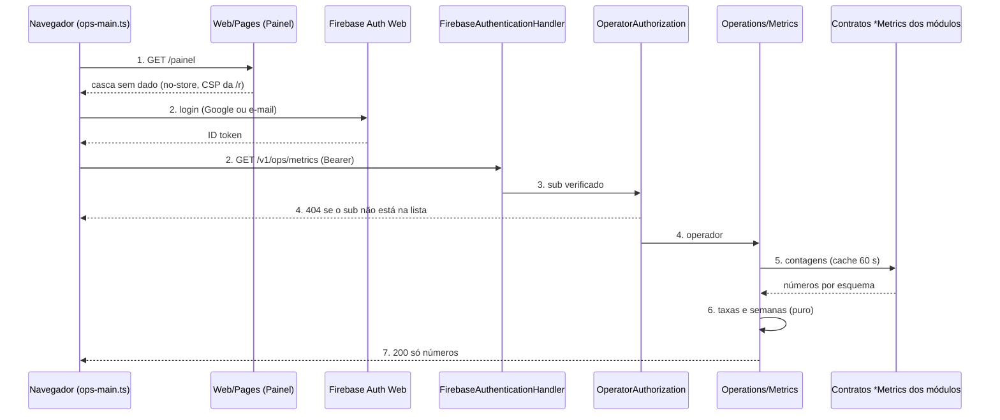
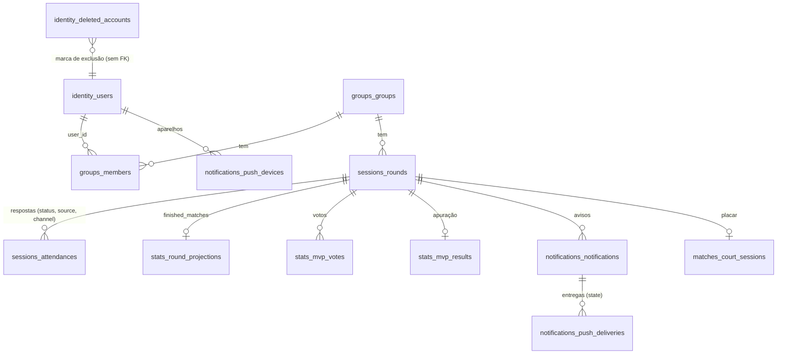
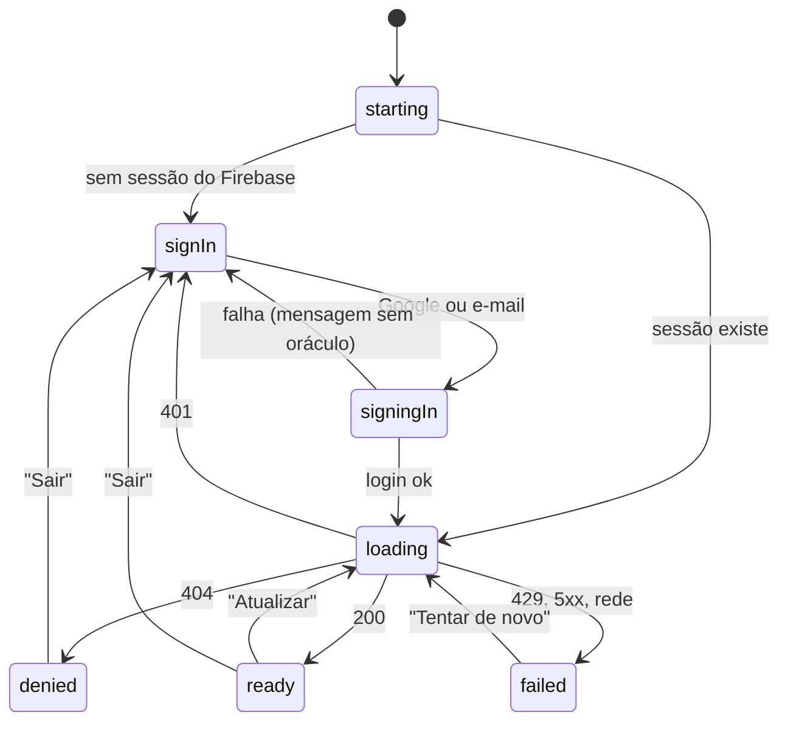

# E7.2 · Painel de métricas do portão (página do operador)

**Approved**: 2026-11-24 - user: "aprovado, pode seguir"
**Settled mid-build:** none
**Review:** <escrito quando a revisão for enviada - sent at <hash>>
**Fix pass:** <escrito quando a correção for feita>

> **Aprovado pelo Gabriel em 24/11/2026** (respostas 213 a 216 no plano; 217 no padrão). A 218 (domínio de produção no Firebase e a variável `SACOU_OPERATOR_UIDS` nos dois ambientes) é ação dele e só bloqueia a página de produção.

## Problem

Hoje o Gabriel não tem como ver se o piloto está funcionando sem abrir o banco do Neon e escrever SQL. O portão da Fase 2 (`produto.md:212`: "5 grupos reais usarem o app por 4 rodadas seguidas, com pelo menos 60% dos confirmados vindo pelo link, e não pela lista do WhatsApp") não é medido em lugar nenhum, embora o banco já guarde a origem de cada resposta (`sessions.attendances.channel` `app`/`web` e `source` `self`/`admin`/`regular`, ADR 0070 D3, "Canal (para a E7.2)"). Também não há visão de cadastros, exclusões, notificações que falham ou aparelhos registrados. O custo: o M7 (piloto) não tem o "relatório semanal com as métricas" que o plano promete (`plano-mvp.md:78`), e um problema de push ou de adesão ao link só aparece quando um jogador reclama. Evidência: o pedido literal em `request.md`; nenhum número de uso foi dado.

Quando isto sair, o Gabriel abre `https://<serviço>.run.app/painel` no PC, entra com a conta dele e vê, em cada ambiente, só contagens e taxas: cadastros, grupos, rodadas, a taxa do portão, partidas, votos do MVP e a saúde das notificações, sem nenhum nome, e-mail, apelido ou ID.

## Shape

Reaproveita a casca web da `/c` (Razor Page sem dado do servidor, script do Vite com o login Firebase Web, reducer e controlador por portas, folha de login compartilhada, cabeçalhos e CSP da `/r`) e o padrão de autenticação do ADR 0036; nada de serviço, conta paga ou PostHog (ADR 0046). As regras que mudam o resultado (quem é operador, o que conta como confirmação pelo link, ativo, semana, taxa com denominador zero) rodam no C#: funções puras com testes xUnit e consultas por módulo com testes de integração no Postgres real (`Sacou.Integration.Tests`); o script só desenha o que a API devolveu.

1. O Gabriel abre `GET /painel` -> `Sacou.Api/Web/Pages` (exists) - Razor Page casca (como `Invite.cshtml`), anônima, sem dado nenhum do servidor, com a config Web do Firebase em `data-`; limitador `round-page` por endereço.
2. Script `apps/web/src/ops-main.ts` (new) - login pela folha da tela 02 (`Shared/_SignInSheet.cshtml`, `dom/sign-in-sheet.ts`, exists), depois `GET /v1/ops/metrics` com `Authorization: Bearer`, `credentials: "omit"`.
3. `FirebaseAuthenticationHandler` (exists) - confere o ID token (ADR 0036); principal com o `sub`.
4. `OperatorAuthorization` (new, door 1) - o `sub` está em `Operations:OperatorSubjects` do ambiente? Não: 404. Sim: segue. Limitador `ops` (new) por usuário.
5. `Operations/Metrics` (new, fatia vertical na API) - lê do cache de 60 s ou chama os contratos de leitura agregada de cada módulo (door 2): `Identity.Contracts.IIdentityMetrics`, `Groups.Contracts.IGroupsMetrics`, `Sessions.Contracts.ISessionsMetrics`, `Stats.Contracts.IStatsMetrics`, `Notifications.Contracts.INotificationsMetrics` (todos new) - cada um conta só no próprio esquema e devolve números.
6. `OpsMetricsCalculator` (new, puro) - junta os números, faz as taxas (denominador zero vira `null`) e as semanas (segunda-feira, `America/Sao_Paulo`).
7. out: `200 OpsMetricsResponse` (só inteiros, taxas e instantes; lista fechada por teste de reflexão), `Cache-Control: no-store`; o script desenha com `textContent`.

**Changes underneath**

| Front | What changes |
| --- | --- |
| domain | Nenhum termo muda. "Operador" é novo e não é papel de grupo (`Role` Admin/Co-admin/Player não muda); ninguém ramifica nele fora da fatia `Operations` |
| stored data | Nada a migrar: só leitura. Rodadas anteriores à E3.12 têm `channel = app` (padrão da migração) e entram como "app" |
| readers | A nova página `/painel` de cada ambiente; nenhum leitor antigo vê dado novo |

New: nothing - read only. Nenhuma coluna nova (se a pergunta 214 escolher a opção 2, vira door 4 e migração).

Estados da página (reducer, como o da `/c`):

## Surface

| Route | In | Out | Status | Who |
| --- | --- | --- | --- | --- |
| `GET /painel` (e `HEAD`) | nada (query ignorada, nunca refletida) | casca HTML sem dado, `no-store` | `200`; `429` HTML curto com `Retry-After`; POST cai no `401` do padrão seguro | qualquer um (a casca não tem dado); limitador `round-page` 60 / 60 s por endereço |
| `GET /v1/ops/metrics` | `Authorization: Bearer <ID token>`; sem corpo; query recusada | `OpsMetricsResponse` (contagens, taxas `0..1` ou `null`, `generatedAt`, `cachedUntil`, `environment`) | `200`; `401` sem token ou token inválido; `404` `ops.not-found` para conta fora da lista (mesmo corpo de rota inexistente); `429` `Retry-After` | só `sub` em `Operations:OperatorSubjects` do ambiente; não exige `POST /v1/me` |

## Landing

| One-way door | Literal shape | Alternative rejected |
| --- | --- | --- |
| 1. Autorização de operador (padrão novo) | `Operations:OperatorSubjects` = lista de UIDs do Firebase, lida da variável de ambiente `Operations__OperatorSubjects` (separada por vírgula) que o `service.yaml` recebe pelo `envsubst` da variável de ambiente do GitHub `vars.SACOU_OPERATOR_UIDS` (environments `test` e `production`); vazia = ninguém entra (fecha); cada item conferido na partida pelo formato do `AuthSubject` (1 a 128 ASCII visíveis), mensagem com a chave e nunca o valor; política `OperatorOnly` aplicada só às rotas `/v1/ops/*`; resposta 404 para não operador | **Papel no banco** (`identity.users.is_operator`): migração, concessão por SQL em produção e mais um dado sobre a pessoa. **E-mail na lista:** a API não recebe nem guarda e-mail e aceita e-mail não verificado (ADR 0036, D3), então um e-mail não prova nada. **Token fixo na URL ou cabeçalho:** vai para o log do Cloud Run e o navegador não manda cabeçalho sozinho. **IAP / Cloud Run IAM:** pediria balanceador (pago) ou outro serviço |
| 2. Leitura agregada entre módulos (padrão novo) | Cada módulo expõe em `Contracts` uma interface `I<Módulo>Metrics` que devolve só números (`record` com `int`/`long`), contando no próprio esquema; a fatia `Operations` compõe. Nenhum contrato `*Metrics` devolve `MemberId`, `UserId`, nome ou texto livre (teste de reflexão) | **SQL direto em vários esquemas numa fatia só:** quebra o "cada módulo dono do seu esquema" e vira precedente de leitura cruzada. **Visão materializada / tabela de métricas:** migração e job (a API não pode ter `BackgroundService`, ADR 0068 D2) |
| 2b. *(achada no build, S2)* Chave e nome do grupo nos contratos | `IGroupsMetrics.ListAsync` devolve `CountedGroup(Guid GroupId, string Name, DateTimeOffset CreatedAt)` e `ISessionsMetrics` devolve `HeldWeek(Guid GroupId, DateOnly WeekStart, int Rounds, int Confirmed, int SelfAnswered, int ByLink)`: o `GroupId` só junta os dois dentro da API e nunca sai na resposta; o `Name` é o da resposta 216. Os tipos comuns (`MetricsPeriod`, `WeeklyCount`) ficam em `Sacou.Shared.Metrics`. Teste de reflexão (`MetricsContractsShapeTests`) só aceita número, data, instante, `CountedGroup.GroupId`, `HeldWeek.GroupId` e `CountedGroup.Name` | **Rótulo por grupo calculado no Sessions:** o Sessions teria de ler o nome do Groups (leitura cruzada). **Contrato do Sessions agrupando por nome:** nome não é chave (dois grupos podem ter o mesmo) |
| 3. Rota `/painel` e `GET /v1/ops/metrics` nas listas fechadas | Entram na lista de Razor Pages do teste de arquitetura, na lista de rotas sem `{groupId}` (ADR 0040 D4) e na tabela método + rota → política (ADR 0062); política `ops` (`RateLimiting:Ops`, 20 / 60 s por usuário) | Sem limitador: a página acorda o Neon e roda ~15 contagens a cada carga |
| 4. *(só se a 214 for a opção 2)* `identity.users.last_seen_at` | `timestamptz` anulável, gravado no `POST /v1/me` no máximo 1 vez por dia | Derivar de ações gravadas (recomendado; sem dado pessoal novo) |

- Nada mais aqui é difícil de reverter: o formato da resposta só tem o script do próprio painel como consumidor.

## Criteria

### S1: o Gabriel entra no painel e vê os cadastros (P1)

A casca, o login, a lista de operadores e a primeira seção (usuários) funcionando de ponta a ponta no ambiente de teste.

**Acceptance Criteria**

1. WHEN alguém abre `GET /painel` THEN a API SHALL responder 200 com a casca HTML que não contém número, nome, ID nem texto vindo do banco, com `Cache-Control: no-store`, `X-Robots-Tag: noindex, nofollow`, `X-Frame-Options: DENY`, `Referrer-Policy: strict-origin` e a CSP da `/r` (ADR 0070 D5, sem `unsafe-inline`, `unsafe-eval` nem curinga)
   - com `?x=<script>` na query → a resposta não contém `x` nem `<script>`; `POST /painel` → 401 do padrão seguro; `/painel/qualquer` → sem endpoint
2. WHILE não há sessão do Firebase na aba, a página SHALL mostrar a folha de login da tela 02 (Google e e-mail; no navegador embutido, o aviso de abrir no navegador) e nenhuma requisição a `/v1/ops/metrics`
3. WHEN o `sub` do token está em `Operations:OperatorSubjects` THEN `GET /v1/ops/metrics` SHALL responder 200 com `Cache-Control: no-store`
4. IF o `sub` não está na lista THEN a API SHALL responder 404 com o mesmo corpo de uma rota inexistente e registrar só `ops.denied`, nunca o `sub`
   - lista `["abc"]`, token `abc` → 200; token `abd` → 404; token `ABC` → 404 (comparação ordinal exata); lista vazia → 404 para todos; token ausente ou vencido → 401
5. IF `Operations__OperatorSubjects` tem item fora do formato do `AuthSubject` (vazio, espaço, acima de 128 caracteres, não ASCII) THEN a API SHALL recusar a partida com a chave `Operations:OperatorSubjects` na mensagem e sem o valor
   - `"abc, def"` (espaço depois da vírgula) → aparado e aceito; `"abc,,def"` → recusa (item vazio); variável ausente → sobe com lista vazia
6. WHEN o operador abre o painel THEN a página SHALL mostrar a seção "Usuários" com: cadastrados (total de `identity.users`), novos em cada uma das últimas 8 semanas (segunda a domingo, `America/Sao_Paulo`, semana atual incluída e parcial), contas excluídas no total e por semana (`identity.deleted_accounts.deleted_at`)
   - usuário criado domingo 23:30 em São Paulo (segunda 02:30 UTC) → conta na semana do domingo; semana sem cadastro → 0, nunca ausente
7. WHEN a página mostra os números THEN SHALL mostrar o ambiente ("Teste" ou "Produção", de `environment`) e "Atualizado às HH:MM" (de `generatedAt`, hora de São Paulo)
8. WHEN o operador usa "Atualizar" THEN a página SHALL pedir de novo e, se o cache de 60 s ainda vale, mostrar os mesmos números com o mesmo "Atualizado às"
9. WHEN o operador usa "Sair" THEN a página SHALL encerrar a sessão do Firebase e voltar à folha de login, sem números na tela
10. IF a resposta é 404 THEN a página SHALL mostrar "Esta conta não tem acesso ao painel." e o botão "Sair", sem número nenhum
11. IF a resposta é 429 THEN a página SHALL mostrar "Muitas atualizações seguidas. Tente de novo em N s." com o `Retry-After`; IF 5xx ou sem conexão THEN "Não foi possível carregar o painel." e "Tentar de novo"
12. WHILE a resposta não chegou, a página SHALL mostrar "Carregando…" sem números antigos de outra conta
13. The `OpsMetricsResponse` SHALL ter só campos numéricos, de taxa, de instante, o rótulo do ambiente e, no recorte por grupo, o nome do grupo (resposta 216); teste de reflexão com a lista fechada; nenhum `Guid`, outra `string` livre ou coleção de membros
14. WHEN chegam mais de 20 pedidos de `/v1/ops/metrics` do mesmo usuário em 60 s THEN o 21º SHALL receber 429 com `Retry-After`
15. WHEN dois pedidos chegam dentro de 60 s THEN o segundo SHALL sair do cache, sem consulta ao banco (teste com contador no contrato falso); depois de 60 s, nova consulta
16. The script SHALL escrever na página só por `textContent` (lint do pacote já proíbe `innerHTML` e afins) e a página SHALL funcionar de 360 px a 1920 px de largura, só com unidades relativas, alvos de pelo menos 2,75 rem e contraste AA

### S2: a taxa do portão e as rodadas (P1)

O número que decide a Fase 2, com o recorte por grupo.

**Acceptance Criteria**

17. WHEN o operador abre o painel THEN a página SHALL mostrar a seção "Grupos": total de `groups.groups` e ativos (grupo com pelo menos 1 rodada não cancelada com `starts_at` nos últimos 30 dias)
18. WHEN o operador abre o painel THEN a página SHALL mostrar a seção "Rodadas": criadas (total e por semana, por `created_at`), realizadas (não canceladas com `starts_at` no passado), encerradas (`closed_at` preenchido) e canceladas (`status = canceled`)
19. WHEN o operador abre o painel THEN a página SHALL mostrar a seção "Portão" com a taxa definida na pergunta 215 e, ao lado, a meta "60%", em cada uma das últimas 8 semanas (pela semana do `starts_at` da rodada) e no total
   - regra pela recomendação da 215: só rodadas realizadas; confirmado = `status` em `going` ou `promoted`; pré-confirmação dos mensalistas (`source = regular`) fora do numerador e do denominador; taxa do portão = `source = self` ÷ confirmados; também mostra a fatia "pelo link" = `source = self` e `channel = web` ÷ confirmados
   - 3 confirmados `self/web`, 1 `self/app`, 2 `admin`, 4 `regular` → portão 4/6 = 67%, pelo link 3/6 = 50%; rodada cancelada com 10 `self/web` → não entra; rodada que ainda não começou → não entra; semana sem rodada → "—", nunca 0%
20. IF o denominador é 0 THEN a API SHALL devolver a taxa `null` e a página SHALL mostrar "—"
21. WHEN o operador abre o painel THEN a página SHALL mostrar, por grupo (rótulo da pergunta 216, ordem de criação do grupo), rodadas realizadas, confirmados, taxa do portão, a maior sequência de semanas seguidas com rodada realizada e se o grupo cumpre "4 rodadas seguidas com 60% ou mais" (sim ou não)
   - rodadas realizadas nas semanas 1, 2, 3, 4 com taxas 70, 60, 65, 80% → cumpre; 1, 2, 4, 5 → não (sequência quebrada); 4 seguidas com uma de 59% → não
22. The página SHALL mostrar "Grupos que cumprem o portão: N de 5"
23. The contagem SHALL usar o `channel` e o `source` gravados na linha atual (última resposta que mudou a linha, ADR 0070 D3): uma resposta pelo link depois mudada pelo app conta como app

### S3: jogo, MVP, notificações e saúde (P2)

O resto do que o Gabriel pediu ("notificações e outros módulos úteis").

**Acceptance Criteria**

24. WHEN o operador abre o painel THEN a página SHALL mostrar "Jogo": partidas terminadas (soma de `stats.round_projections.finished_matches`) e rodadas com placar (`matches.court_sessions`), no total e por semana
25. WHEN o operador abre o painel THEN a página SHALL mostrar "MVP": votos (`stats.mvp_votes`), rodadas apuradas (`stats.mvp_results`) e média de votantes por rodada apurada (`null` sem apuração)
26. WHEN o operador abre o painel THEN a página SHALL mostrar "Notificações": avisos criados (`notifications.notifications`, total e últimos 7 dias), entregas por estado (`pending`, `sending`, `sent`, `delivered`, `failed`, `unknown`, `expired`, cada um com contagem, 0 incluído), taxa de falha = (`failed` + `expired`) ÷ entregas encerradas, aparelhos ativos por plataforma (`disabled_at` nulo, `android`/`ios`) e desativados por motivo (`not_registered`, `over_device_limit`)
27. WHEN o operador abre o painel THEN a página SHALL mostrar "Usuários ativos" nos últimos 7 e 30 dias pela definição da pergunta 214
   - pela recomendação: usuário distinto com pelo menos uma destas no período: resposta de presença própria (`source = self`, `responded_at`), aparelho visto (`push_devices.last_seen_at`), início de placar (`court_writers.started_at`) ou voto do MVP (`cast_at`); a mesma pessoa em três ações conta 1; ação há 30 dias e 1 minuto → fora dos 30 dias
28. WHEN o operador abre o painel THEN a página SHALL mostrar "Saúde": mensagens do outbox pendentes e postas de lado (`set_aside_at` preenchido)
29. The resposta inteira SHALL sair de uma consulta por métrica sem varredura por linha no C# (agregação no Postgres), e cada contrato `*Metrics` SHALL ter teste de integração com dados semeados no Postgres real

## Out of scope

| Excluded | Why |
| --- | --- |
| 429 por política do limitador | Não fica no banco; o limitador vive na memória e o Cloud Logging já tem os logs. Pôr no banco seria escrita por requisição. Fica para o Cloud Monitoring |
| Gráficos | Tabelas e números bastam para o portão; gráfico pede biblioteca nova no `apps/web` |
| Exportar CSV, relatório semanal por e-mail | O plano fala em "relatório semanal": o painel é a fonte; mandar e-mail pede serviço novo (custo) |
| Qualquer dado de pessoa, lista de usuários, busca por grupo | Pedido: "só contagens e sem dado pessoal" |
| Tela no app | Pedido: página do navegador, como a `/termos` |
| Ações de operador (apagar, bloquear, reenviar push) | Só leitura; ação de operador é superfície de ataque nova |
| Excluir grupos ou contas de teste da produção | Pergunta 217 (padrão: contar tudo) |

## Assumptions

| Assumption | Chosen default | Rationale | Confirmed? |
| --- | --- | --- | --- |
| Semana | Segunda a domingo em `America/Sao_Paulo`, 8 semanas mais a atual | Piloto no Brasil; o racha é semanal | n |
| Cache | 60 s na memória do processo (`maxScale` 1, ADR 0068 D2), mesmo valor para os operadores | Contagens leves; evita acordar o Neon a cada clique | n |
| Contagens pequenas | Sem supressão (sem "menos de 5"): só o operador vê, só agregados, nenhuma linha por pessoa | O Gabriel é o controlador e já vê o banco; esconder números pequenos tira o sentido do piloto de 3 a 5 grupos. O risco que fica é o vazamento da resposta: por isso 404, `no-store` e lista fechada de campos | n |
| Provedor de login do operador | Google e e-mail, como a `/r` | Mesma folha; o 2FA é da conta Google do Gabriel | n |
| Tempo limite das consultas | 5 s por consulta; estourou → 503 e "Não foi possível carregar o painel." | Neon 0,25 CU acordando | n |
| Visual | Sem tela em `design/mvp/`: tema e fontes da `/r`, entrada de CSS própria no Vite | ADR 0083 D6 fez o mesmo | n |
| Logs | Só `ops.served` / `ops.denied` e a duração; nunca `sub`, IP nem números | Eventos e logs sem dado pessoal | n |

**Open questions:**

- **213 · Quem entra e onde fica a lista** (`blocks`). 1) Login Firebase na página e lista de UIDs do Firebase por ambiente numa variável do GitHub (`vars.SACOU_OPERATOR_UIDS`, environments `test` e `production`), fora do repositório (**recomendado**: custo zero, sem migração, ele copia o UID no console do Firebase). 2) O mesmo, com a lista no Secret Manager (mais um segredo por ambiente e permissão para a conta de execução). 3) Papel de operador numa coluna do banco (migração e concessão por SQL).
  - **Resposta do Gabriel (24/11/2026):** opção 1, variável do GitHub, mas "essa variável deve aceitar mais de 1 usuário": `SACOU_OPERATOR_UIDS` é uma lista de UIDs separados por vírgula (espaços ignorados, entradas vazias descartadas), com teste para 0, 1 e 2 UIDs.
- **214 · O que é "usuário ativo"** (`blocks`). 1) Derivar das ações já gravadas: resposta de presença própria, aparelho visto pelo push, início de placar ou voto, nos últimos 7 e 30 dias (**recomendado**: sem dado pessoal novo; quem só abre o app sem push nem resposta não conta). 2) Nova coluna `last_seen_at` em `identity.users`, gravada no máximo 1 vez por dia (dado pessoal novo, migração, atualiza a política de privacidade). 3) Deixar fora.
  - **Resposta do Gabriel (24/11/2026):** opção 1, derivar das ações já gravadas.
- **215 · Qual número é o portão de 60%** (`blocks`). `produto.md:212` diz "vindo pelo link, e não pela lista do WhatsApp"; o banco separa quem respondeu sozinho (`self`) de quem o admin marcou (`admin`) e, entre os sozinhos, `web` de `app`. 1) Portão = respostas do próprio jogador (link ou app) ÷ confirmados, sem a pré-confirmação dos mensalistas; o painel mostra também a fatia só pelo link (**recomendado**: o contrário de "lista do WhatsApp" é o admin digitando, e quem confirma no app é ainda melhor). 2) Portão = só pelo link web ÷ confirmados. 3) Igual à 1, mas com os mensalistas pré-confirmados no denominador.
  - **Resposta do Gabriel (24/11/2026):** opção 1: portão = respostas do próprio jogador (link ou app) ÷ confirmados sem os mensalistas pré-confirmados; a fatia só pelo link aparece à parte.
- **216 · Como aparece cada grupo no recorte** (`blocks`). 1) "Grupo 1, 2, 3…" pela ordem de criação, sem nome (**recomendado**: nome de grupo pode ter nome de gente, como "Vôlei do Zé"; ele reconhece pela ordem e pelo número de membros). 2) Com o nome do grupo. 3) Sem recorte por grupo, só totais (não dá para conferir "5 grupos por 4 rodadas").
  - **Resposta do Gabriel (24/11/2026):** opção 2, com o nome do grupo. Consequência: `/v1/ops/metrics` passa a levar o nome de cada grupo (pode identificar pessoas), visível só a quem está em `SACOU_OPERATOR_UIDS`; registrar em `dados-pessoais.md` (finalidade: acompanhamento do piloto pelo operador), manter `no-store` e nunca logar o corpo.
- **217 · Grupos de teste na produção** (`open`). 1) Contar tudo (**recomendado**: cada ambiente tem o seu painel; a produção só recebe o piloto). 2) Lista de grupos excluídos por configuração.
  - **Resposta do Gabriel (24/11/2026):** não perguntada; segue o padrão recomendado (contar tudo).
- **218 · Ação de conta do Gabriel** (`blocks go-live`, só a página de produção). Pôr o domínio `*.run.app` da produção nos domínios autorizados do Firebase e nos referenciadores da chave Web (hoje só o teste está, ADR 0070 D8), e criar `vars.SACOU_OPERATOR_UIDS` nos environments `test` e `production` do GitHub. Sem isso, o painel de produção abre e o login falha; o de teste funciona.

## Differences from the source

None - não há captura nem tela em `design/mvp/` para o painel; a página segue o visual da `/r`.

## Sources

- `request.md` - binding - o pedido literal e o formato aprovado (página da API, só a conta dele, só contagens, custo zero)
- `docs/plano-mvp.md:78`, `:199` - binding - E7.2, aceite "60% pelo link medido", depende de E3.4 e E3.12
- `docs/produto.md:212`, `:381` - binding - definição do portão da Fase 2
- ADR 0046 - binding - sem PostHog, contagem no banco
- ADR 0070 D3 a D7 - binding - `channel`, casca web, login, CSP, cabeçalhos, limitador por endereço
- ADR 0083 D5 e D6 - binding - padrão de página servida pela API, estilo próprio
- ADR 0036 D3 e D7 - binding - identidade pelo `sub`, e-mail não verificado, 401 sem oráculo
- ADR 0068 D2, D3 - binding - `maxScale` 1, sem trabalho em segundo plano, variáveis por ambiente

## Build notes (para o orquestrador)

- **Sensível:** sim (login, autorização nova, agregados do banco). `revisor` e `revisor-seguranca` separados; desenvolvedor Opus.
- **Partes:** estimativa de ~1.800 linhas. Parte 1 = S1 + S2 (o portão); Parte 2 = S3.
- **Base de conhecimento:** ADR novo (operador e leitura agregada, doors 1 a 3), linha em `.specs/STATE.md` para as doors 1 e 2 depois da aprovação, seção nova em `modelo-de-ameacas.md` (página do operador: S falsificar operador, I vazamento dos agregados, D abuso), linha em `dados-pessoais.md` só se a 214 for a opção 2, `segredos.md`/`gcp-configuracao.md` com o nome `SACOU_OPERATOR_UIDS` (não é segredo; fica fora do repo por ser identificador da conta).
- **Casos de teste extras:** sabotar a comparação do `sub` (case-insensitive, `Contains` em vez de igualdade), trocar `going` por todos os estados no denominador, esquecer o filtro de cancelada, a borda do fuso no domingo à noite, o cache servindo depois de 60 s, e conferir que `/painel` sem login não chama a API (espião no `fetch`).
