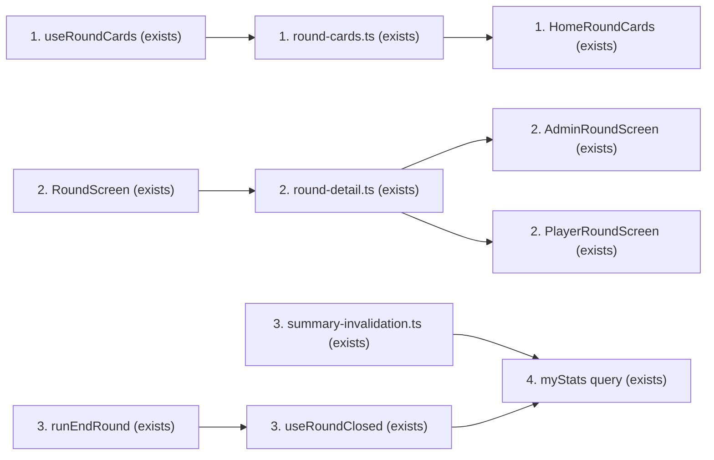
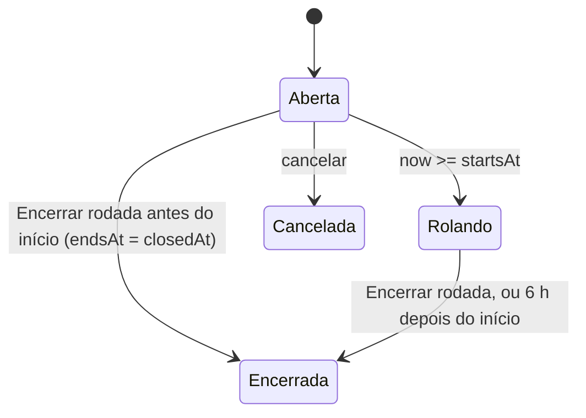
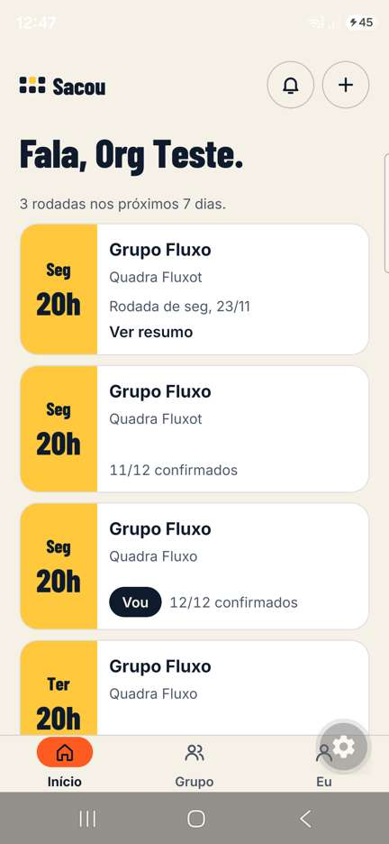
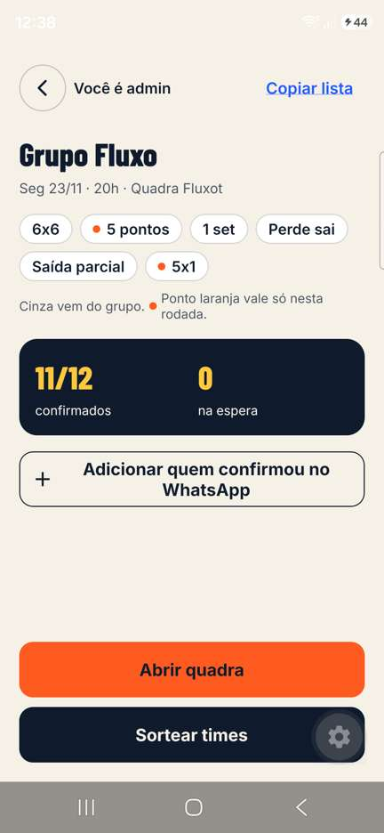
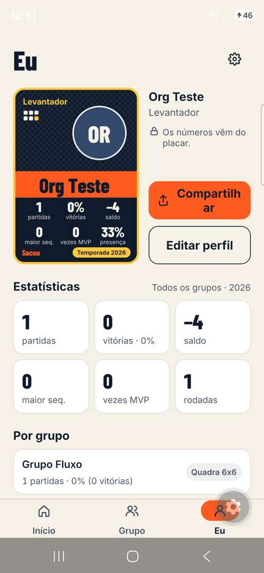
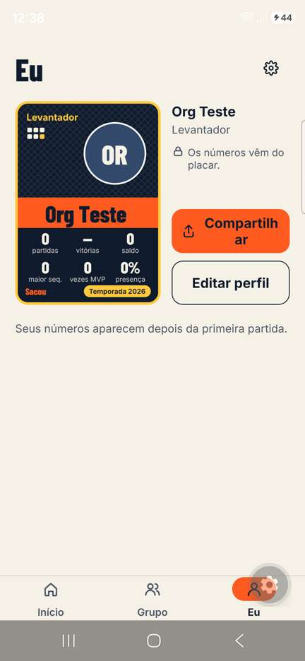
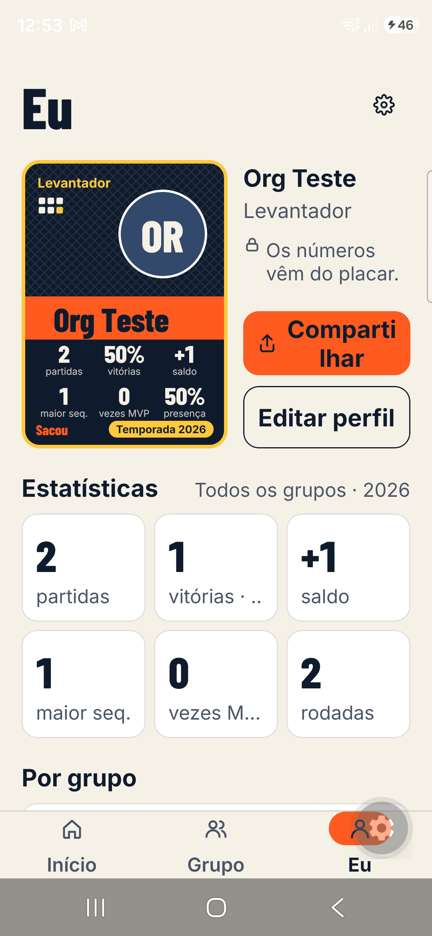

# R99 · Defeitos do percurso de 23/11 (Início, rodada encerrada, cartinha)

**Approved**: 2026-11-23 - user: "aprovado, pode seguir"
**Settled mid-build:** botões da aba Eu - user: "Manter embaixo da cartinha (Recomendado)" (23/11, ADR 0077)
**Review:** sent at 8a2d8b46
**Fix pass:** done - 06 sem "Tirar" e 26 sem presença na rodada encerrada (`adminRoundOffers`, `presenceCard`), testes das ações da 06 e do "Ver resumo", selo fora do verde (`79577d5f`); arranjo da aba Eu registrado no ADR 0077 e travado por teste

## Problem

Encerrar uma rodada antes do horário (R98 P2) move o `endsAt` dela para o passado, mas o `startsAt` continua no futuro. Hoje o app decide o que é "próxima rodada" só pelo `startsAt`. Por isso uma rodada encerrada aparece no Início duas vezes, uma com "Ver resumo" e outra como aberta (print `docs/operacao/percurso-m5/116-inicio-duplicado.jpg`). Ela também entra no "3 rodadas nos próximos 7 dias" e continua como "Próxima: seg 23/11" no cartão do grupo. A página da rodada (telas 06 e 26) não tem estado de encerrada e segue oferecendo "Abrir quadra", "Sortear times" e "Adicionar quem confirmou" (print `104-seg-pagina-pos-encerrar.jpg`). O link "Resumo da rodada" só aparece depois do horário de início, então some justamente na rodada encerrada antes da hora.

A cartinha da aba Eu continua com os números antigos depois de uma partida e do encerramento, até recarregar o app (print `119-cartinha-desatualizada.jpg`), porque `["me","stats"]` não é invalidada. O botão "Compartilhar" quebra no meio da palavra ("Compartilh / ar") com fonte 1.0 (print `106-eu-cartinha-zerada.jpg`). Com fonte 1.3, "vitórias · 50%" e "vezes MVP" ficam cortados (print `122-cartinha-fonte-1-3.jpg`). Quem paga é o organizador do piloto: ele vê a lista errada, pode reabrir a quadra de uma rodada fechada e não vê o próprio resultado. Fonte: o percurso de 23/11 (PR #226, passos 38 a 45).

**O que muda com a R99:** uma rodada encerrada aparece uma vez só, como "Ver resumo". A página dela diz que acabou e leva ao resumo. A cartinha mostra os números novos sem recarregar, e os textos dela não quebram nem cortam palavras.

## Shape

A R99 reaproveita a regra que já decide "encerrada" na tela Rodadas do grupo (`groupRoundState` em `features/rounds/model/group-rounds.ts`, `endsAt <= now`) e o `useRoundClosed`. Não nasce regra nova paralela. Toda regra que muda o resultado roda nos modelos puros (`round-cards.ts`, `round-detail.ts`) e numa função de invalidação testável com um `QueryClient`, todos ao alcance do Vitest do app.

1. A lista de rodadas do grupo (`GET /v1/groups/{id}/rounds`) chega a `useRoundCards` (exists). Em `round-cards.ts` (exists), uma rodada com `endsAt <= now` sai de `nextRoundOf`, `upcomingRoundsOf` e `roundsInWindow` e fica só em `recentRoundOf`. `HomeRoundCards` (exists) e o cartão do grupo mostram o resultado.
2. Ao abrir a rodada (`GET .../rounds/{id}`), `RoundScreen` (exists) segue para `AdminRoundScreen` ou `PlayerRoundScreen` (exists). Um predicado de encerrada em `round-detail.ts` (exists) troca o rodapé de ações pelo selo "Encerrada" e o botão "Ver resumo". `summaryAvailable` passa a valer também para a rodada encerrada antes do início.
3. "Encerrar rodada" chama `runEndRound` → `onServerClosed` → `useRoundClosed` (exists). Ele já invalida a rodada, o resumo e a lista, e passa a invalidar também `queryKeys.myStats()`. Quando o servidor confirma pontos de uma rodada, a invalidação do resumo (`summary-invalidation.ts`, exists) passa a invalidar também `myStats`.
4. Saída: a 06, o Início e a aba Eu leem de novo da API na próxima renderização. Nada novo é gravado.

**Changes underneath**

| Front | What changes |
| --- | --- |
| domain | "próxima rodada" passa a querer dizer agendada, com início no futuro **e ainda não encerrada** (`endsAt > now`). Usam isso: `HomeRoundCards`, o cartão do grupo em Grupos e `roundsInWindow`. |
| stored data | nada a migrar: só leitura do `endsAt` que a API já manda |
| readers | Início (03), cartão do grupo (17), telas 06 e 26, aba Eu (14) |

Data: none - só lê `RoundSummary.endsAt` e `Round.endsAt`, que a API já manda.

## Surface

None - nothing consumed outside. Nenhuma rota nova nem mudança de contrato.

## Landing

None - a R99 só mexe em regras de leitura do app e em layout; não há esquema, contrato nem dependência novos.

- Nothing else in this change is hard to reverse

## Criteria

### S1: Rodada encerrada aparece uma vez só no Início (P1)

O organizador encerra a rodada antes do horário e o Início mostra só o cartão "Ver resumo" dela.

**Acceptance Criteria**

1. IF uma rodada agendada tem `endsAt <= now` THEN `upcomingRoundsOf` e `nextRoundOf` SHALL não incluí-la, mesmo com `startsAt > now`
   - encerrada às 12h, início às 20h, agora 12h05 → fora; `endsAt` exatamente igual a `now` → fora; `endsAt` 1 ms depois de `now` → dentro
2. IF uma rodada agendada tem `endsAt <= now` THEN `roundsInWindow` SHALL não contá-la
   - 3 rodadas na janela, 1 encerrada antes do início → "2 rodadas nos próximos 7 dias."
3. WHEN uma rodada é encerrada antes do início THEN o Início SHALL mostrar um único cartão dela, com "Ver resumo", que abre o resumo (12)
4. WHEN a única rodada futura de um grupo foi encerrada THEN o cartão do grupo SHALL não dizer "Próxima: <data dela>": mostra a próxima não encerrada, ou o estado sem próxima rodada que já existe
5. WHEN o organizador volta ao Início depois de "Encerrar rodada" THEN o Início SHALL refletir o encerramento sem recarregar o app (a lista já é invalidada por `useRoundClosed`; o teste confirma)

### S2: A página de uma rodada encerrada diz que acabou (P1)

**Acceptance Criteria**

6. WHILE a rodada tem `endsAt <= now` e não está cancelada, a tela 06 (admin) SHALL mostrar o selo "Encerrada" e o botão "Ver resumo", e SHALL não mostrar "Abrir quadra", "Sortear times"/"Montar times" nem "Adicionar quem confirmou no WhatsApp"
7. WHILE a rodada tem `endsAt <= now`, a tela 26 (jogador) SHALL mostrar o mesmo selo e o mesmo botão, sem o rodapé de presença (VOU / Não vou)
8. WHEN alguém toca em "Ver resumo" na 06 ou na 26 THEN o app SHALL abrir o resumo (12) dessa rodada
9. The rule `summaryAvailable` SHALL valer para uma rodada não cancelada com `startsAt <= now` **ou** `endsAt <= now`
   - encerrada antes do início → disponível; aberta e futura → não; cancelada → não
10. WHEN o organizador encerra a rodada pela quadra e volta para a 06 THEN a 06 SHALL mostrar o estado encerrado sem recarregar o app
11. The app SHALL tirar os textos "Encerrada" e "Ver resumo" de `src/strings/` (reaproveitando os da tela Rodadas do grupo quando forem iguais); a lista de confirmados continua visível

### S3: A cartinha mostra os números novos sem recarregar (P1)

**Acceptance Criteria**

12. WHEN o servidor responde ao encerramento da rodada (`onServerClosed`) THEN o app SHALL invalidar `queryKeys.myStats()`, além da rodada, do resumo e da lista
13. WHEN o servidor confirma pontos de uma rodada (o caminho que já invalida o resumo) THEN o app SHALL invalidar também `queryKeys.myStats()`
14. WHEN o jogador abre a aba Eu depois de 12 ou 13 THEN a cartinha e as estatísticas SHALL mostrar os números da API, não os do cache anterior

### S4: Textos da cartinha sem quebra nem corte (P2)

**Acceptance Criteria**

15. WHILE a fonte do sistema está em 1.0 ou 1.3, numa tela de 360 dp de largura, o botão "Compartilhar" da aba Eu SHALL mostrar a palavra inteira, sem quebra no meio. Pode quebrar só entre palavras ou trocar o arranjo dos botões, mas mantém o rótulo "Compartilhar" de `Perfil.dc.html`
16. WHILE a fonte está em 1.3, os rótulos das estatísticas ("vitórias · 50%", "vezes MVP", "maior seq.") SHALL aparecer inteiros, sem "..": podem ocupar 2 linhas
17. The app SHALL manter os alvos de toque ≥ 44 px e o layout só com unidades relativas (`docs/padroes/frontend.md`)

## Out of scope

| Excluded | Why |
| --- | --- |
| Local do grupo pré-preenchido na Nova rodada | Gabriel, 23/11: "Nenhum, R99 só 1 a 3"; fica em `pendencias.md` para a E6.2 |
| Horário em formato livre ("21h") | idem |
| Nomes sobrepostos junto à rede no placar | idem |
| Aviso LogBox sobre a barra de abas | só em desenvolvimento |
| Mudança na API (`round-not-started`, `endsAt`) | o contrato já traz o que o app precisa |
| Reabrir uma rodada encerrada | não existe no produto |

## Assumptions

| Assumption | Chosen default | Rationale | Confirmed? |
| --- | --- | --- | --- |
| O que a 06 mostra para rodada encerrada | Selo "Encerrada", lista de quem foi e só o botão "Ver resumo"; somem Abrir quadra, Sortear e Adicionar | Gabriel, 23/11, escolheu "Encerrada + Ver resumo (Recomendado)" | y |
| Escopo da R99 | Só os defeitos 1 a 3; os menores ficam para a E6.2 | Gabriel, 23/11, escolheu "Nenhum, R99 só 1 a 3 (Recomendado)" | y |
| "Encerrada" no app | `endsAt <= now` e status não cancelado, a mesma regra de `groupRoundState` | uma regra só para Início, Rodadas do grupo e 06 | n |
| Arranjo do botão Compartilhar | o desenvolvedor escolhe (largura mínima, botões empilhados ou rótulo sem quebra), desde que o rótulo fique inteiro e igual ao canvas | layout é do desenvolvedor, preso ao design system | n |

**Open questions:** none - all resolved or logged above.

## Differences from the source

| Source shows | Product shows | Confirmed |
| --- | --- | --- |
| `Perfil.dc.html`: "Compartilhar" e "Editar perfil" na coluna ao lado da cartinha | os dois botões em largura total embaixo da cartinha | y - AD-001 (ADR 0077) |

`Rodada.dc.html` não desenha a rodada encerrada; a R99 acrescenta esse estado (ADR 0077) sem mudar o que o canvas desenha.

## Sources

- `docs/estado/pendencias.md`, último item (percurso de 23/11) - binding - os defeitos 1 a 3
-  - binding - o defeito do S1
-  - binding - o defeito do S2
-  - binding - o defeito do S3
-  - binding - o defeito do S4 (fonte 1.0)
-  - binding - o defeito do S4 (fonte 1.3)
- `design/mvp/Perfil.dc.html` - binding - o rótulo "Compartilhar" e "vitórias · 62%"
- `design/mvp/Rodada.dc.html`, `RodadaJogador.dc.html` - binding - as telas 06 e 26 (sem estado de encerrada)
