# Sacou · caminho feliz no celular (Android, build de desenvolvimento, API de teste)

Data: 21/11/2026. Aparelho: Galaxy 1080×2340 pelo `adb`. Contas fictícias criadas pelo app (dados em arquivo fora do repositório).

> Observação geral: durante todo o teste a API respondeu **"Muitas tentativas em pouco tempo. Espere um pouco e tente de novo."** (HTTP 429) quase a cada ação. Só voltou a funcionar esperando cerca de 1 minuto entre ações, ou fechando o app por ~3 minutos. Ver Lacunas e defeitos, item 1.

## Passo 0 · Preparação (conta do Gabriel)

O celular estava na quadra de uma partida antiga (grupo de teste, partida 5, 1º set 5–5) que travava partidas novas. Pelo **Menu → Encerrar partida → Encerrar partida** a partida foi encerrada ("Sem vencedor: ninguém sai da quadra").

- **Defeito:** depois de encerrar, a tela mostrou "Não deu para montar a próxima partida. A rodada desta quadra não está no celular. Abra a rodada com internet e volte aqui." e, ao sair da conta, o app avisou "Pontos ainda não enviados — A quadra tem marcações que ainda não foram enviadas. Elas só vão ser enviadas quando você entrar de novo com esta conta." Foi preciso tocar em **Sair mesmo assim**; o encerramento dessa partida pode não ter chegado ao servidor.

## Passo 1 · Tela de entrada

O usuário abre o app e vê "Seu racha organizado", com **Entrar com Google** e **Usar e-mail e senha**.

## Passo 2 · Criar conta com e-mail e senha (conta A, organizador)

Toque em **Usar e-mail e senha**, escolha a aba **Criar conta**, preencha e-mail e senha (mínimo 6 caracteres) e toque em **Criar conta**.

## Passo 3 · Perfil de quadra

Logo depois do cadastro aparece "Seu perfil de quadra — Leva 20 segundos. Ajuda no sorteio.": apelido (**Org Teste**), posição principal (**Levantador**), "Também jogo de", e a autoavaliação de 1 a 5 (**3 · Me viro bem**). Toque em **Pronto**.

- **Defeito:** no primeiro toque em **Pronto**, logo após criar a conta, apareceu "Muitas tentativas em pouco tempo. Espere um pouco e tente de novo." e o perfil não foi salvo, mesmo esperando 1 a 2 minutos com o app aberto. Só funcionou fechando o app à força, esperando ~1 min e reabrindo. Também apareceu, em vermelho do modo dev, `Uncaught (in promise) Error: Call to function 'NativeRequest.cancel' has been rejected` (repetiu várias vezes durante o teste).

## Passo 4 · Início sem grupo

"Fala, Org Teste. Você ainda não está em nenhum grupo. Recebeu um link do grupo? Abra pelo WhatsApp e toque em entrar." e o botão **Criar grupo**.

## Passo 5 · Criar grupo: modelo

Toque em **Criar grupo**. Passo 1 de 2, "Como é o seu racha?": Pelada descontraída, **Racha organizado**, Treino (Pro), Areia rei da quadra, Do zero. Escolha **Racha organizado** e toque em **Continuar com Racha organizado**.

## Passo 6 · Criar grupo: dados

Passo 2 de 2, "Duas perguntas e pronto": nome (**Grupo Fluxo**), dia e horário (folha com dia da semana e horário 24h: **Sábado, 16h**), local (**Quadra Fluxo**), vagas (12), **Quadra 6x6**, mensalistas fixos **Não**. Toque em **Criar grupo**.

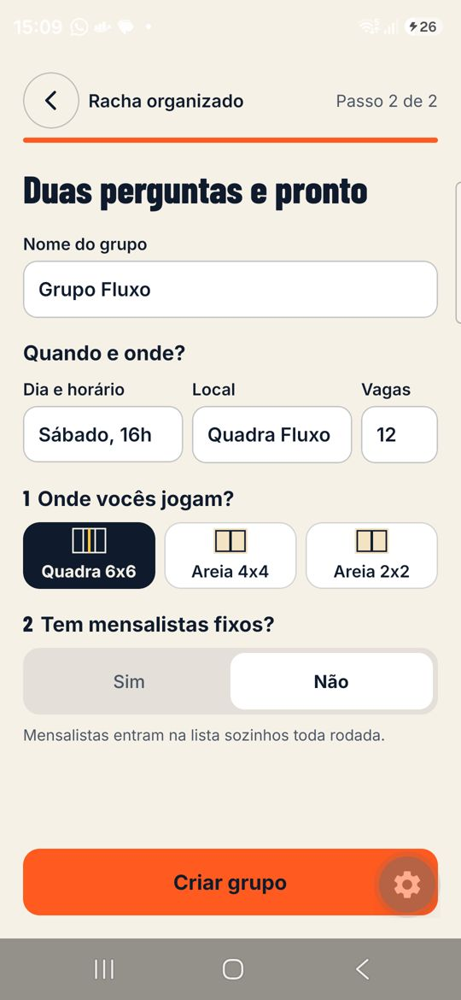

- **Defeito:** o primeiro e o segundo toque em **Criar grupo** deram "Muitas tentativas em pouco tempo..." (print 08). No terceiro, depois de esperar, o grupo foi criado mas a tela mostrou "Grupo criado, mas não salvamos tudo." com **Tentar de novo** / **Seguir assim** (print 09); **Tentar de novo** caiu de novo no limite, e **Seguir assim** levou a "Não deu para carregar o padrão do grupo. Muitas tentativas..." (print 10). Na rodada criada depois, o local veio vazio e o dia veio "Dom 20h" em vez de "Sábado 16h", sinal de que o dia/local do grupo não foram salvos.

## Passo 7 · Seus grupos

Aba **Grupo**: "1 grupo. Você organiza." com o cartão do Grupo Fluxo (Admin, "Nenhuma rodada marcada") e os atalhos **Membros**, **Como jogamos**, **Criar rodada**.

## Passo 8 · Como jogamos

Toque em **Como jogamos**: modelo usado, Presença e vagas (limite 12, mensalistas com prioridade, avulsos abrem 24h antes), Jogo (25 pontos, 1 set, tie-break 15, vantagem de 2), Fila (regra automática, quem sai primeiro), Sorteio (equilibrar pela nota do admin), Rotação (Livre/6x0; 5x1, 4x2 e 6x2 marcados **Pro**; regra de sobreposição FIVB atual/Clássica; líbero) e MVP do dia (pelos dados do placar, votação da galera, ponto individual Pro).

- **Defeito:** o interruptor **Votação da galera** não fica ligado: ao tocar, ele volta para desligado e a tela pula de posição (3 tentativas, inclusive com o app recém-aberto). O fim da lista fica atrás da barra de navegação do Android.
- **Defeito:** mudar **Pontos por set** para 5 não pegou (continuou 25), com a faixa "Muitas tentativas em pouco tempo..." no topo.

## Passo 9 · Membros

Atalho **Membros**: "1 membro", abas Mensalistas / Avulsos / Convites, aviso "1 nota para confirmar. O sorteio usa a sugestão até lá. Revisar" e os botões **Convidar por link** e **QR do grupo**.

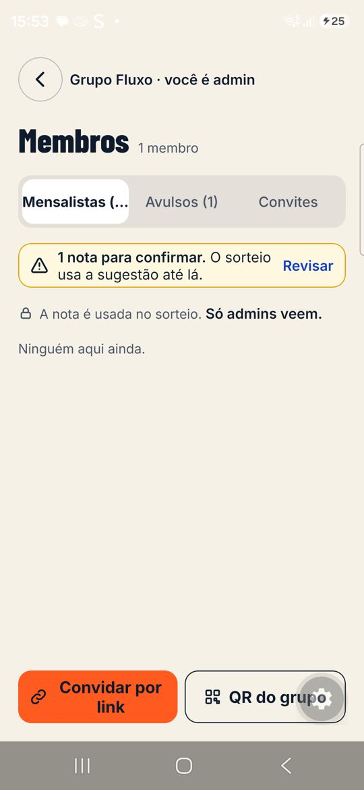

- **Defeito:** ao abrir Membros pela primeira vez: "Não deu para carregar os membros. Muitas tentativas em pouco tempo..." (print 15). Só abriu depois de deixar o app fechado por ~3 minutos.

## Passo 10 · Convite por link e QR

Toque em **Convidar por link**: "Quem abrir o link ou ler o QR entra no grupo como jogador." Aparece o QR do convite, o link (`.../c#...`) com **Copiar** ("Link copiado"), **Mandar no WhatsApp** e **Desativar este link e gerar outro**. "O link vale até você desativar."

- **Defeito:** a primeira tentativa deu "Não deu para gerar o link. Muitas tentativas..."; funcionou com **Tentar de novo** depois de 1 minuto.

## Passo 11 · O convidado abre o link (conta B)

O jogador abre o link no navegador do celular. A página "Convite para um grupo no Sacou — Entre para ver o grupo do convite." tem o botão **Entrar pra ver o convite**, que abre a folha de login (Google ou e-mail e senha).

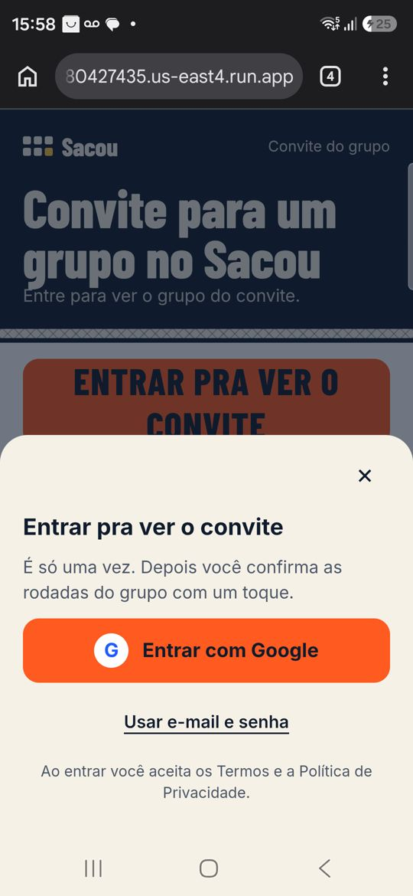

- **Lacuna:** o link `https://.../c#...` abre sempre no Chrome; o app não se registra para abrir esse link e não há, dentro do app, um lugar para colar um link ou ler o QR. O caminho do convite é sempre pela web.

## Passo 12 · Conta B no app e aceite do convite

A conta B (**Beto Teste**, Ponteiro, nota 3) foi criada no app como no Passo 2–3. Depois, no navegador, **Usar e-mail e senha → Entrar** com a mesma conta: a página mostra "Grupo Fluxo · 1 membro" e **Entrar no grupo**. Após o toque: "Você entrou. Baixe o app para ver as rodadas."

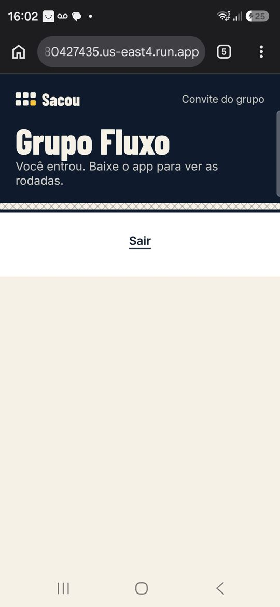

- **Lacuna:** a página de sucesso diz "Baixe o app" mas não tem botão para abrir o app nem para a loja.

No app da conta B, aba **Grupo**: "1 grupo. Você joga nele." com Grupo Fluxo como **Jogador**.

## Passo 13 · Cartinha inicial da organizadora

Aba **Eu** da conta A antes de jogar: Levantador, 0 partidas, "—" de vitórias, saldo 0, maior sequência 0, 0 vezes MVP, "—" de presença.

## Passo 14 · Nova rodada (organizadora)

Aba **Grupo → Criar rodada**. A tela "Nova rodada" vem com o padrão do grupo (Dia, Horário, Local, Vagas, chips "6x6 · 25 pontos · 1 set · Perde sai · Saída parcial · Livre / 6x0") e o bloco **Personalizar esta rodada**.

Em **Personalizar esta rodada** dá para mudar Sets, **Pontos por set** (abre uma folha com campo numérico e **Confirmar**) e **Rotação** (Livre / 6x0, 5x1, 4x2, 6x2). O que difere do grupo vira chip com ponto laranja ("só nesta rodada") e o contador "2 mudanças", com **Voltar ao padrão** em cada linha. Aqui a rodada 1 foi criada com 5 pontos e rotação 5x1.

- **Observação:** na rodada, **Pontos por set** SALVA (chip "5 pontos"); o que não salva é o mesmo campo em **Como jogamos** do grupo (Passo 8). Quem sabe o campo do grupo e o da rodada usam telas/rotas diferentes.
- **Defeito (a investigar):** ao digitar o valor, se o teclado for fechado antes de **Confirmar**, a folha pula e o toque cai fora; o valor volta a 25.

## Passo 15 · Rodada publicada, visão do admin

Depois de **Publicar e compartilhar no WhatsApp** a rodada abre com "Você é admin", **Copiar lista**, os chips do jogo, "Cinza vem do grupo. Ponto laranja vale só nesta rodada.", o contador 0/12 confirmados / 0 na espera, **Adicionar quem confirmou no WhatsApp** e **Sortear times**.

## Passo 16 · Adicionar confirmados

**Adicionar quem confirmou no WhatsApp** abre uma folha com busca de membros ("Ainda não confirmaram": Beto Teste e Você, cada um com **Adicionar**) e a área **Convidado sem conta** (nome, entra como Avulso). Com o nome digitado o formulário abre **Adicionar convidado** com Posição opcional e **Nota do sorteio** (padrão 3,0 · definir). Foram adicionados a organizadora, o Beto e convidados avulsos até 11 de 12.

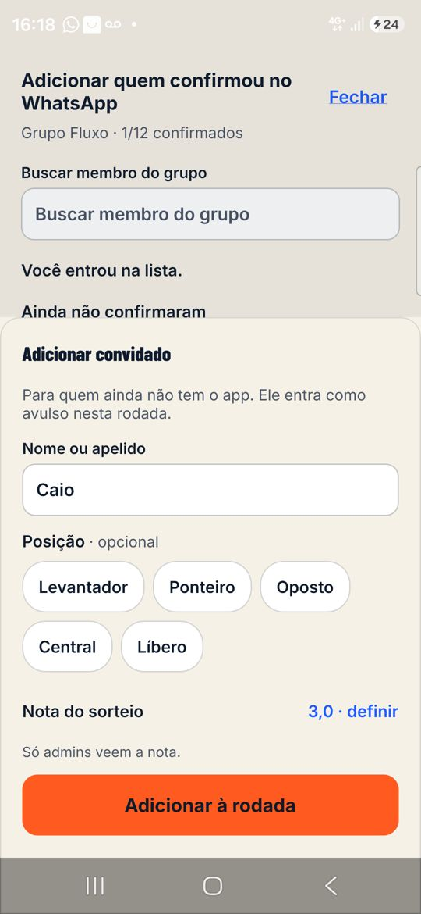

## Passo 17 · Conta do jogador confirma presença

Na conta B (Beto), o card da rodada mostra "Vai? Falta 1 vaga · 11/12" com **VOU** e **Não vou**. Após **VOU**: "Você vai · 12º da lista · 12/12" e **Não vou mais**.

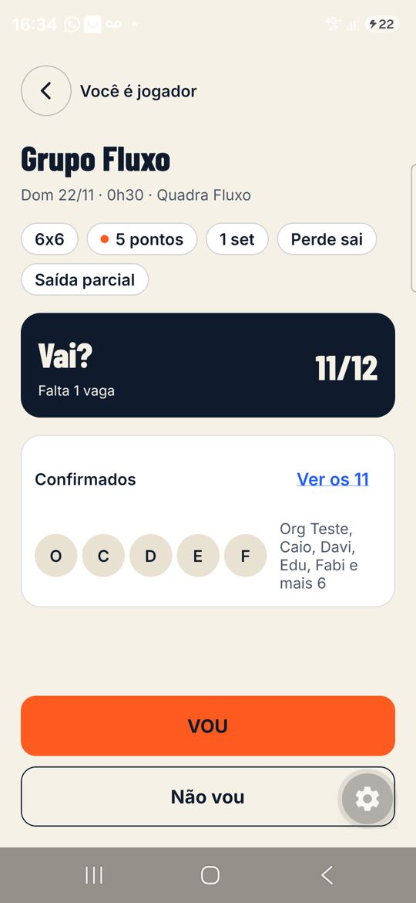
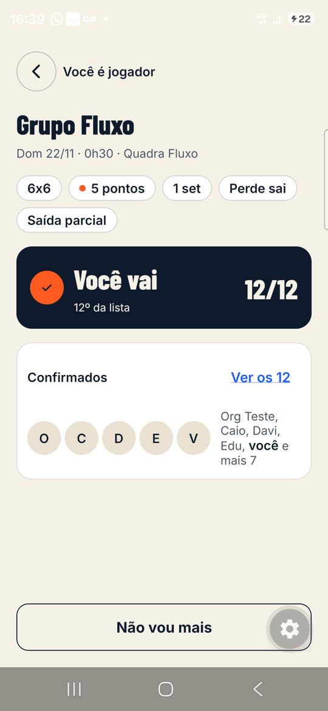

## Passo 18 · Retomada no dia seguinte (Metro novo)

O app em desenvolvimento abre no seletor do Development Build; digite `http://localhost:8081` e **Connect** (o `adb reverse` precisa estar ativo). O primeiro bundle levou ~100 s.

- **Defeito:** a rodada 1 (Dom 22/11 · 0h30, 12/12 confirmados) ficou parada de um dia para o outro e agora o card da Início mostra **Ver resumo**; o resumo diz "Grupo Fluxo · 0 partidas — Nenhuma partida terminou nesta rodada." A rodada foi encerrada sem que ninguém jogasse (provavelmente encerramento automático pelo horário). Não houve aviso e a aba Grupo passou a mostrar "Nenhuma rodada marcada". O sorteio da rodada 1 nunca aconteceu; recomeçamos com uma rodada nova.

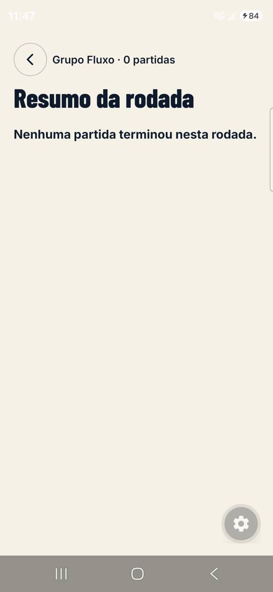

- **Defeito:** em Notificações o título "Notificações" quebra em duas linhas ("Notificaçõe / s") por falta de largura ao lado do botão **Marcar como lidas**. Lista vazia: "Nenhuma notificação por enquanto."

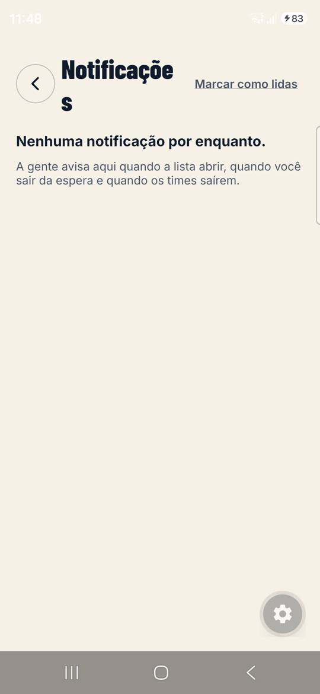

## Passo 19 · Rodada 2 (Seg 23/11 · 20h)

Mesmo caminho do Passo 14, com 5 pontos e rotação 5x1.

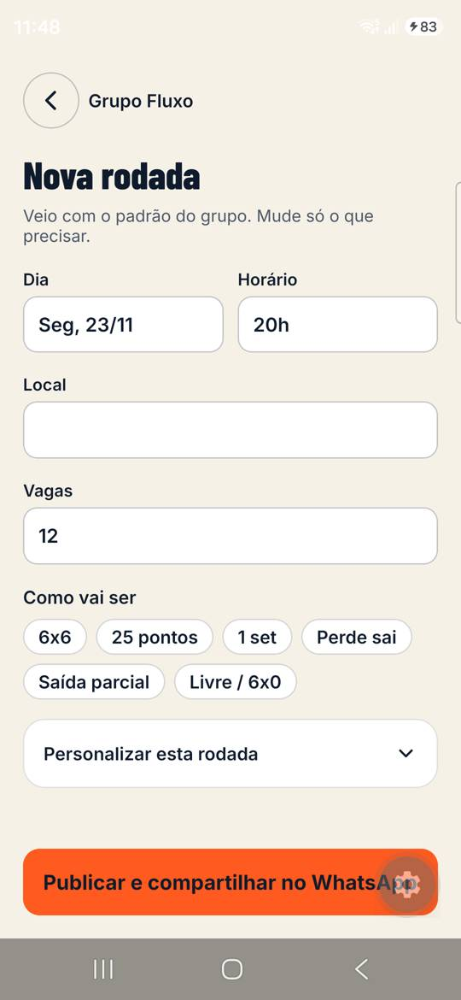

- **Defeito:** ao **Publicar e compartilhar no WhatsApp** aparece a faixa "Muitas tentativas em pouco tempo. Espere um pouco e tente de novo." mesmo com o limite do ambiente de teste já ×10 e poucas chamadas nesta sessão (3 tentativas seguidas).

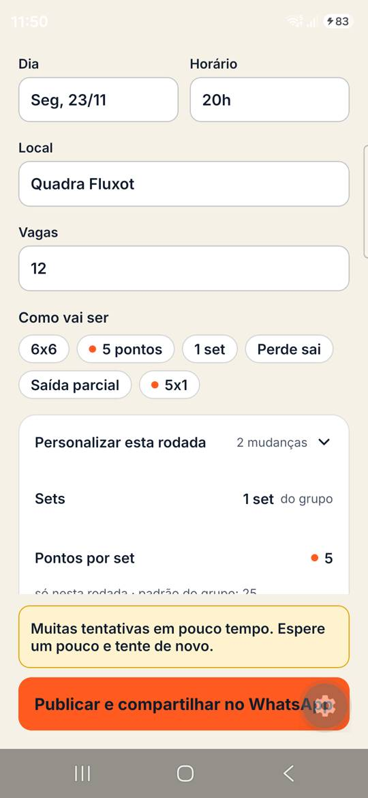

- **Defeito (causa: laço do push, em correção):** a faixa "Muitas tentativas em pouco tempo" reapareceu ao adicionar confirmados: só 1 em cada ~3 toques passava, mesmo com 20–45 s de espera. A causa apontada é o app registrando o aparelho para push em laço (PUT `/v1/me/push-devices`, 10–20 por segundo), que esgota a cota do usuário. Isso explica também os "Muitas tentativas" dos Passos 4, 8, 9 e 10.

## Passo 20 · Sortear times (rodada 2, 10 confirmados)

Passa-se a rodada 2 com 10 de 12 confirmados (os 2 últimos não passaram pelo limite). Toque em **Sortear times**.

Com 10 confirmados (a rodada 2 não chegou a 12 por causa do limite), o sorteio faz **2 times de 5** (Laranja e Azul), mostra "Diferença 0,0 · ótimo" (média de nota A 3,0 · B 3,0) e os botões **Trocar**, **Travar dupla**, **Sortear de novo** e **Confirmar e compartilhar**.

- **Observação:** a organizadora não entrou no sorteio (não foi adicionada: limite). Mesmo assim o sorteio não avisa que faltam 2 para 12.
- **Defeito/Lacuna:** a rotação 5x1 escolhida na criação da rodada não aparece como chip na tela da rodada (Passos 15 e 20), nem no sorteio.

## Passo 21 · Confirmar e compartilhar o sorteio

**Confirmar e compartilhar** abre o seletor de compartilhamento do Android com o texto "Grupo Fluxo · Seg 23/11 / Laranja: Beto, Caio, Hugo, Ivo, Juca / Azul: Davi, Edu, Fabi, Gabi, Leo". Fechar o seletor (Voltar) leva à folha **Partida 1**.

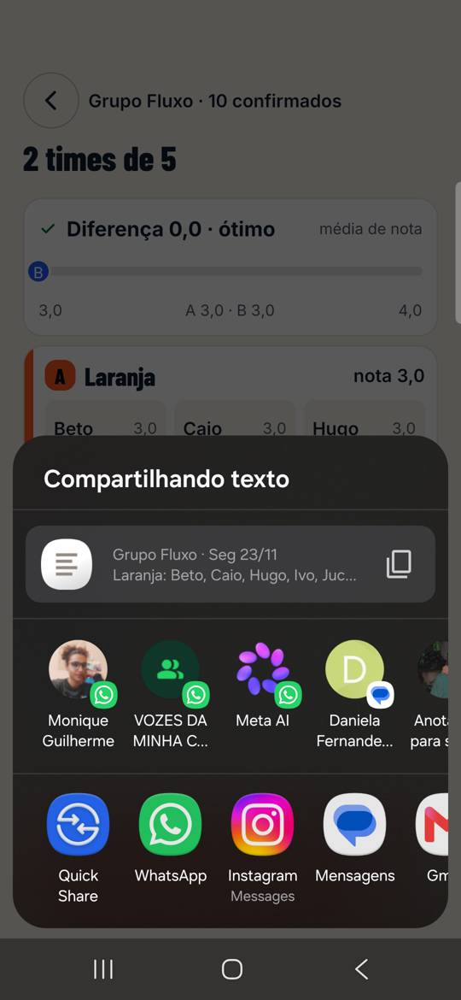

## Passo 22 · Preparar a partida e escolher a rotação

A folha **Partida 1** mostra Laranja x Azul, **Pontos por set** (−/+ , aqui já 5, herdado da rodada), **Sets** (1 set, Melhor de 3, Melhor de 5), **Saca primeiro** (A · Laranja / B · Azul / **Sortear**) e **Rotação de cada time**.

- **Não desenvolvido / limitação:** a rotação de cada time diz "Laranja tem 5: sem rotação." Com 5 jogadores por time o 5x1 da rodada não pode ser usado, então a seleção de rotação fica sem efeito neste teste (precisaria de 6 por time = 12 confirmados).

## Passo 23 · Jogo (placar)

**Começar partida** muda o botão para "Abrindo a quadra…" e a tela fica presa nele por mais de 3 minutos antes de abrir (o limite do laço de push pode estar travando a chamada; sem mensagem de erro, e o log do app não mostra nada).

- **Defeito (causa provável: laço do push, em correção):** "Abrindo a quadra…" demorou mais de 3 minutos, sem aviso.

A quadra abre na horizontal: "1º set", "Posições no momento do saque", "Salvo no celular", **Menu**; Laranja à esquerda (0, "Sacando"), Azul à direita (0, "Em recepção"), **Desfazer** e **Corrigir** no meio. Tocar no lado de um time marca o ponto para ele ("Mais um ponto e o Laranja fecha o set" em 4–1, com "Set point").

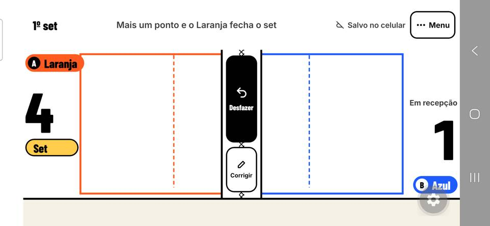

- **Lacuna:** a quadra não mostra jogadores nem formação: com 5 por time não há rotação, então as meias-quadras ficam vazias (só as linhas).

No 5º ponto: "Fim do set 1? Laranja 5, Azul 1 · Laranja vence o set e faz 1–0 · Laranja vence a partida 1–0", com **Desfazer último ponto** e **Confirmar fim da partida**.

Depois de confirmar: "Fim do set 1 · partida encerrada — Laranja venceu 5–1, sets 1–0". Próxima: Laranja x Azul ("Ninguém esperando. Os mesmos times."), com **Confirmar e ir para a próxima partida**, **Encerrar rodada** e **Voltar ao início**.

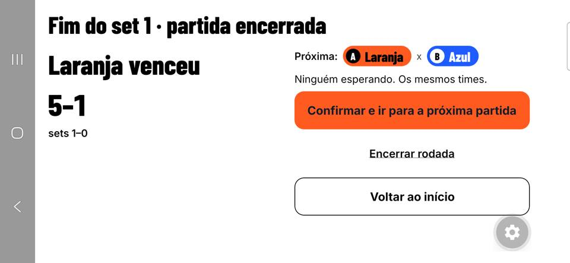

## Passo 24 · Encerrar a rodada e resumo

**Encerrar rodada** abre o **Resumo da rodada**.

- **Defeito (causa: laço do push, em correção):** na primeira abertura "Não deu para abrir o resumo. Muitas tentativas em pouco tempo..." com **Tentar de novo** (print 46-encerrar). Na segunda: "Grupo Fluxo · 0 partidas — Ainda faltam 6 pontos para enviar. O resumo pode mudar. — Nenhuma partida terminou nesta rodada." Os 6 pontos do placar ficam na fila do celular sem chegar ao servidor.

## Passo 25 · Cartinha, fonte máxima e push (não concluídos)

- **Cartinha pós-jogo: não verificada.** A aba **Eu** abriu "Não deu para abrir seus números. Muitas tentativas em pouco tempo..." (defeito, causa: laço do push, em correção), e nenhum resumo/cartinha chegou a ser gerado porque os 6 pontos da partida não foram enviados (Passo 24). A segunda rodada completa também não foi feita por isso.
- **Fonte do sistema 1.3:** só a tela Início foi conferida. Os cards da rodada, o título "Fala, Org Teste." e a barra de navegação cabem sem cortar; nenhum texto foi truncado. O título "Notificações" já quebra mal em 1.0 (Passo 18).

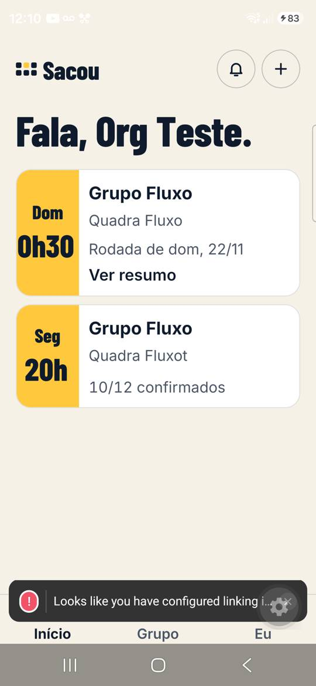

- **Defeito (só em desenvolvimento):** um aviso do React Navigation ("Looks like you have configured linking in multiple places...") aparece como toast na parte de baixo e cobre a barra de navegação; fica preso e não some com toque nem deslize, bloqueando as abas Grupo e Eu.
- **Push:** em **Eu → Configurações** há a linha **Notificações — "Lista, espera, times"**; abre a lista de notificações (vazia). Não há pedido de permissão de notificação nem tela de ajustes de push. O aparelho está em laço de registro (PUT `/v1/me/push-devices`), então o registro "funciona" só em excesso.
- **Defeito:** a rodada 1 (Dom 22/11) nunca foi sorteada e acabou sozinha sem partida (Passo 18); a rodada 2 foi sorteada e jogada (5–1), mas o resultado não chegou ao servidor.

## Segunda tentativa (22/11, push corrigido)

Data: 22/11/2026, a partir das 14h40. Mesmo aparelho (Galaxy 1080×2340), Metro na `main` com o PR #209, API de teste (Cloud Run). Conta A (Org Teste) já logada. Notas escritas durante o percurso.

### Passo 26 · Como jogamos do grupo: Pontos por set e Votação da galera

Aba **Grupo → Gerenciar Grupo Fluxo → Como jogamos**.

- **Primeira abertura (14h39): Defeito.** Logo após abrir o app, a tela mostrou "Não deu para carregar as regras. Muitas tentativas em pouco tempo." (**Tentar de novo** só funcionou depois de ~1 minuto).
- **Pontos por set: SALVA.** Seção **Jogo → Pontos por set: 25 → Mudar**, apagar o valor, digitar 21, **Confirmar**. O texto passou a "Pontos por set: 21" e o resumo a "21 pontos · 1 set · tie-break 15 · vantagem de 2". Saí da tela (Voltar até Seus grupos), reabri **Como jogamos** e o valor continuava 21. O defeito antigo "voltam sozinhos" não se repetiu. (O problema da folha que pula quando o teclado fecha antes de **Confirmar** se repetiu: o toque cai fora, precisa tocar de novo em **Confirmar** depois que a folha desce.)
- **Votação da galera: SALVA.** Seção **MVP do dia → Votação da galera** (estava desligada) → ligar. Saí da tela, reabri, e continuou ligada. Não se repetiu o defeito de voltar sozinha.
- Observação: no grupo, 5x1, 4x2 e 6x2 aparecem com selo **Pro** (bloqueados); só Livre / 6x0 está livre.

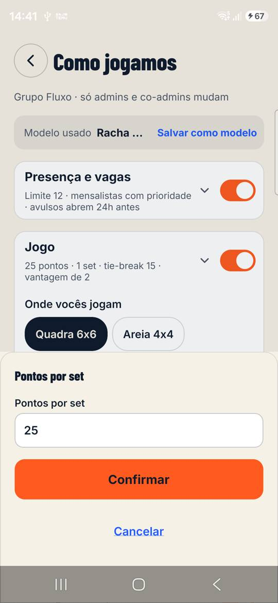

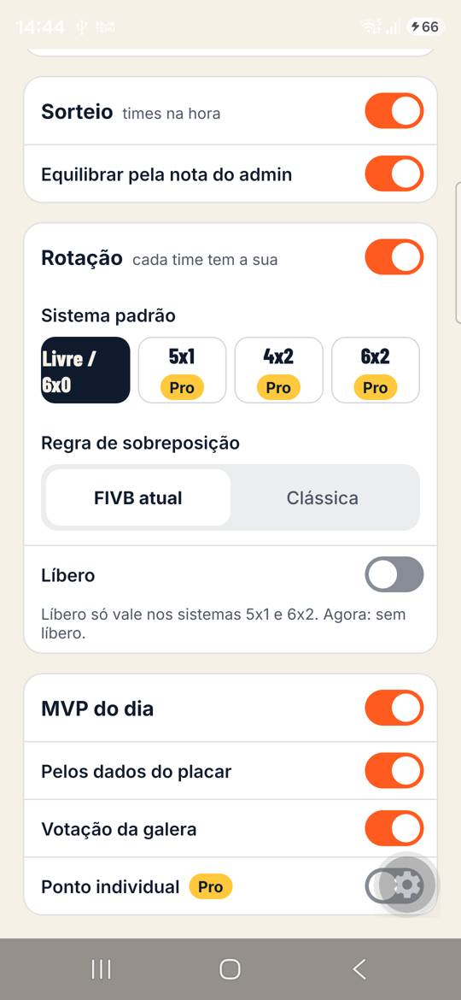

### Passo 27 · Rodada já existente (Seg 23/11) e lentidão

A rodada da tentativa anterior (Seg 23/11 · 20h, 5 pontos, 5x1, 10/12) continua aberta: não existe como cancelá-la pelo app (Editar rodada só altera dados).

- **Defeito:** a página da rodada não mostra a rotação escolhida (5x1) nos chips; só em **Editar rodada** aparece "5x1, só nesta rodada" (repetiu o defeito do Passo 20).
- **Defeito:** **Abrir quadra** mostra "Outro celular está marcando — Org Teste está marcando esta quadra... Último ponto que chegou, há 162 min. Nenhuma partida aberta agora" (a quadra da tentativa anterior ficou reservada). **Assumir o placar** fica em "Carregando o placar…" / "Lendo a quadra…" por mais de 3 minutos e acaba em "Não deu para assumir a quadra. Tente de novo." (duas vezes).
- **Defeito:** **Adicionar quem confirmou no WhatsApp**: o toque em **Adicionar** demora mais de 1 minuto para responder ("Mano entrou na lista" apareceu só depois); o seguinte terminou em "Muitas tentativas em pouco tempo" às 15h05, depois de mais de 2 minutos.
- A rede do aparelho está boa (ping de 15 ms ao servidor, `/health` do servidor responde "Healthy" em menos de 1 s pelo computador). Ou seja, o "Muitas tentativas" (HTTP 429) continua vindo do servidor de teste mesmo com o PR #209, e o app demora minutos para mostrar o erro (provável repetição com espera).

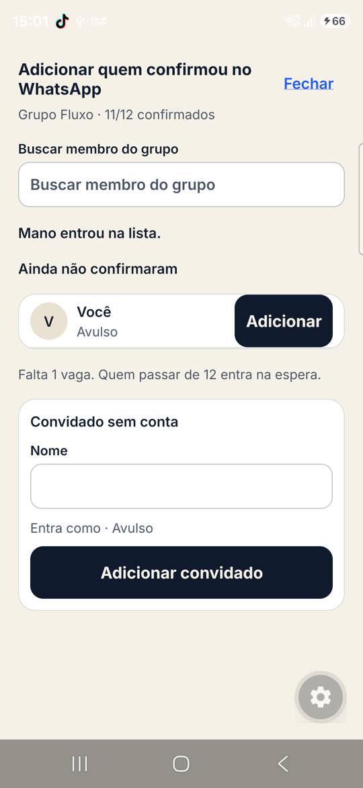
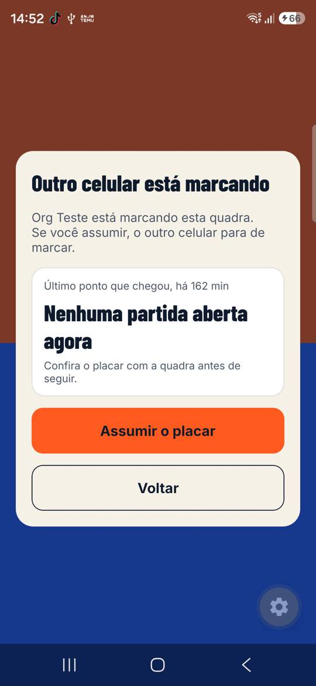

## Terceira tentativa (22/11, Metro em observação, main com os PRs #209 e #210)

Data: 22/11/2026, a partir das 16h00. Mesmo aparelho, Metro em modo de observação (sem `CI=1`), com o laço do push corrigido (PR #209) e a tela "Rodadas do grupo" (PR #210).

- **Nota sobre os passos 26 e 27:** os "Muitas tentativas" daqueles passos vieram do código antigo, porque o Metro rodava com `CI=1` e não recarregava; o app ainda tinha o laço do push. Não são evidência de falha do PR #209.
- **Reabertura (16h00): a sessão se perdeu.** Ao reabrir pelo dev client o app voltou deslogado (folha "Entrar pra confirmar"). Foi preciso entrar de novo com a conta A. O bundle carregou em ~52 s.
- **Observação (teste de tela):** na folha de e-mail e senha, a primeira toque no campo de senha caiu no campo de e-mail (a folha sobe quando o teclado abre), e a senha foi digitada no campo errado. Também Escape (keyevent 111) com a folha aberta fecha a folha.
- **Defeito grave (16h02, bloqueia o percurso):** logo depois do login, a Início quebra com "Render Error: undefined is not a function" em `HomeRoundCards.tsx` linha 99, na chamada `.toSorted(`. O `Array.prototype.toSorted` (ES2023) não existe no Hermes deste dev client no Android. É o único uso de `toSorted` no app (introduzido pelo PR #210). Depois de **Dismiss** (ou **Minimize**) a tela fica em branco e não há como navegar. Reproduzi 3 vezes (login, reabrir sem parar o app, parar e reabrir). Não há caminho de contorno sem mexer no código: a Início é a rota inicial e o erro ocorre sempre que ela renderiza com a conta logada. Como o `toSorted` é chamado mesmo com lista vazia, qualquer conta é afetada.

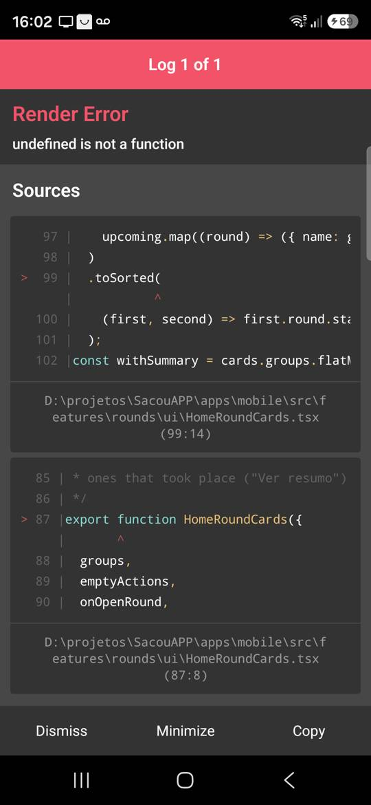

- **Não verificados por causa do bloqueio:** a tela "Rodadas do grupo", as duas rodadas completas, a quadra presa (passo 27), a cartinha com fonte 1.3 e o modo avião.
- **Push (só o que dá para ver sem o app):** a permissão `POST_NOTIFICATIONS` já está concedida ao pacote (concedida antes). Não houve chamada `push-devices` no log do Metro, mas o app nem chegou a renderizar a Início.
- **Parada:** 3 travas no mesmo ponto. Próximo passo: trocar `toSorted` por `[...lista].sort(...)` (ou `slice().sort`) em `HomeRoundCards.tsx` e refazer a partir do passo 28.

## Quarta tentativa (22/11, código atual)

Data: 22/11/2026, a partir das 16h10. Mesmo aparelho, Metro em observação, `main` com os PRs #209, #210 e #213 (`toSorted`). Prints a partir de 64.

### Passo 28 · Recarregar e Início
- Primeira carga do bundle demorou: o Metro ficou ~3 min sem responder em `/status` (tela em branco). Depois respondeu e o app abriu.
- **Sessão mantida ao reabrir (defeito da terceira tentativa sumiu):** o app abriu direto na Início logada. **Início sem erro (`toSorted` corrigido).**

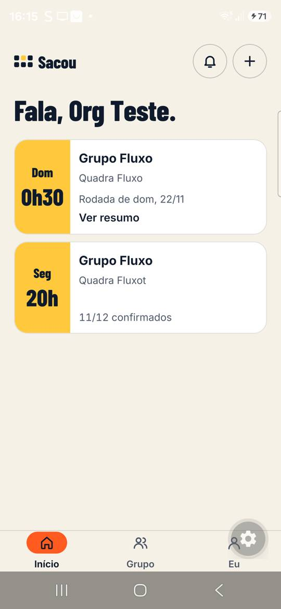

### Passo 29 · Tela "Rodadas do grupo"
Aba **Grupo** → toque no cartão do grupo. Lista **Próximas** (Seg 23/11 Aberta, 11/12 confirmados) e **Recentes** (Dom 22/11 Encerrada · Ver resumo, 12/12). Funciona.
- **Nova rodada** sugeriu **Ter 24/11 · 20h** (dia livre depois de Seg), vagas 12, 6x6 / 21 pontos / 1 set / Perde sai / Saída parcial / Livre. O campo **Local** veio vazio (o grupo tem "Quadra Fluxo"; o padrão não preenche o local). Preenchi "Quadra Fluxo" e publiquei.
- Publicar abre a folha de compartilhar do sistema com o texto da rodada e o link (fechei sem enviar). A rodada nova entra em **Próximas**.

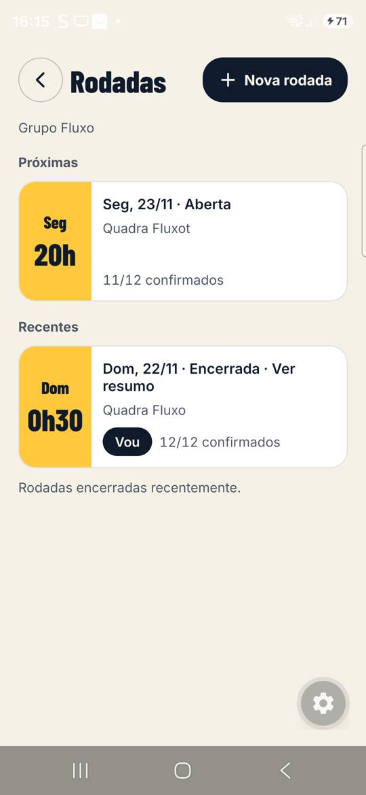
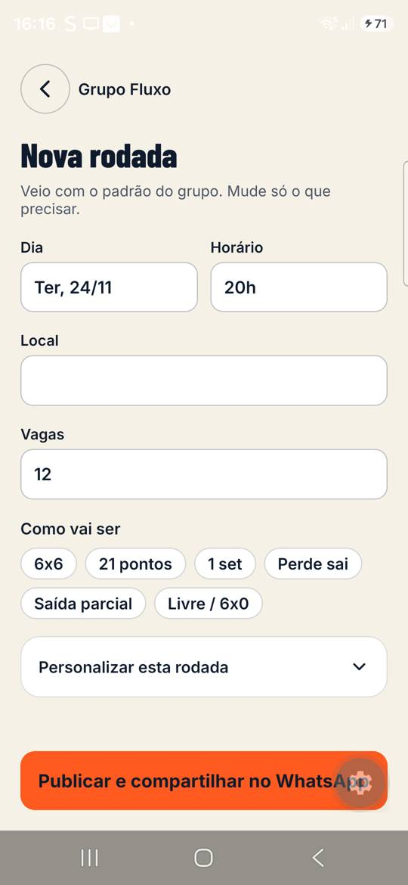
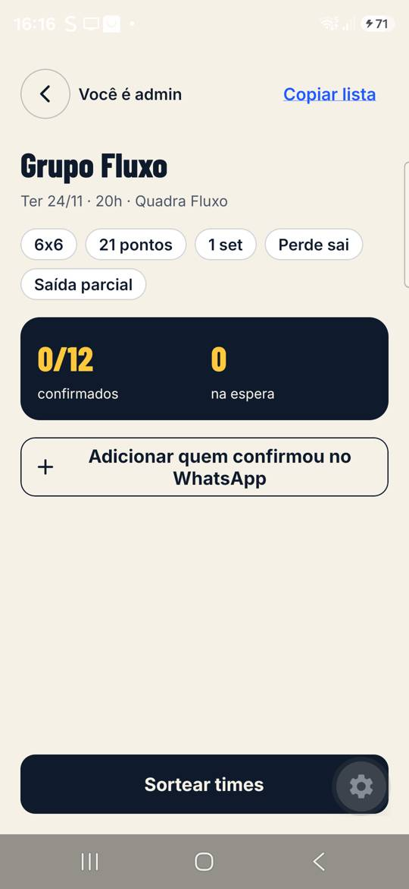

### Passo 30 · Presença
**Adicionar quem confirmou no WhatsApp**: 10 toques em **Adicionar** (Beto + 9 avulsos) responderam em ~4 s cada, sem "Muitas tentativas" (10/12). O aviso "X entrou na lista" desloca a lista para baixo e faz o toque seguinte errar o alvo se for no mesmo lugar.
- Observação: o Beto aparece como **Avulso** na lista de quem falta (embora tenha conta); os demais como "Sem conta".
- Os chips da rodada mostram "Saída parcial" mas não a rotação.

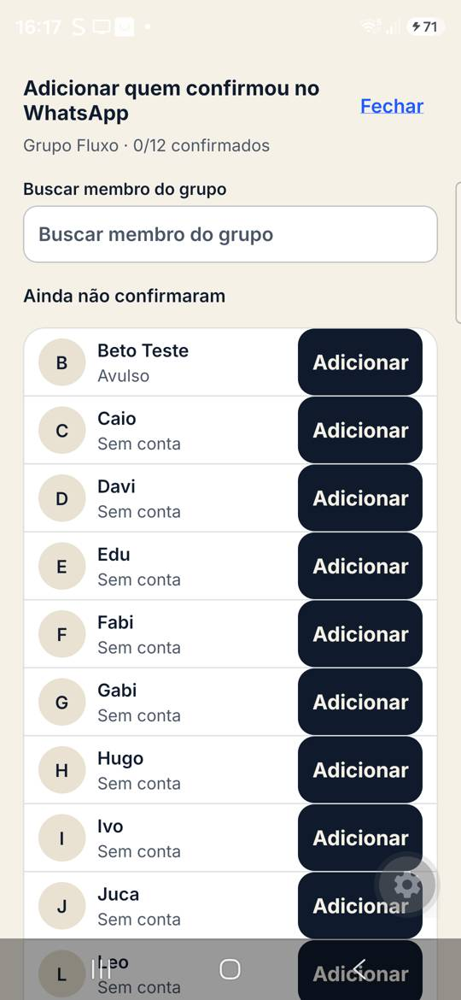

### Passo 31 · Sorteio
**Sortear times**: 2 times de 5, diferença 0,0 "ótimo" (Laranja: Beto, Fabi, Gabi, Hugo, Juca; Azul: Caio, Davi, Edu, Ivo, Leo). **Confirmar e compartilhar** abre a folha do sistema com o texto dos times (sem notas). Em seguida abre direto a preparação da **Partida 1**.

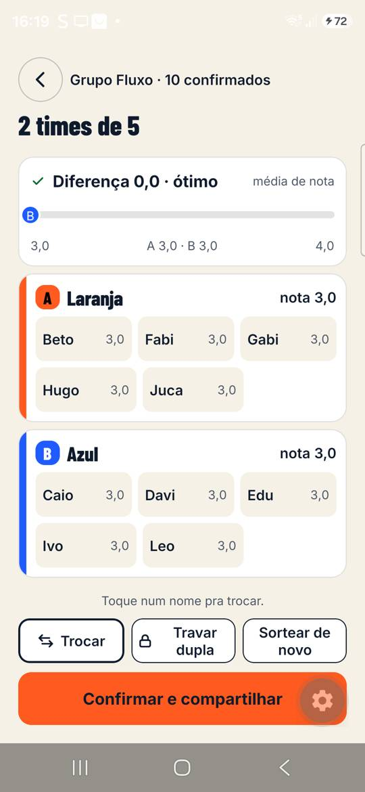

### Passo 32 · Rotação
Na preparação: 21 pontos, 1 set, quem saca primeiro (A · Laranja), "Rotação de cada time: Laranja tem 5: sem rotação" (grupo Livre/6x0). **Não desenvolvido / não aplicável:** não há escolha de formação nesta rodada (o grupo está em Livre, 5x1/4x2/6x2 têm selo Pro).

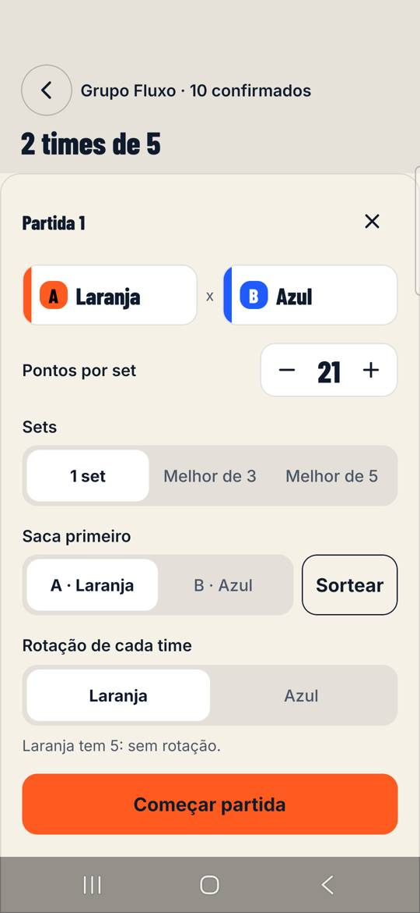

### Passo 33 · Partida
**Começar partida** abre o placar na horizontal ("Salvo no celular"), **sem** o aviso "Outro celular está marcando" (**defeito do passo 27 sumiu** com a própria conta). Marquei 14 a 14 e depois Laranja 21 a 14: tela "Fim do set 1?" → **Confirmar fim da partida** → "Laranja venceu 21–14, sets 1–0", com **Confirmar e ir para a próxima partida / Encerrar rodada / Voltar ao início**.

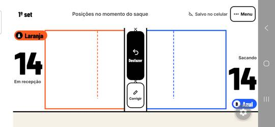
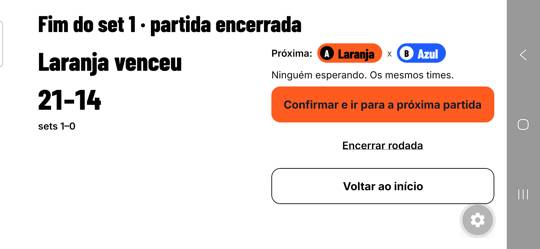

### Passo 34 · Encerrar rodada
- **Defeito (ou limitação do percurso):** **Encerrar rodada** responde "A rodada ainda não começou e não pode ser encerrada." (409 `sessions.round-not-started`), porque a rodada é de Ter 24/11 (futura). O app deixa **Abrir quadra** e jogar uma rodada que ainda não começou, mas não deixa encerrá-la. Repeti 2 vezes, mesmo resultado.

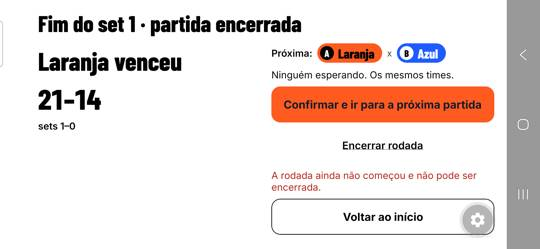

Não foi possível jogar o resumo e a cartinha de uma rodada nova hoje: o seletor de dia de **Nova rodada** só começa amanhã (Seg 23/11) e o servidor só deixa encerrar depois do início. Todas as rodadas abertas são futuras.

### Passo 35 · Segunda rodada (Seg 23/11, 11/12)
- **Sortear times**: 2 times de 5 + 1 reserva (Mano na fila), diferença 0,0. **Confirmar e compartilhar** abriu a preparação da Partida 1 (5 pontos, 5x1 só nesta rodada). "Laranja tem 5: sem rotação" (5x1 pede 6 jogadores). Não há escolha de formação com 5 por time.
- **Defeito (passo 27 continua):** **Começar partida** mostra "Outro celular está marcando — Org Teste está marcando esta quadra... Último ponto que chegou, há 256 min", com a própria conta. **Assumir o placar** respondeu em ~14 s "O placar do servidor veio com defeito. Nada mudou neste celular." Repeti 3 vezes (inclusive **Tentar de novo**), mesmo resultado, então esta rodada não foi jogada. (Já não demora minutos nem dá "Muitas tentativas".) A quadra desta rodada ficou presa pela tentativa anterior; a da rodada Ter 24/11 (nova) abriu normal.
- **Defeito (repete o passo 20/27):** a página da rodada não mostra a rotação 5x1 nos chips; só em **Editar rodada**.

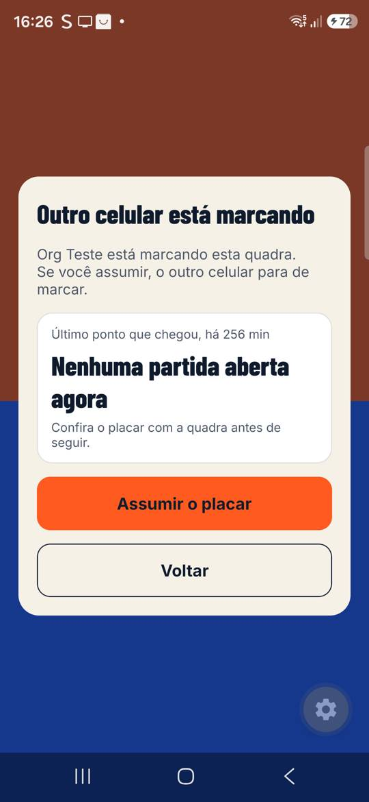
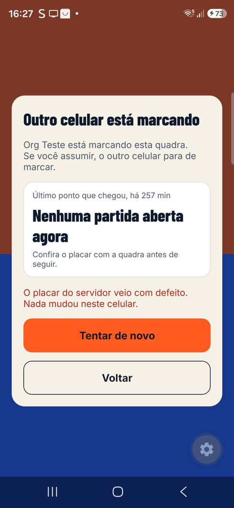

### Passo 36 · Resumo e cartinha
- **Ver resumo** (Dom 22/11, rodada sem partida): "Grupo Fluxo · 0 partidas — Nenhuma partida terminou nesta rodada." Abre sem erro.
- **Eu → cartinha**: abre sem "Muitas tentativas" (defeito antigo sumiu); zerada (0 partidas) porque nenhuma partida foi fechada no servidor. A cartinha com os números reais **não foi verificada**.
- **Fonte 1.3**: a Início cabe sem cortar (print 93). A cartinha com 1.3 **não foi capturada**: a segunda tentativa de ajustar a fonte foi negada pelo sistema de permissões; a fonte voltou a 1.0.
- **Defeito:** o aviso de desenvolvimento "Looks like you have configured linking..." volta a cobrir a barra de navegação e a aba Eu depois de recarregar/trocar a fonte.
- **Defeito:** a Início só mostra Dom 22/11 e Seg 23/11; a rodada nova de **Ter 24/11** (publicada às 16h17) não aparece, mesmo depois de recarregar (a lista de Rodadas do grupo a mostra).
- **Troca de fonte do sistema** reinicia o app na Início (perde a tela em que estava).

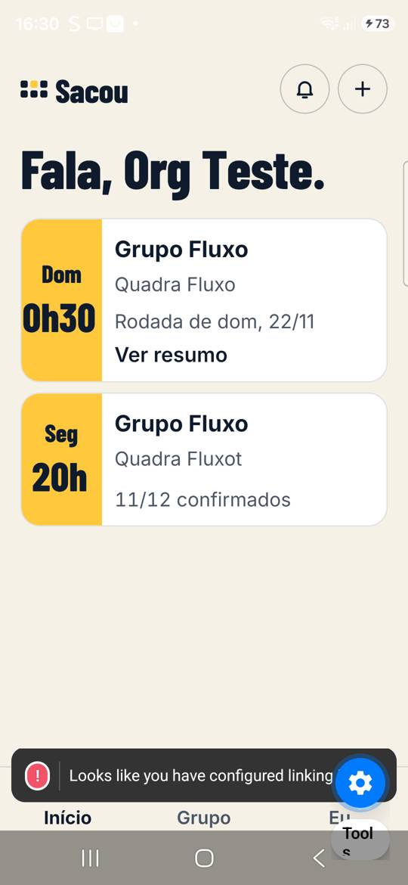
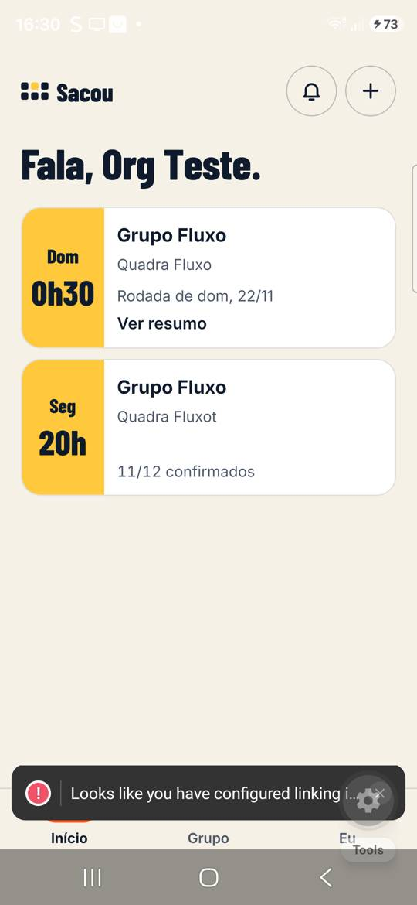

### Passo 37 · Push e modo avião
- **Push:** a permissão de notificação já estava concedida; o app não pediu nada nem mostrou tela de registro; sem chamada `push-devices` no log do Metro (laço sumiu). Não há como confirmar o registro no servidor pelo aparelho.
- **Modo avião** (30 s com o app aberto): aparece a faixa amarela **Sem conexão** na Início, cartões continuam; ao desligar o modo avião a faixa some em segundos e o app volta a funcionar.

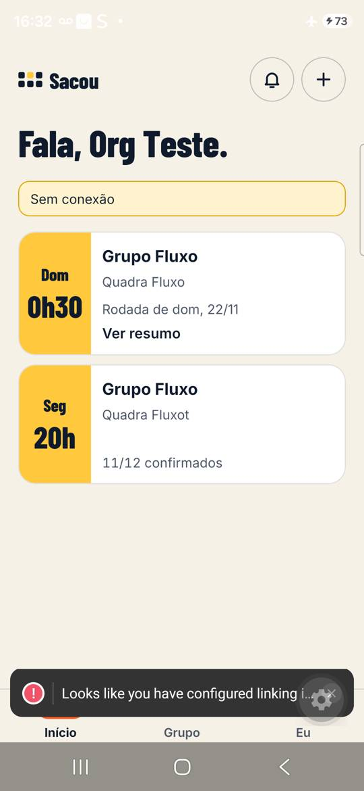

## Próxima tentativa · passos a incluir

### Tornar o Beto mensalista (pedido do Gabriel, 22/11)

Conta A (organizadora). **Grupo → Gerenciar Grupo Fluxo → Membros**, tocar no **Beto Teste**, e na folha de opções, seção **Tipo**, escolher **Mensalista**.

- Conferir que a escolha está disponível mesmo com o grupo criado com "mensalistas fixos: Não" (se aparecer bloqueada, anotar como **Defeito** ou **Não desenvolvido**, com o texto exato).
- Conferir que o Beto passa para a aba **Mensalistas** da lista de membros.
- Abrir uma rodada aberta e conferir que, em "Ainda não confirmaram", o Beto aparece como **Mensalista** (antes: "Avulso") e no topo da lista.
- Voltar o Beto para **Avulso** e conferir o caminho inverso.
- Conferir que um convidado **Sem conta** não pode virar mensalista (opção bloqueada).

## Quinta tentativa (23/11, main com a R98)

Data: 23/11/2026, das 12h30 às 13h05. Mesmo aparelho (`RQGL50AMKPX`), `main` em `7a6f5e43` (R98 inteira), conta A (Org Teste). Prints a partir de 99.

- **Ambiente (não é defeito do app):** o `apps/mobile/.env` aponta `EXPO_PUBLIC_API_URL` para `http://localhost:5080`, então a primeira carga mostrou "Não deu para carregar seus grupos · Sem conexão" e o `metro.log` registrou `[push] registration: failed` duas vezes. Para seguir, subi um proxy local na porta 5080 do computador, repassando para a API de teste do Cloud Run, com `adb reverse tcp:5080 tcp:5080`. Daí em diante tudo funcionou.
- Na primeira abertura o dev client mostrou o seletor de servidor (digitei `http://localhost:8081`); a sessão da conta A estava mantida.

### Passo 38 · Início (item 1) — Passou, com defeitos novos
- Início abre logada, sem erro, com "2 rodadas nos próximos 7 dias": **Seg 20h** (11/12) e **Ter 20h** (10/12). A de Ter 24/11 agora aparece. **Passou.**
- **Defeito (novo):** depois de encerrar rodadas de hoje, a Início mostra a mesma rodada duas vezes: uma como "Rodada de seg, 23/11 · Ver resumo" e outra como aberta ("11/12 confirmados", ou "Vou · 12/12"). O contador "N rodadas nos próximos 7 dias" não bate com os cartões (3 contados, 4 vistos; depois 6). "Rodadas do grupo" mostra o estado certo (Encerrada). Persiste depois de **Reload**. Para reproduzir: encerrar uma rodada de hoje e voltar à Início.
- **Defeito (novo):** o cartão do grupo (aba **Grupo**) continua com "Próxima: seg, 23/11 · 11/12 confirmados" mesmo com a rodada encerrada.

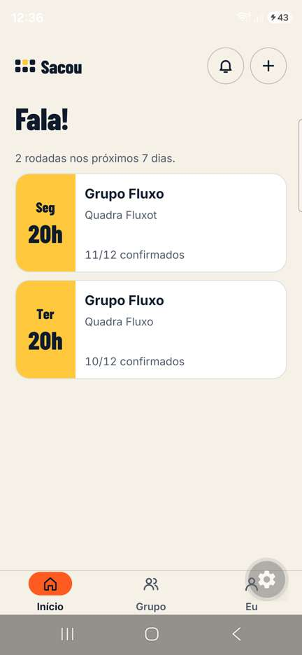
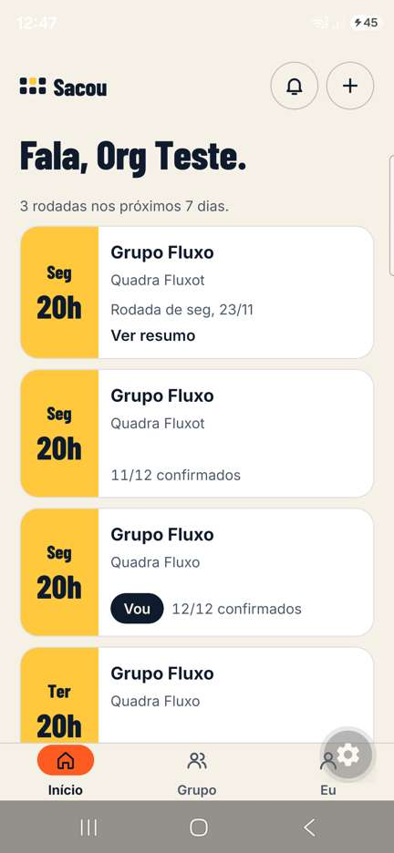

### Passo 39 · Quadra da rodada de Seg 23/11 (item 3) — Passou
Página da rodada mostra o chip **5x1** (print 100). **Abrir quadra** mostra "Outro celular está marcando — Org Teste... há 1467 min"; **Assumir o placar** respondeu em poucos segundos, sem "O placar do servidor veio com defeito", e abriu o placar já no fim da partida (Laranja 5–1). **Encerrar rodada** antes das 20h funcionou (R98 P2) e abriu o resumo (Beto Teste MVP, +4 de saldo). **Passou.** O aviso "Outro celular está marcando" ainda aparece com a própria conta (esperado: a quadra ficou reservada pela tentativa anterior).
- **Defeito:** depois de **Encerrar rodada**, a página da rodada continua com 11/12, **Abrir quadra** e **Sortear times** (estado antigo em cache; a lista "Rodadas" mostra Encerrada).

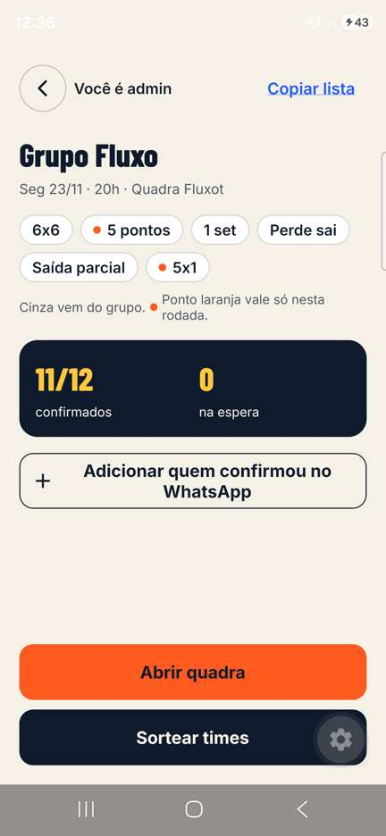
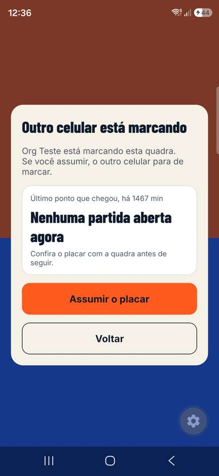
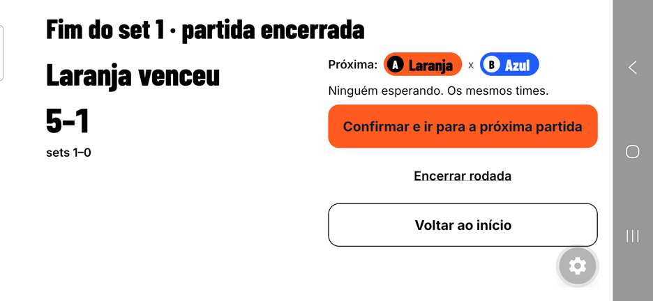

### Passo 40 · Rodada A, hoje, com rotação 5x1 (item 2) — Passou
Nova rodada **Seg 23/11 · 20h** (hoje já é selecionável; o padrão sugerido é Qua 25/11), Local digitado, **Rotação 5x1** em "Personalizar" (chip laranja "só nesta rodada"). O chip **5x1 aparece na página da rodada** (defeito dos passos 20/27/35 corrigido). Adicionar: 11 toques seguidos, ~4 s cada, sem "Muitas tentativas"; 12/12. Sorteio 2 times de 6, diferença 0,0 (Laranja: Leo, Beto, Davi, Edu, Ivo, Juca; Azul: Caio, Fabi, Gabi, Hugo, Mano, Org). Preparação com "Rotação de cada time: 5x1" e "Levantador do Laranja: Leo". Reduzi os pontos para 5 (16 toques no −). Quadra na horizontal com as posições e "5x1 · rotação N" por time; ponto do Azul gira o time (sideout). Laranja 5–1 → **Confirmar fim da partida** → **Encerrar rodada** (12h44, antes das 20h) → resumo (Leo MVP, "Votar no MVP · fecha em 23 h").
- **Cartinha (Eu):** logo depois, continuava **zerada** ("Seus números aparecem depois da primeira partida"). Só depois de **Reload** do app mostrou os números reais: **1 partida, 0 vitórias, saldo −4, presença 33%, 1 rodada** (o Org estava no Azul). **Defeito:** a aba Eu não é atualizada depois de encerrar a rodada (cache), sem recarregar.
- Observação: no placar, bolinhas e nomes de jogadores do mesmo time se sobrepõem junto à rede (ex.: "Caio/Org", "Fabi/Gabi/Org").
- **Defeito de layout:** o botão **Compartilhar** da cartinha quebra a palavra ("Compartilh/ar") já com a fonte 1.0.

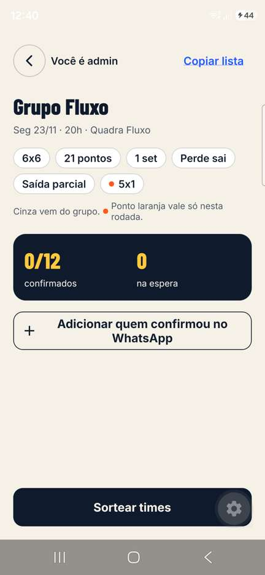
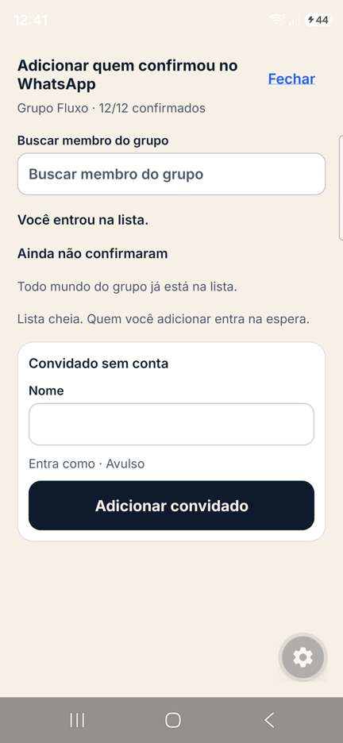
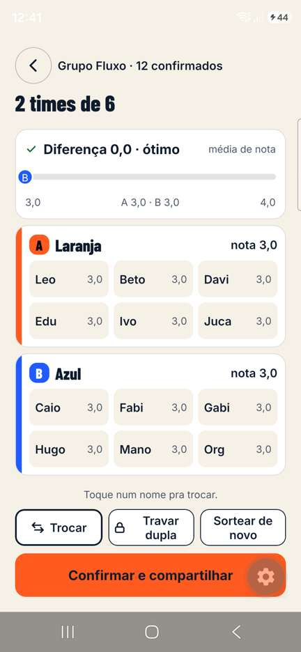
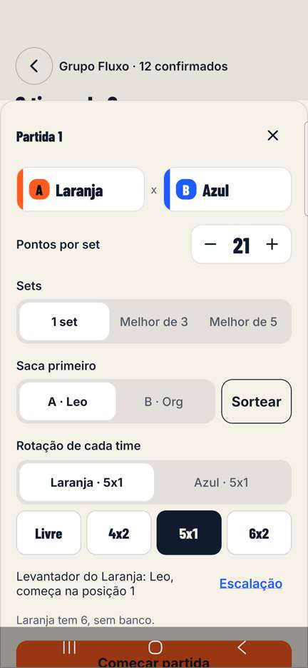
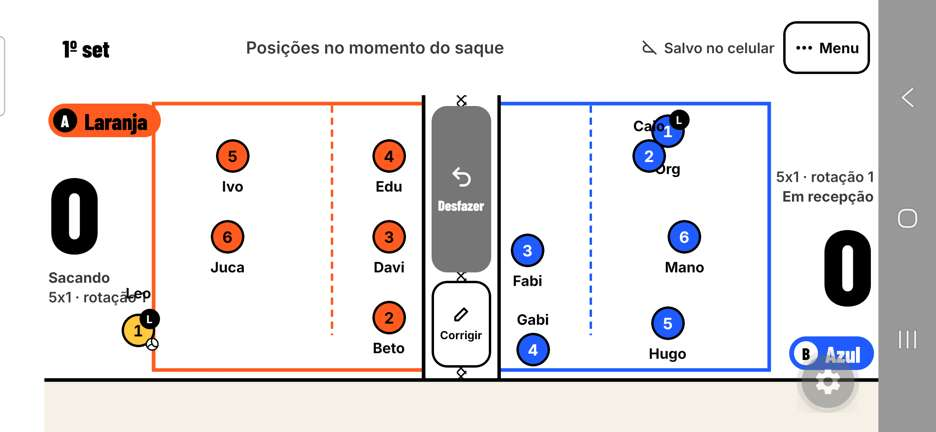

### Passo 41 · Rodada B, hoje, sem rotação (item 2) — Passou
Nova rodada **Seg 23/11 · 21h** (horário digitado como `21:00`; "2100" é recusado com "Use o formato 20:30"), 12 presenças, sorteio, preparação (Livre), Laranja 5–0, **Encerrar rodada**, resumo (Beto Teste MVP, +5). Org no Laranja. Cartinha **sem Reload**: ainda 1 partida (desatualizada, print 119). **Depois de Reload:** **2 partidas, 50% de vitórias (1), saldo +1, maior sequência 1, presença 50%, 2 rodadas**, "Grupo Fluxo · 2 partidas · 50%". Os números batem. **Passou** (com o defeito de atualização do Passo 40).

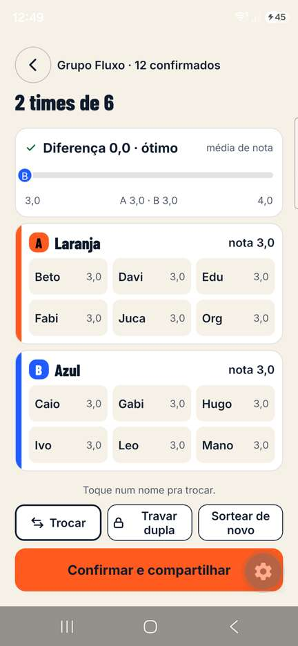

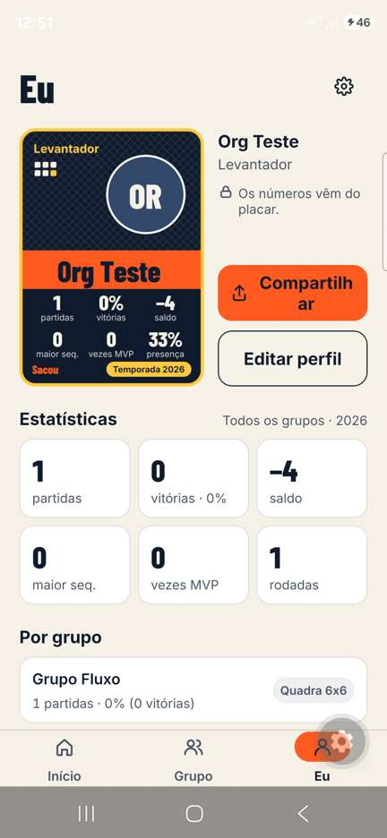
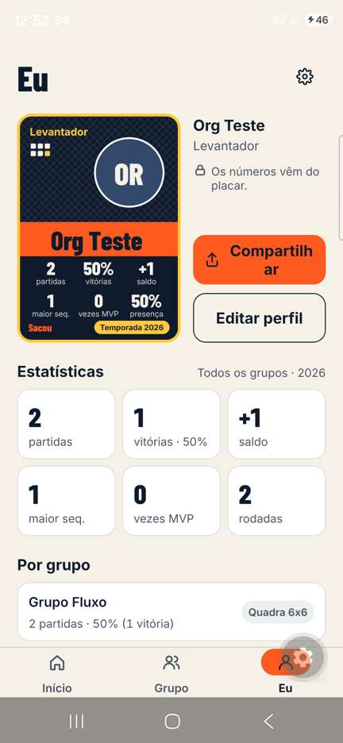

### Passo 42 · Mensalista (item 4) — Passou, com observações
**Grupo → Membros** (abas "Mensalistas (0)", "Avulsos (12)"). Toque nos três pontos do Beto Teste → folha com **Tipo: Mensalista | Avulso**, disponível mesmo com o grupo criado com "mensalistas fixos: Não". **Mensalista**: o Beto passa para a aba **Mensalistas (1)** (Avulsos 11). Voltar para **Avulso**: retorna (Mensalistas 0, Avulsos 12). **Convidado Sem conta (Davi):** o seletor **Mensalista** fica bloqueado, com o texto "Precisa ter conta" (o toque não faz nada). **Passou.**
- **Observação / Não verificado:** com o Beto mensalista, as rodadas novas (Qua 25/11 e Qui 26/11) já nasceram com **1/12 confirmados** e o Beto fora de "Ainda não confirmaram". Ou seja, o mensalista entra sozinho na rodada, em vez de aparecer como "Mensalista" no topo da lista de quem falta. O rótulo "Mensalista" na lista de quem falta **não foi verificado**, porque o Beto já vinha confirmado (a rodada de Ter 24/11 também o tinha). Se a intenção é o rótulo, vale confirmar com o Gabriel. Por consequência, as rodadas Qua 25/11 e Qui 26/11 ficaram abertas no servidor de teste (1/12).
- Observação: o rótulo da aba ativa fica truncado ("Mensalistas (...").

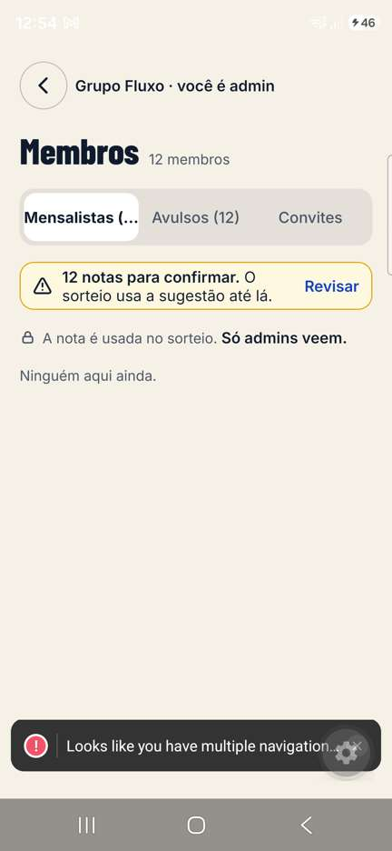
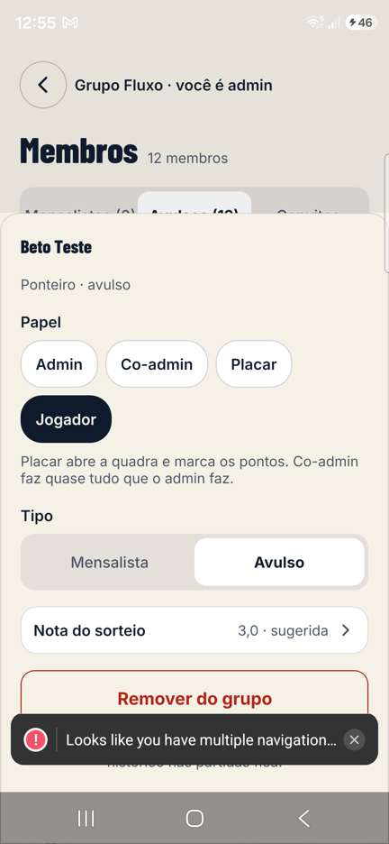

### Passo 43 · Fonte 1.3 na cartinha (item 5) — Passou, com defeitos de layout
`adb shell settings put system font_scale 1.3` funcionou (sem negação) e o app reiniciou na Início. A Início cabe (print 121). Na cartinha (aba Eu) o cartão e os números cabem. **Defeitos:** "Compartilhar" quebra no meio da palavra ("Comparti/lhar"); nas estatísticas os rótulos ficam cortados ("vitórias · ..", "vezes M..."). Fonte devolvida a 1.0 (`settings get` = 1.0).
- **Defeito (repete):** o aviso de desenvolvimento "Looks like you have multiple navigation containers..." volta a cobrir a barra de abas e o botão de publicar depois de trocar a fonte; foi preciso dispensá-lo pelo log (tocar, **Dismiss**).

### Passo 44 · Push depois do 1º VOU (item 6) — Não verificado
A permissão `POST_NOTIFICATIONS` já estava concedida (`granted=true`) e a conta A já tinha confirmado presença (por **Adicionar**), então o app não pediu permissão. Não há como ver o pedido depois do 1º VOU sem uma conta nova e sem limpar os dados do app (o que desloga); nenhuma conta B (Beto) estava logada. O `metro.log` mostra `[push] registration: failed` (2x, enquanto a API estava inalcançável por causa do `.env`) e depois `[push] registration: registered` (4x, nas cargas seguintes): o registro funciona quando a API responde e não gera laço.

### Passo 45 · Modo avião (item 7) — Passou
30 s em modo avião (`cmd connectivity airplane-mode enable`) com o app na Início: faixa amarela **Sem conexão**, cartões mantidos. Ao desligar, a faixa some em segundos e a Início volta ao normal.

## Sexta tentativa (23/11, percurso do jogador)

Data: 23/11/2026, das 16h28 às 16h50. Mesmo aparelho (`RQGL50AMKPX`), Metro da worktree R99 (app direto na API de teste), contas Org Teste, Beto Teste e Caio Push. Prints a partir de 129 (nenhum com QR legível, contato, e-mail ou senha). O Chrome do aparelho ficou logado como Beto Teste.

### Passo 46 · Desativar o convite exposto (M5-B1) — Passou, com lacuna
- Antes, o link antigo (`/c#...`) no Chrome mostrava "Grupo Fluxo · Você já está nesse grupo" (print 130). Em Grupo → Membros → aba **Convites** havia "Criado em 21 nov · 2 entradas · Revogar". **Revogar** abre a folha "Revogar este convite? Quem tiver este link não entra mais por ele."; confirmei e a aba passou a dizer "Nenhum convite valendo." (print 131). O mesmo link no Chrome agora mostra **"Link inválido ou desativado."** (print 132). **Passou:** o convite exposto está morto.
- **Lacuna (ambiente):** a tela Membros **não mostrou "Convidar por link" nem "QR do grupo"**, então não deu para usar "Desativar este link e gerar outro" nem gerar o link novo. O rodapé só aparece com `EXPO_PUBLIC_INVITE_BASE_URL` (`MembersScreen`, `buildInviteBaseUrl`), e o `.env` desta worktree só tem a URL da API e o Google. Sem essa variável o admin de um build de produção ficaria sem convite e sem aviso. O link novo **não foi gerado**; a linha `Convite:` do arquivo de contas diz "revogado".

### Passo 47 · Link da rodada de hoje (Seg 23/11, 20h) — Lacuna
Na página da rodada, "Copiar lista" copia só o texto da lista ("Grupo Fluxo · Seg 23/11 · 20h · Quadra Fluxo, Confirmados (1/12) 1. Caio Push"), **sem o link** (print 133). O link só aparece na folha de compartilhar **ao publicar a rodada** (`share.textWithLink`). Quem fecha a folha, ou quer reenviar o link na semana seguinte, **não tem como pegar o link de uma rodada já publicada**. Para ter um link, publiquei uma rodada nova (**Sex 27/11, 20h**, 12 vagas, "Copiar" na folha) e usei esse link no resto do percurso; o link de hoje não foi obtido. **Lacuna.**

### Passo 48 · Link da rodada no navegador, sem o app — Passou
A página `/r/...` abre sem app e sem conta: "Grupo Fluxo · Sex, 27/11 · 20h · Quadra Fluxo · 6x6 · 21 pts · quem perde sai", contador 0/12 ("Faltam 12. Chama o pessoal!"), 12 "vaga aberta" e **VOU / NÃO VOU** (print 134). **Passou.** Observações: o canto superior diz "Convite do grupo" numa página de rodada; "Chama o pessoal!" é fala de organizador, não de jogador. O Chrome já vinha com sessão (link "Sair" no rodapé).

### Passo 49 · VOU anônimo e login pela web — Passou
Com sessão (Chrome logado), o VOU de avulso já mostra o aviso (print 135). Depois de **Sair** (print 137), o toque em **VOU** abre a folha "Entrar pra confirmar · É só uma vez…" com Google e e-mail e senha (print 138). Entrei com o Beto por e-mail e senha e voltei para a mesma rodada (print 139). **Passou.**

### Passo 50 · VOU de avulso e de mensalista pela web — Defeito
- **Avulso (Beto ainda avulso):** a página mostra "A lista dos avulsos ainda não abriu." **sem dia nem hora**, e VOU / NÃO VOU continuam laranja e ativos (print 140). **Confirma o achado 2 na web.** O toque no VOU não faz nada visível.
- **Mensalista (Beto promovido pelo admin):** VOU respondeu "Você vai. Sua vaga é a 1ª." com "NÃO VOU MAIS" (print 142). **Defeito:** logo depois do VOU o cabeçalho continua "0/12" e a lista continua com 12 "vaga aberta"; só depois de **Atualizar** mostra "1/12 · Mensalistas: Beto Teste · Avulsos 0 de 11 vagas" (print 143). Para reproduzir: promover o jogador a mensalista, abrir `/r/...`, entrar e tocar em VOU.

### Passo 51 · A mesma rodada no app (Beto) — Passou
A Início do Beto lista Seg, Qua, Qui e **Sex 20h** com "Vou · 1/12 confirmados". Na página da Sex o app mostra "Você vai · 1º da lista · 1/12", "Confirmados: você" e "Não vou mais" (print 146). Bate com a web. **Passou.**
- Observação: o selo **"Vou" no cartão da Início é estado, mas parece botão**, e os cartões sem o selo não têm botão: para confirmar é preciso abrir a rodada (prints 144 e 145).
- Observação: "Não vou mais" desfaz a presença com um toque, sem confirmação (um toque meu caiu nele sem querer); refazer exige "VOU".

### Passo 52 · O que o jogador vê dos times — Lacuna (confirma o achado 6)
Em nenhuma tela do jogador há os times: nem na página da rodada, nem no resumo. A única lista com times é a de **votar no MVP** (cada linha diz "Laranja · 1 partida · +7"), que só existe depois de encerrada. Sem o texto do WhatsApp, o jogador não sabe em que time caiu antes do jogo. **Lacuna.**

### Passo 53 · Resumo e voto no MVP (Ter 24/11, encerrada) — Passou
- Início → "Ver resumo": "MVP do dia · Beto Teste · Laranja · +7 de saldo · 1 vitória em 1 · **Calculado pelo placar** · **Votação da galera aberta**", botão "Votar no MVP · fecha em 22 h", "Time que mais venceu: A Laranja", "Maior sequência", "Mandar pro grupo · WhatsApp" (print 147). O Beto, que não pode votar em si, vê o próprio nome como MVP provisório com o título "MVP do dia": **confirma o achado 7**.
- "Votar no MVP": "Quem foi o MVP? · Voto secreto · fecha em 22 h", lista dos outros jogadores (o Beto não aparece), botão "Escolha quem foi o MVP" desligado até marcar alguém (print 148). Marquei Fabi → "Você votou em Fabi. Seu voto é secreto. O resultado sai quando a votação fechar, em 22 h." (print 149). No resumo, "Você já votou · resultado em 22 h" no lugar do botão (print 150). **Passou.**
- **Achado 11 (parcial):** a entrada é só "Ver resumo" ou o cartão da Início; nada avisa o jogador. Tocar numa rodada encerrada abre direto o resumo (R99).

### Passo 54 · Cartinha do Beto — Passou
Aba Eu: Ponteiro, **4 partidas, 100% de vitórias, +20 de saldo, maior sequência 4, 3 vezes MVP, presença 100%** (print 153). "Compartilhar" cabe em uma linha na fonte 1.0. **Passou.**

### Passo 55 · Avulso (Caio Push) com o VOU desligado — Defeito (confirma o achado 2)
Em rodada de **quarta** e de **sexta**, o card diz "**Vai?** · Avulsos confirmam a partir de **ter, 20h**" (quarta) e "a partir de **qui, 20h**" (sexta); o botão VOU fica claro (desligado) e "Não vou" continua ativo (prints 154 e 155). O jogador não aprende que existe uma janela dos avulsos nem recebe "Me avisa quando abrir". Na lista de confirmados o Beto aparece sem marca de mensalista. **Defeito de texto (achado 2).**

### Passo 56 · Página de sucesso do convite ("Baixe o app") — Não verificado
Sem convite válido (passo 46) e sem o botão "Convidar por link" (ambiente), não deu para entrar como convidado e ver a página de sucesso.

### Estado final
App logado como **Org Teste**; Beto voltou a Avulso; **Sex 27/11 20h** ficou publicada com 1/12 (Beto); o Chrome do aparelho segue logado como Beto Teste.

### Achados da análise de UX
- **1 (caminho web do jogador):** em parte **desmentido**: `/r/...` abre sem o app, mostra a lista, aceita login e VOU (mensalista). Continuam valendo o convite do grupo (passo 56, não verificado) e a falta de como pegar o link de uma rodada já publicada (passo 47).
- **2 (VOU desligado do avulso):** **confirmado** na web (sem data) e no app (sem motivo e sem aviso).
- **4 (cancelar rodada):** não verificado.
- **6 (jogador não vê os times):** **confirmado**.
- **7 (MVP provisório como definitivo):** **confirmado**. **5:** o texto "Notificações · Lista, espera, times" segue nas configurações.
