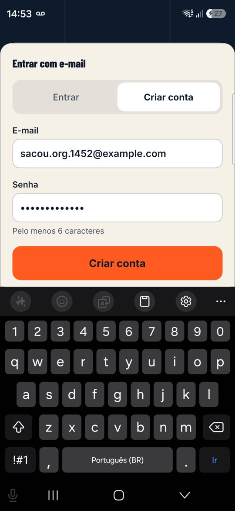
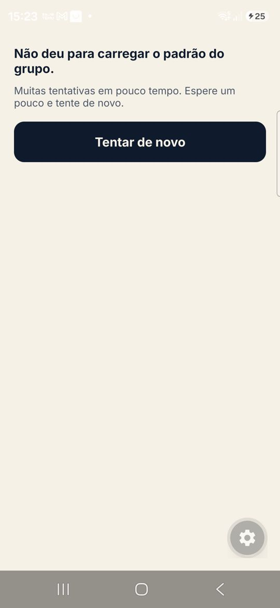
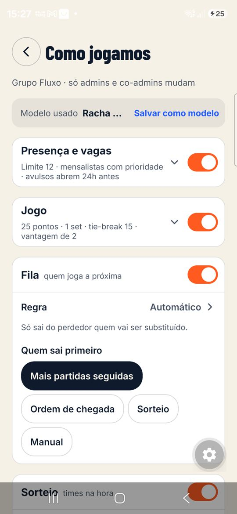
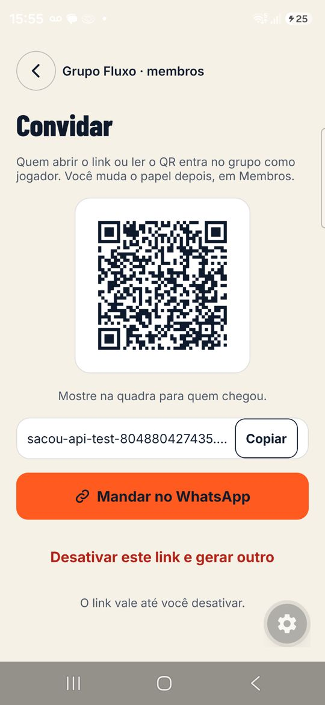
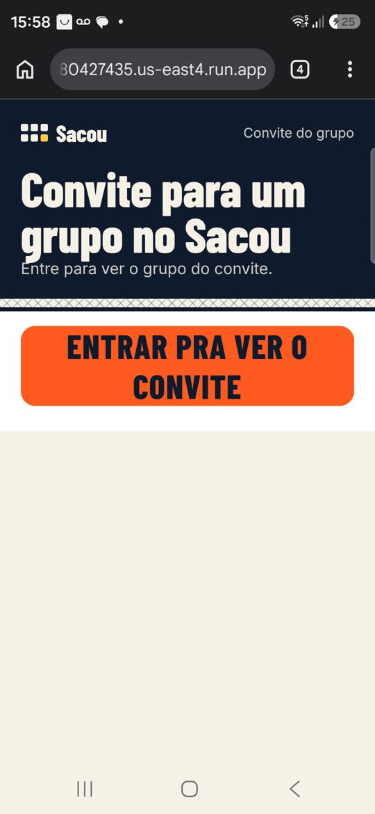
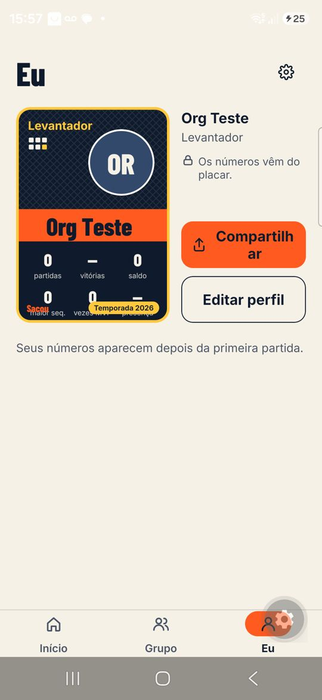

# Sacou · caminho feliz no celular (Android, build de desenvolvimento, API de teste)

Data: 21/11/2026. Aparelho: Galaxy 1080×2340 pelo `adb`. Contas fictícias criadas pelo app (dados em arquivo fora do repositório).

> Observação geral: durante todo o teste a API respondeu **"Muitas tentativas em pouco tempo. Espere um pouco e tente de novo."** (HTTP 429) quase a cada ação. Só voltou a funcionar esperando cerca de 1 minuto entre ações, ou fechando o app por ~3 minutos. Ver Lacunas e defeitos, item 1.

## Passo 0 · Preparação (conta do Gabriel)

O celular estava na quadra de uma partida antiga (grupo de teste, partida 5, 1º set 5–5) que travava partidas novas. Pelo **Menu → Encerrar partida → Encerrar partida** a partida foi encerrada ("Sem vencedor: ninguém sai da quadra").

- **Defeito:** depois de encerrar, a tela mostrou "Não deu para montar a próxima partida. A rodada desta quadra não está no celular. Abra a rodada com internet e volte aqui." e, ao sair da conta, o app avisou "Pontos ainda não enviados — A quadra tem marcações que ainda não foram enviadas. Elas só vão ser enviadas quando você entrar de novo com esta conta." Foi preciso tocar em **Sair mesmo assim**; o encerramento dessa partida pode não ter chegado ao servidor.

## Passo 1 · Tela de entrada

O usuário abre o app e vê "Seu racha organizado", com **Entrar com Google** e **Usar e-mail e senha**.

## Passo 2 · Criar conta com e-mail e senha (conta A, organizador)

Toque em **Usar e-mail e senha**, escolha a aba **Criar conta**, preencha e-mail e senha (mínimo 6 caracteres) e toque em **Criar conta**.

## Passo 3 · Perfil de quadra

Logo depois do cadastro aparece "Seu perfil de quadra — Leva 20 segundos. Ajuda no sorteio.": apelido (**Org Teste**), posição principal (**Levantador**), "Também jogo de", e a autoavaliação de 1 a 5 (**3 · Me viro bem**). Toque em **Pronto**.

- **Defeito:** no primeiro toque em **Pronto**, logo após criar a conta, apareceu "Muitas tentativas em pouco tempo. Espere um pouco e tente de novo." e o perfil não foi salvo, mesmo esperando 1 a 2 minutos com o app aberto. Só funcionou fechando o app à força, esperando ~1 min e reabrindo. Também apareceu, em vermelho do modo dev, `Uncaught (in promise) Error: Call to function 'NativeRequest.cancel' has been rejected` (repetiu várias vezes durante o teste).

## Passo 4 · Início sem grupo

"Fala, Org Teste. Você ainda não está em nenhum grupo. Recebeu um link do grupo? Abra pelo WhatsApp e toque em entrar." e o botão **Criar grupo**.

## Passo 5 · Criar grupo: modelo

Toque em **Criar grupo**. Passo 1 de 2, "Como é o seu racha?": Pelada descontraída, **Racha organizado**, Treino (Pro), Areia rei da quadra, Do zero. Escolha **Racha organizado** e toque em **Continuar com Racha organizado**.

## Passo 6 · Criar grupo: dados

Passo 2 de 2, "Duas perguntas e pronto": nome (**Grupo Fluxo**), dia e horário (folha com dia da semana e horário 24h: **Sábado, 16h**), local (**Quadra Fluxo**), vagas (12), **Quadra 6x6**, mensalistas fixos **Não**. Toque em **Criar grupo**.

- **Defeito:** o primeiro e o segundo toque em **Criar grupo** deram "Muitas tentativas em pouco tempo..." (print 08). No terceiro, depois de esperar, o grupo foi criado mas a tela mostrou "Grupo criado, mas não salvamos tudo." com **Tentar de novo** / **Seguir assim** (print 09); **Tentar de novo** caiu de novo no limite, e **Seguir assim** levou a "Não deu para carregar o padrão do grupo. Muitas tentativas..." (print 10). Na rodada criada depois, o local veio vazio e o dia veio "Dom 20h" em vez de "Sábado 16h", sinal de que o dia/local do grupo não foram salvos.

## Passo 7 · Seus grupos

Aba **Grupo**: "1 grupo. Você organiza." com o cartão do Grupo Fluxo (Admin, "Nenhuma rodada marcada") e os atalhos **Membros**, **Como jogamos**, **Criar rodada**.

## Passo 8 · Como jogamos

Toque em **Como jogamos**: modelo usado, Presença e vagas (limite 12, mensalistas com prioridade, avulsos abrem 24h antes), Jogo (25 pontos, 1 set, tie-break 15, vantagem de 2), Fila (regra automática, quem sai primeiro), Sorteio (equilibrar pela nota do admin), Rotação (Livre/6x0; 5x1, 4x2 e 6x2 marcados **Pro**; regra de sobreposição FIVB atual/Clássica; líbero) e MVP do dia (pelos dados do placar, votação da galera, ponto individual Pro).

- **Defeito:** o interruptor **Votação da galera** não fica ligado: ao tocar, ele volta para desligado e a tela pula de posição (3 tentativas, inclusive com o app recém-aberto). O fim da lista fica atrás da barra de navegação do Android.
- **Defeito:** mudar **Pontos por set** para 5 não pegou (continuou 25), com a faixa "Muitas tentativas em pouco tempo..." no topo.

## Passo 9 · Membros

Atalho **Membros**: "1 membro", abas Mensalistas / Avulsos / Convites, aviso "1 nota para confirmar. O sorteio usa a sugestão até lá. Revisar" e os botões **Convidar por link** e **QR do grupo**.

- **Defeito:** ao abrir Membros pela primeira vez: "Não deu para carregar os membros. Muitas tentativas em pouco tempo..." (print 15). Só abriu depois de deixar o app fechado por ~3 minutos.

## Passo 10 · Convite por link e QR

Toque em **Convidar por link**: "Quem abrir o link ou ler o QR entra no grupo como jogador." Aparece o QR do convite, o link (`.../c#...`) com **Copiar** ("Link copiado"), **Mandar no WhatsApp** e **Desativar este link e gerar outro**. "O link vale até você desativar."

- **Defeito:** a primeira tentativa deu "Não deu para gerar o link. Muitas tentativas..."; funcionou com **Tentar de novo** depois de 1 minuto.

## Passo 11 · O convidado abre o link (conta B)

O jogador abre o link no navegador do celular. A página "Convite para um grupo no Sacou — Entre para ver o grupo do convite." tem o botão **Entrar pra ver o convite**, que abre a folha de login (Google ou e-mail e senha).

- **Lacuna:** o link `https://.../c#...` abre sempre no Chrome; o app não se registra para abrir esse link e não há, dentro do app, um lugar para colar um link ou ler o QR. O caminho do convite é sempre pela web.

## Passo 12 · Conta B no app e aceite do convite

A conta B (**Beto Teste**, Ponteiro, nota 3) foi criada no app como no Passo 2–3. Depois, no navegador, **Usar e-mail e senha → Entrar** com a mesma conta: a página mostra "Grupo Fluxo · 1 membro" e **Entrar no grupo**. Após o toque: "Você entrou. Baixe o app para ver as rodadas."

- **Lacuna:** a página de sucesso diz "Baixe o app" mas não tem botão para abrir o app nem para a loja.

No app da conta B, aba **Grupo**: "1 grupo. Você joga nele." com Grupo Fluxo como **Jogador**.

## Passo 13 · Cartinha inicial da organizadora

Aba **Eu** da conta A antes de jogar: Levantador, 0 partidas, "—" de vitórias, saldo 0, maior sequência 0, 0 vezes MVP, "—" de presença.

