# Sacou · caminho feliz no celular (Android, build de desenvolvimento, API de teste)

Data: 21/11/2026. Aparelho: Galaxy 1080×2340 pelo `adb`. Contas fictícias criadas pelo app (dados em arquivo fora do repositório).

> Observação geral: durante todo o teste a API respondeu **"Muitas tentativas em pouco tempo. Espere um pouco e tente de novo."** (HTTP 429) quase a cada ação. Só voltou a funcionar esperando cerca de 1 minuto entre ações, ou fechando o app por ~3 minutos. Ver Lacunas e defeitos, item 1.

## Passo 0 · Preparação (conta do Gabriel)

O celular estava na quadra de uma partida antiga (grupo de teste, partida 5, 1º set 5–5) que travava partidas novas. Pelo **Menu → Encerrar partida → Encerrar partida** a partida foi encerrada ("Sem vencedor: ninguém sai da quadra").

- **Defeito:** depois de encerrar, a tela mostrou "Não deu para montar a próxima partida. A rodada desta quadra não está no celular. Abra a rodada com internet e volte aqui." e, ao sair da conta, o app avisou "Pontos ainda não enviados — A quadra tem marcações que ainda não foram enviadas. Elas só vão ser enviadas quando você entrar de novo com esta conta." Foi preciso tocar em **Sair mesmo assim**; o encerramento dessa partida pode não ter chegado ao servidor.

## Passo 1 · Tela de entrada

O usuário abre o app e vê "Seu racha organizado", com **Entrar com Google** e **Usar e-mail e senha**.

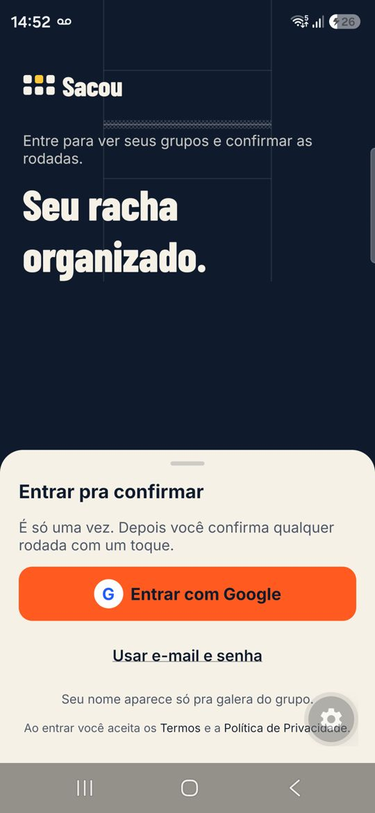

## Passo 2 · Criar conta com e-mail e senha (conta A, organizador)

Toque em **Usar e-mail e senha**, escolha a aba **Criar conta**, preencha e-mail e senha (mínimo 6 caracteres) e toque em **Criar conta**.

## Passo 3 · Perfil de quadra

Logo depois do cadastro aparece "Seu perfil de quadra — Leva 20 segundos. Ajuda no sorteio.": apelido (**Org Teste**), posição principal (**Levantador**), "Também jogo de", e a autoavaliação de 1 a 5 (**3 · Me viro bem**). Toque em **Pronto**.

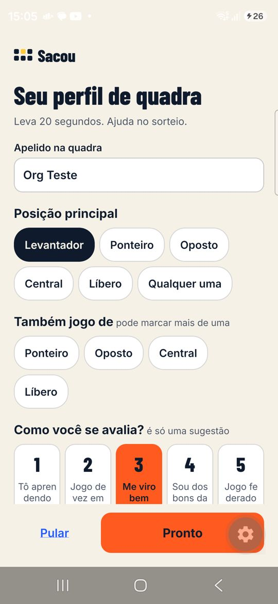

- **Defeito:** no primeiro toque em **Pronto**, logo após criar a conta, apareceu "Muitas tentativas em pouco tempo. Espere um pouco e tente de novo." e o perfil não foi salvo, mesmo esperando 1 a 2 minutos com o app aberto. Só funcionou fechando o app à força, esperando ~1 min e reabrindo. Também apareceu, em vermelho do modo dev, `Uncaught (in promise) Error: Call to function 'NativeRequest.cancel' has been rejected` (repetiu várias vezes durante o teste).

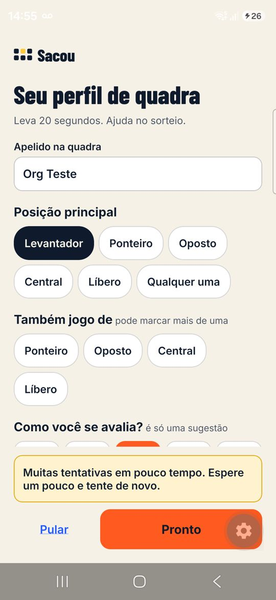

## Passo 4 · Início sem grupo

"Fala, Org Teste. Você ainda não está em nenhum grupo. Recebeu um link do grupo? Abra pelo WhatsApp e toque em entrar." e o botão **Criar grupo**.

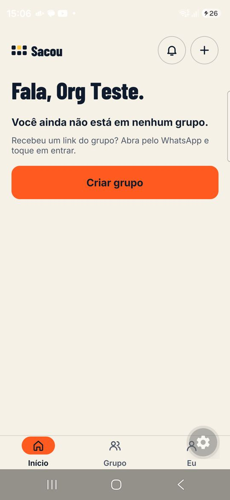

## Passo 5 · Criar grupo: modelo

Toque em **Criar grupo**. Passo 1 de 2, "Como é o seu racha?": Pelada descontraída, **Racha organizado**, Treino (Pro), Areia rei da quadra, Do zero. Escolha **Racha organizado** e toque em **Continuar com Racha organizado**.

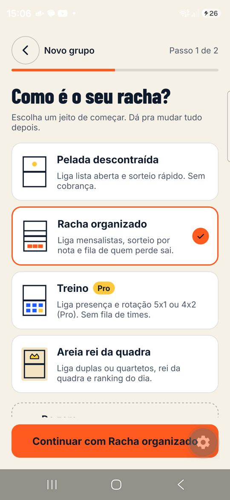

## Passo 6 · Criar grupo: dados

Passo 2 de 2, "Duas perguntas e pronto": nome (**Grupo Fluxo**), dia e horário (folha com dia da semana e horário 24h: **Sábado, 16h**), local (**Quadra Fluxo**), vagas (12), **Quadra 6x6**, mensalistas fixos **Não**. Toque em **Criar grupo**.

- **Defeito:** o primeiro e o segundo toque em **Criar grupo** deram "Muitas tentativas em pouco tempo..." (print 08). No terceiro, depois de esperar, o grupo foi criado mas a tela mostrou "Grupo criado, mas não salvamos tudo." com **Tentar de novo** / **Seguir assim** (print 09); **Tentar de novo** caiu de novo no limite, e **Seguir assim** levou a "Não deu para carregar o padrão do grupo. Muitas tentativas..." (print 10). Na rodada criada depois, o local veio vazio e o dia veio "Dom 20h" em vez de "Sábado 16h", sinal de que o dia/local do grupo não foram salvos.

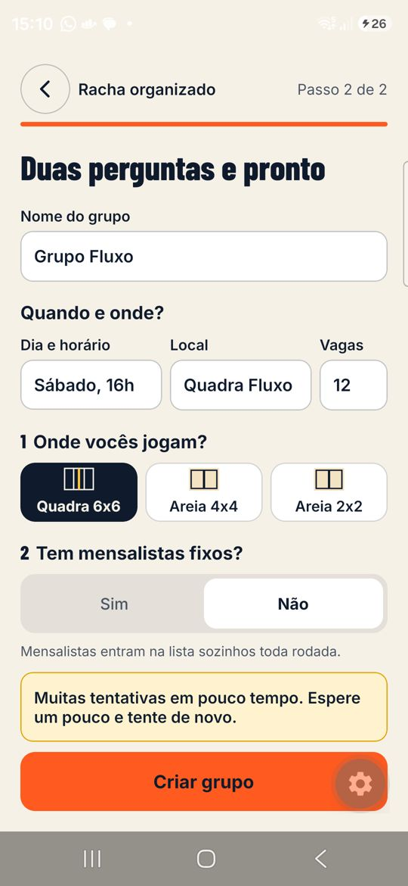
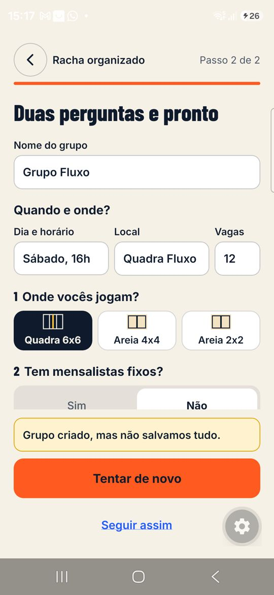

## Passo 7 · Seus grupos

Aba **Grupo**: "1 grupo. Você organiza." com o cartão do Grupo Fluxo (Admin, "Nenhuma rodada marcada") e os atalhos **Membros**, **Como jogamos**, **Criar rodada**.

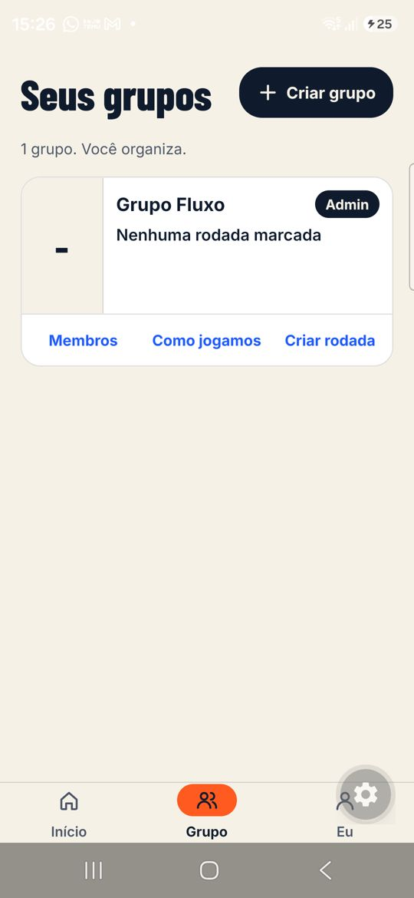

## Passo 8 · Como jogamos

Toque em **Como jogamos**: modelo usado, Presença e vagas (limite 12, mensalistas com prioridade, avulsos abrem 24h antes), Jogo (25 pontos, 1 set, tie-break 15, vantagem de 2), Fila (regra automática, quem sai primeiro), Sorteio (equilibrar pela nota do admin), Rotação (Livre/6x0; 5x1, 4x2 e 6x2 marcados **Pro**; regra de sobreposição FIVB atual/Clássica; líbero) e MVP do dia (pelos dados do placar, votação da galera, ponto individual Pro).

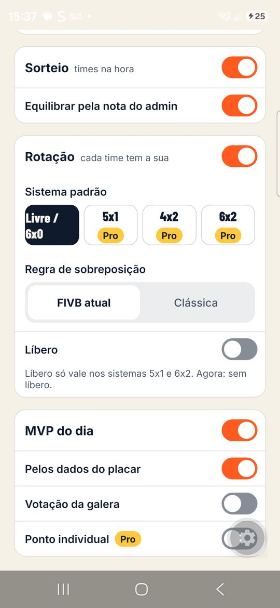

- **Defeito:** o interruptor **Votação da galera** não fica ligado: ao tocar, ele volta para desligado e a tela pula de posição (3 tentativas, inclusive com o app recém-aberto). O fim da lista fica atrás da barra de navegação do Android.
- **Defeito:** mudar **Pontos por set** para 5 não pegou (continuou 25), com a faixa "Muitas tentativas em pouco tempo..." no topo.

## Passo 9 · Membros

Atalho **Membros**: "1 membro", abas Mensalistas / Avulsos / Convites, aviso "1 nota para confirmar. O sorteio usa a sugestão até lá. Revisar" e os botões **Convidar por link** e **QR do grupo**.

- **Defeito:** ao abrir Membros pela primeira vez: "Não deu para carregar os membros. Muitas tentativas em pouco tempo..." (print 15). Só abriu depois de deixar o app fechado por ~3 minutos.

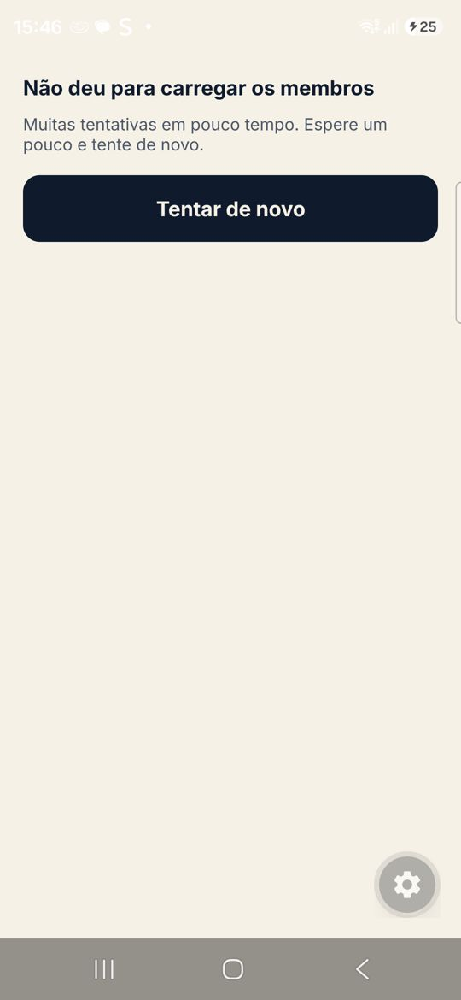

## Passo 10 · Convite por link e QR

Toque em **Convidar por link**: "Quem abrir o link ou ler o QR entra no grupo como jogador." Aparece o QR do convite, o link (`.../c#...`) com **Copiar** ("Link copiado"), **Mandar no WhatsApp** e **Desativar este link e gerar outro**. "O link vale até você desativar."

- **Defeito:** a primeira tentativa deu "Não deu para gerar o link. Muitas tentativas..."; funcionou com **Tentar de novo** depois de 1 minuto.

## Passo 11 · O convidado abre o link (conta B)

O jogador abre o link no navegador do celular. A página "Convite para um grupo no Sacou — Entre para ver o grupo do convite." tem o botão **Entrar pra ver o convite**, que abre a folha de login (Google ou e-mail e senha).

- **Lacuna:** o link `https://.../c#...` abre sempre no Chrome; o app não se registra para abrir esse link e não há, dentro do app, um lugar para colar um link ou ler o QR. O caminho do convite é sempre pela web.

## Passo 12 · Conta B no app e aceite do convite

A conta B (**Beto Teste**, Ponteiro, nota 3) foi criada no app como no Passo 2–3. Depois, no navegador, **Usar e-mail e senha → Entrar** com a mesma conta: a página mostra "Grupo Fluxo · 1 membro" e **Entrar no grupo**. Após o toque: "Você entrou. Baixe o app para ver as rodadas."

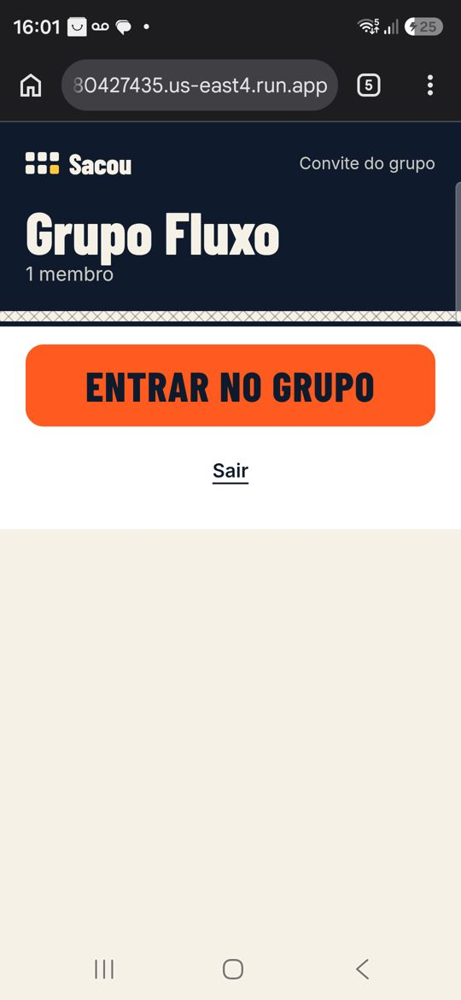

- **Lacuna:** a página de sucesso diz "Baixe o app" mas não tem botão para abrir o app nem para a loja.

No app da conta B, aba **Grupo**: "1 grupo. Você joga nele." com Grupo Fluxo como **Jogador**.

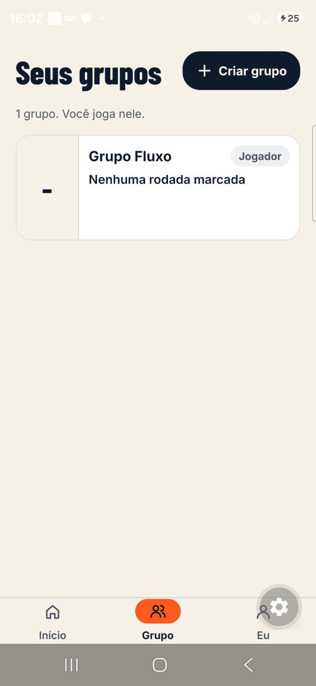

## Passo 13 · Cartinha inicial da organizadora

Aba **Eu** da conta A antes de jogar: Levantador, 0 partidas, "—" de vitórias, saldo 0, maior sequência 0, 0 vezes MVP, "—" de presença.

## Passo 14 · Nova rodada (organizadora)

Aba **Grupo → Criar rodada**. A tela "Nova rodada" vem com o padrão do grupo (Dia, Horário, Local, Vagas, chips "6x6 · 25 pontos · 1 set · Perde sai · Saída parcial · Livre / 6x0") e o bloco **Personalizar esta rodada**.

Em **Personalizar esta rodada** dá para mudar Sets, **Pontos por set** (abre uma folha com campo numérico e **Confirmar**) e **Rotação** (Livre / 6x0, 5x1, 4x2, 6x2). O que difere do grupo vira chip com ponto laranja ("só nesta rodada") e o contador "2 mudanças", com **Voltar ao padrão** em cada linha. Aqui a rodada 1 foi criada com 5 pontos e rotação 5x1.

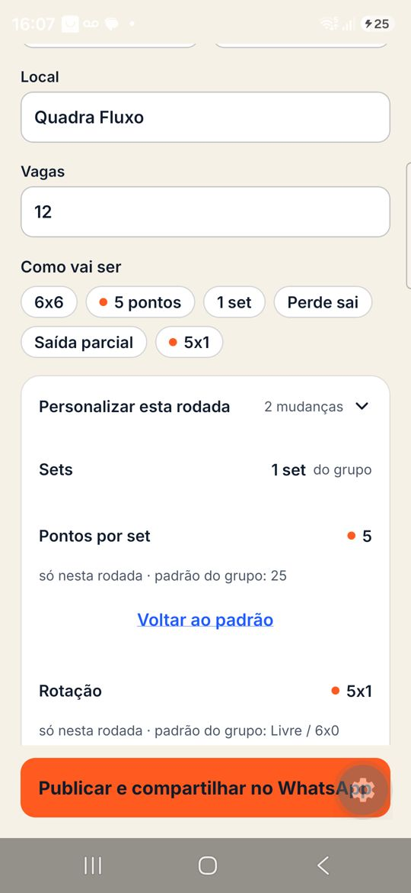

- **Observação:** na rodada, **Pontos por set** SALVA (chip "5 pontos"); o que não salva é o mesmo campo em **Como jogamos** do grupo (Passo 8). Quem sabe o campo do grupo e o da rodada usam telas/rotas diferentes.
- **Defeito (a investigar):** ao digitar o valor, se o teclado for fechado antes de **Confirmar**, a folha pula e o toque cai fora; o valor volta a 25.

## Passo 15 · Rodada publicada, visão do admin

Depois de **Publicar e compartilhar no WhatsApp** a rodada abre com "Você é admin", **Copiar lista**, os chips do jogo, "Cinza vem do grupo. Ponto laranja vale só nesta rodada.", o contador 0/12 confirmados / 0 na espera, **Adicionar quem confirmou no WhatsApp** e **Sortear times**.

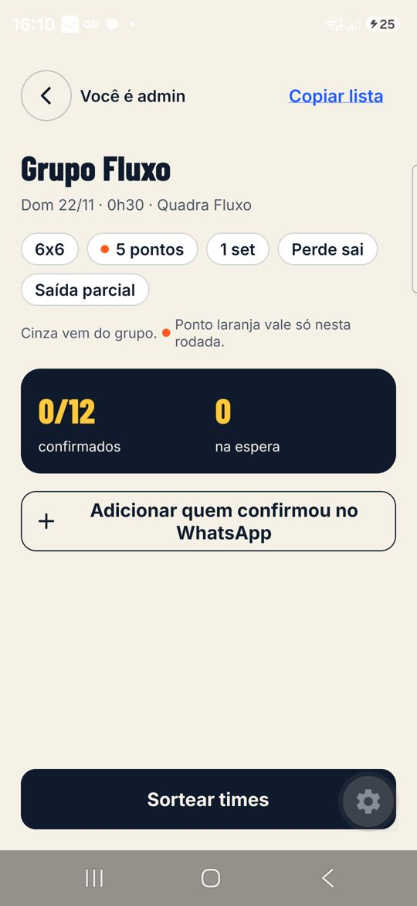

## Passo 16 · Adicionar confirmados

**Adicionar quem confirmou no WhatsApp** abre uma folha com busca de membros ("Ainda não confirmaram": Beto Teste e Você, cada um com **Adicionar**) e a área **Convidado sem conta** (nome, entra como Avulso). Com o nome digitado o formulário abre **Adicionar convidado** com Posição opcional e **Nota do sorteio** (padrão 3,0 · definir). Foram adicionados a organizadora, o Beto e convidados avulsos até 11 de 12.

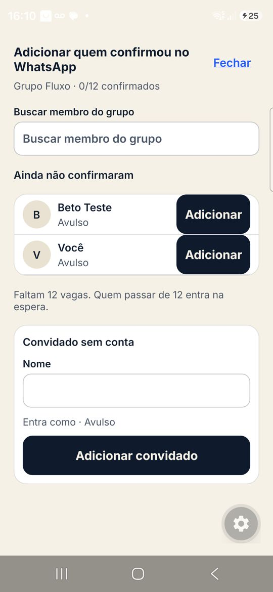

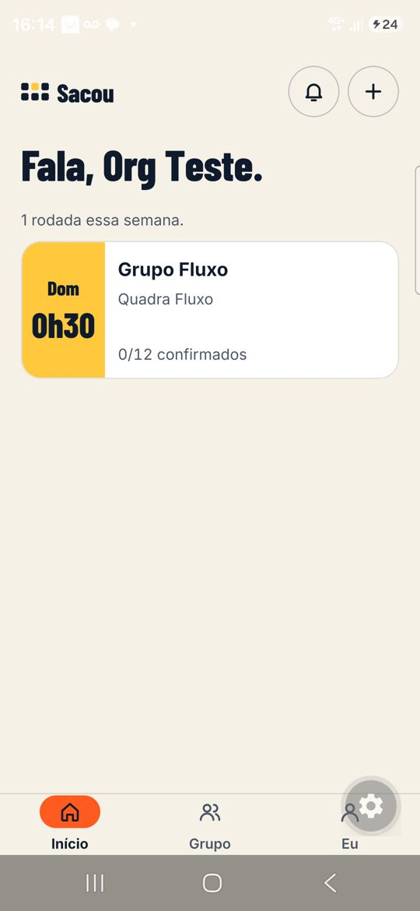
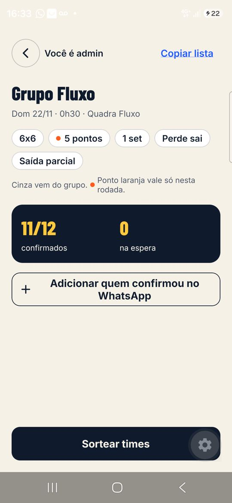

## Passo 17 · Conta do jogador confirma presença

Na conta B (Beto), o card da rodada mostra "Vai? Falta 1 vaga · 11/12" com **VOU** e **Não vou**. Após **VOU**: "Você vai · 12º da lista · 12/12" e **Não vou mais**.

## Passo 18 · Retomada no dia seguinte (Metro novo)

O app em desenvolvimento abre no seletor do Development Build; digite `http://localhost:8081` e **Connect** (o `adb reverse` precisa estar ativo). O primeiro bundle levou ~100 s.

- **Defeito:** a rodada 1 (Dom 22/11 · 0h30, 12/12 confirmados) ficou parada de um dia para o outro e agora o card da Início mostra **Ver resumo**; o resumo diz "Grupo Fluxo · 0 partidas — Nenhuma partida terminou nesta rodada." A rodada foi encerrada sem que ninguém jogasse (provavelmente encerramento automático pelo horário). Não houve aviso e a aba Grupo passou a mostrar "Nenhuma rodada marcada". O sorteio da rodada 1 nunca aconteceu; recomeçamos com uma rodada nova.

- **Defeito:** em Notificações o título "Notificações" quebra em duas linhas ("Notificaçõe / s") por falta de largura ao lado do botão **Marcar como lidas**. Lista vazia: "Nenhuma notificação por enquanto."

## Passo 19 · Rodada 2 (Seg 23/11 · 20h)

Mesmo caminho do Passo 14, com 5 pontos e rotação 5x1.

- **Defeito:** ao **Publicar e compartilhar no WhatsApp** aparece a faixa "Muitas tentativas em pouco tempo. Espere um pouco e tente de novo." mesmo com o limite do ambiente de teste já ×10 e poucas chamadas nesta sessão (3 tentativas seguidas).

- **Defeito (causa: laço do push, em correção):** a faixa "Muitas tentativas em pouco tempo" reapareceu ao adicionar confirmados: só 1 em cada ~3 toques passava, mesmo com 20–45 s de espera. A causa apontada é o app registrando o aparelho para push em laço (PUT `/v1/me/push-devices`, 10–20 por segundo), que esgota a cota do usuário. Isso explica também os "Muitas tentativas" dos Passos 4, 8, 9 e 10.

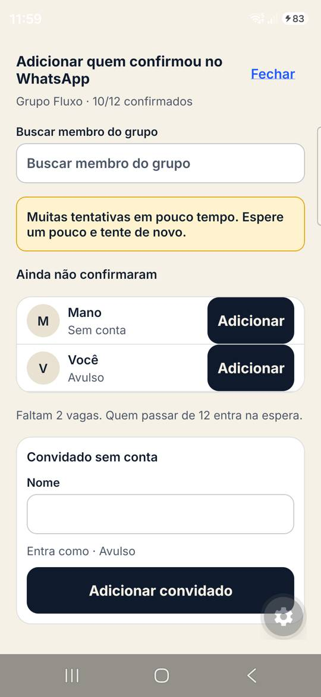

## Passo 20 · Sortear times (rodada 2, 10 confirmados)

Passa-se a rodada 2 com 10 de 12 confirmados (os 2 últimos não passaram pelo limite). Toque em **Sortear times**.

Com 10 confirmados (a rodada 2 não chegou a 12 por causa do limite), o sorteio faz **2 times de 5** (Laranja e Azul), mostra "Diferença 0,0 · ótimo" (média de nota A 3,0 · B 3,0) e os botões **Trocar**, **Travar dupla**, **Sortear de novo** e **Confirmar e compartilhar**.

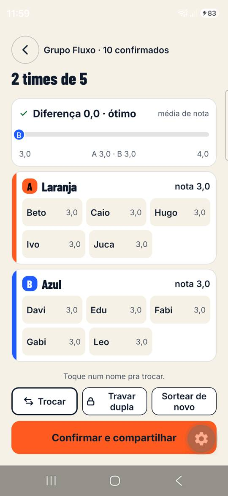

- **Observação:** a organizadora não entrou no sorteio (não foi adicionada: limite). Mesmo assim o sorteio não avisa que faltam 2 para 12.
- **Defeito/Lacuna:** a rotação 5x1 escolhida na criação da rodada não aparece como chip na tela da rodada (Passos 15 e 20), nem no sorteio.

## Passo 21 · Confirmar e compartilhar o sorteio

**Confirmar e compartilhar** abre o seletor de compartilhamento do Android com o texto "Grupo Fluxo · Seg 23/11 / Laranja: Beto, Caio, Hugo, Ivo, Juca / Azul: Davi, Edu, Fabi, Gabi, Leo". Fechar o seletor (Voltar) leva à folha **Partida 1**.

## Passo 22 · Preparar a partida e escolher a rotação

A folha **Partida 1** mostra Laranja x Azul, **Pontos por set** (−/+ , aqui já 5, herdado da rodada), **Sets** (1 set, Melhor de 3, Melhor de 5), **Saca primeiro** (A · Laranja / B · Azul / **Sortear**) e **Rotação de cada time**.

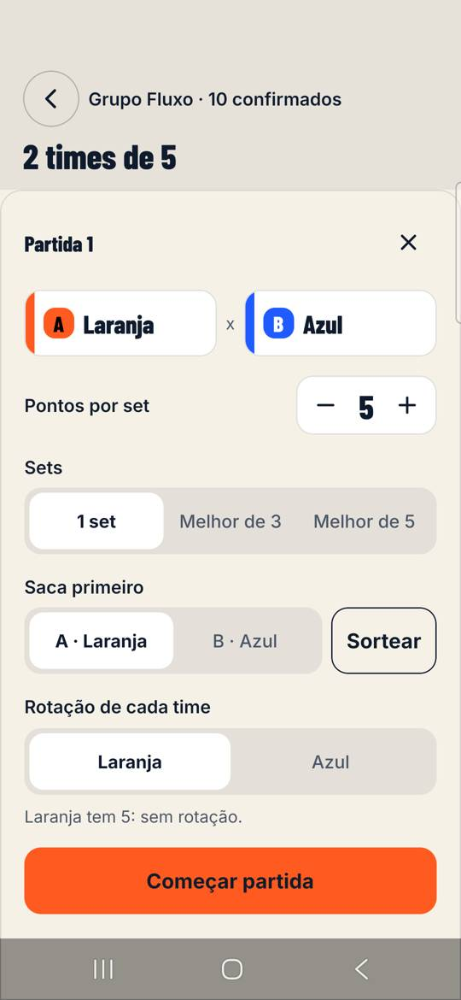

- **Não desenvolvido / limitação:** a rotação de cada time diz "Laranja tem 5: sem rotação." Com 5 jogadores por time o 5x1 da rodada não pode ser usado, então a seleção de rotação fica sem efeito neste teste (precisaria de 6 por time = 12 confirmados).

## Passo 23 · Jogo (placar)

**Começar partida** muda o botão para "Abrindo a quadra…" e a tela fica presa nele por mais de 3 minutos antes de abrir (o limite do laço de push pode estar travando a chamada; sem mensagem de erro, e o log do app não mostra nada).

- **Defeito (causa provável: laço do push, em correção):** "Abrindo a quadra…" demorou mais de 3 minutos, sem aviso.

A quadra abre na horizontal: "1º set", "Posições no momento do saque", "Salvo no celular", **Menu**; Laranja à esquerda (0, "Sacando"), Azul à direita (0, "Em recepção"), **Desfazer** e **Corrigir** no meio. Tocar no lado de um time marca o ponto para ele ("Mais um ponto e o Laranja fecha o set" em 4–1, com "Set point").

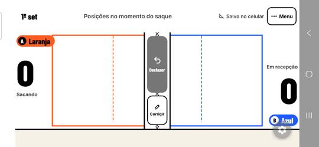

- **Lacuna:** a quadra não mostra jogadores nem formação: com 5 por time não há rotação, então as meias-quadras ficam vazias (só as linhas).

No 5º ponto: "Fim do set 1? Laranja 5, Azul 1 · Laranja vence o set e faz 1–0 · Laranja vence a partida 1–0", com **Desfazer último ponto** e **Confirmar fim da partida**.

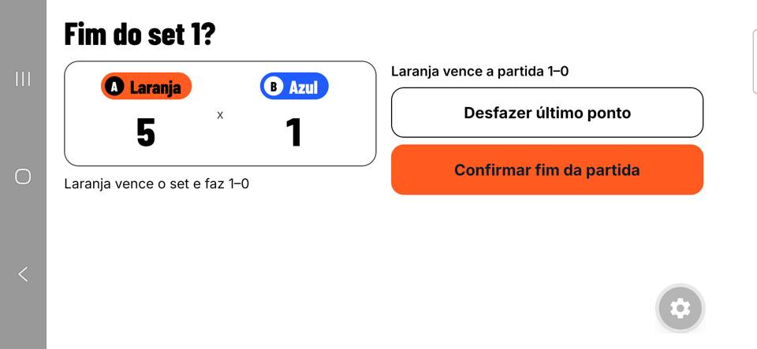

Depois de confirmar: "Fim do set 1 · partida encerrada — Laranja venceu 5–1, sets 1–0". Próxima: Laranja x Azul ("Ninguém esperando. Os mesmos times."), com **Confirmar e ir para a próxima partida**, **Encerrar rodada** e **Voltar ao início**.

## Passo 24 · Encerrar a rodada e resumo

**Encerrar rodada** abre o **Resumo da rodada**.

- **Defeito (causa: laço do push, em correção):** na primeira abertura "Não deu para abrir o resumo. Muitas tentativas em pouco tempo..." com **Tentar de novo** (print 46-encerrar). Na segunda: "Grupo Fluxo · 0 partidas — Ainda faltam 6 pontos para enviar. O resumo pode mudar. — Nenhuma partida terminou nesta rodada." Os 6 pontos do placar ficam na fila do celular sem chegar ao servidor.

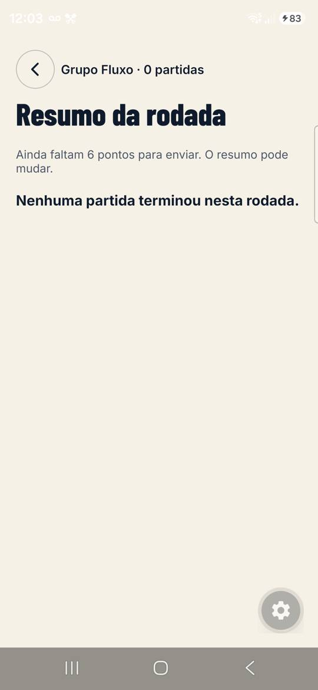

## Passo 25 · Cartinha, fonte máxima e push (não concluídos)

- **Cartinha pós-jogo: não verificada.** A aba **Eu** abriu "Não deu para abrir seus números. Muitas tentativas em pouco tempo..." (defeito, causa: laço do push, em correção), e nenhum resumo/cartinha chegou a ser gerado porque os 6 pontos da partida não foram enviados (Passo 24). A segunda rodada completa também não foi feita por isso.
- **Fonte do sistema 1.3:** só a tela Início foi conferida. Os cards da rodada, o título "Fala, Org Teste." e a barra de navegação cabem sem cortar; nenhum texto foi truncado. O título "Notificações" já quebra mal em 1.0 (Passo 18).

- **Defeito (só em desenvolvimento):** um aviso do React Navigation ("Looks like you have configured linking in multiple places...") aparece como toast na parte de baixo e cobre a barra de navegação; fica preso e não some com toque nem deslize, bloqueando as abas Grupo e Eu.
- **Push:** em **Eu → Configurações** há a linha **Notificações — "Lista, espera, times"**; abre a lista de notificações (vazia). Não há pedido de permissão de notificação nem tela de ajustes de push. O aparelho está em laço de registro (PUT `/v1/me/push-devices`), então o registro "funciona" só em excesso.
- **Defeito:** a rodada 1 (Dom 22/11) nunca foi sorteada e acabou sozinha sem partida (Passo 18); a rodada 2 foi sorteada e jogada (5–1), mas o resultado não chegou ao servidor.
